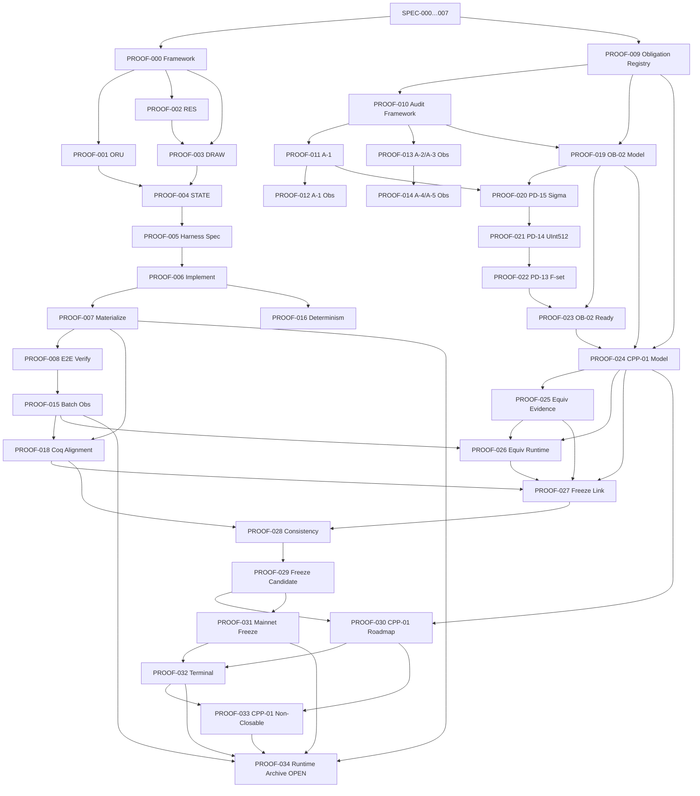

# RIGOR Master Knowledge Base

**Task:** `TASK-KNOWLEDGE-CONSOLIDATION-001`  
**Type:** Authoritative project knowledge synthesis (read-only generation)  
**Sources:** `core/src/`, RFCs, PROOFs, audits, release docs, runtime verification artifacts  
**equivalence_claimed:** `false`

---

## Metadata

| Field | Value |
|-------|-------|
| `knowledge_base_version` | `1.0.0` |
| `generated_at` | `2026-06-25T00:00:00Z` |
| `equivalence_claimed` | `false` |
| `consensus_lock_version` | `1` |
| `mainnet_freeze_baseline` | `mainnet-freeze-rfc015-2026-05-26` |
| `primary_code_authority` | `core/src/consensus/rigor_consensus_lock.h` |

---

## SECTION 1 — PROJECT IDENTITY

### Chain Name

| Property | Value | Source |
|----------|-------|--------|
| Chain name | **RIGOR** | `core/src/consensus/rigor_consensus_lock.h` — `CHAIN_NAME` |
| Product / client | Rigor Core (`rigord`), Rigor Wallet (`rigor-qt`) | `core/configure.ac`, Qt branding |
| URI scheme | `rigor:` | `core/src/qt/bitcoingui.cpp` |

### Human-Readable Prefix (HRP)

| Network | Network ID | Data dir | Bech32 HRP | Source |
|---------|------------|----------|------------|--------|
| Mainnet | `main` | (default) | **`rg`** | `rigor_consensus_lock.h`, `chainparams.cpp` |
| Testnet | `test` | `testnet3` | `trg` | `chainparams.cpp` |
| Devtest | `devtest` | `devtest` | `dvt` | `chainparams.cpp` |
| Signet | `signet` | `signet` | `srg` | `chainparams.cpp` |
| Regtest | `regtest` | `regtest` | `rgrt` | `chainparams.cpp` |
| Slowtest | `slowtest` | `slowtest` | `slt` | `chainparams.cpp` |

### Network Magic (P2P Message Start)

| Network | Magic (hex) | Default P2P Port |
|---------|-------------|------------------|
| Mainnet | `ce f1 db fa` | **8760** |
| Testnet | `0c 12 0a 08` | 18760 |
| Devtest | `1d 2a 3b 4c` | 48760 |
| Signet | first 4 bytes of `SHA256d(signet_challenge)` | 38760 |
| Regtest | `fa bf b5 da` | 28760 |
| Slowtest | `2e 3c 4d 5e` | 49760 |

Source: `core/src/kernel/chainparams.cpp`

### Assets

| Asset | Witness | Role | Unit |
|-------|---------|------|------|
| **ORU** | v0 (P2WPKH / P2WSH) | PoW energy currency; fees; mining subsidy | `COIN` = 1e8 (8 decimals) |
| **RES** | v1 (32-byte, not CVG2) | Scarce derived asset via convergence draw | `RES_COIN` = 100 atoms (0.01 RES minimum) |
| **Convergence (CVG2)** | v1 (32-byte, prefix `CVG2`) | ORU burn; unspendable; ORU-domain | Same as ORU value field |

Hard caps (consensus):
- ORU subsidy floor: **125 ORU** per block (after 3 halvings)
- RES max supply: **21,000,000 RES** (`RES_MAX_SUPPLY = 2,100,000,000` atoms)
- RES mint per draw: **100.00 RES** (`RES_REWARD_AMOUNT = 10,000` atoms)

### Canonical Terminology

| Domain | Canonical terms |
|--------|-----------------|
| Chain | RIGOR, HRP `rg` |
| Assets | ORU, RES |
| Burn mechanism | Convergence, CVG2 |
| Draw | Convergence draw, Sigma-CR-01, selection digest σ |
| RES authorization | PCORB witness, ConvergeProof |
| Roots | Convergence Root (C), CVGE commitment, RIGOR tag |
| PoW | OpuHash (double-SHA256 header → OpuHash digest) |
| Difficulty | ASERT (aserti3-2d), genesis-anchored |
| Wire tags | `RigorTags::CVG2`, `RigorTags::RIGOR`, `RigorTags::Res2WirePrefix` |
| Authority labels (wallet) | `(node)`, `(wallet)`, `(indexed)`, `(simulation)` |
| Architecture principle | Script-as-asset; Witness v0/v1 only; UTXO-only state |

**Obsolete terms (must not be used as current protocol vocabulary):** FORGE, RNG (as asset), MTH, ORUM, ORB/ORB2, β weighting, Arda, variable-T inequality RHS.

---

## SECTION 2 — PROTOCOL EVOLUTION

### Timeline

```
┌─────────────────────────────────────────────────────────────────────────────┐
│  ERA 1 — MTH / RNG / FORGE (legacy design vocabulary)                        │
│  • Three-asset mental model (MTH mining + FORGE convergence + RNG draw)      │
│  • β = 7/5 convergence weighting                                              │
│  • Variable-T inequality (T derived from parent nBits)                      │
│  • |F| ≥ 2 minimum for RES draw; 1 RES per mint; ~27.18M RES cap             │
└───────────────────────────────┬─────────────────────────────────────────────┘
                                │ transition phase (2025–2026)
                                │ • RFC-014: RES_PROBABILITY_TARGET = 2^240 (frozen constant)
                                │ • PATH B-PRIME: decouple RES inequality from PoW difficulty
                                │ • Naming seal: FORGE→Convergence/CVG2, RNG→PCORB/RES draw
                                │ • β exponent removed; integer f only
                                │ • Taproot/BIP341 removed per constitution
                                │ • RFC-015 Occam Rebalance (2026-05-26)
                                ▼
┌─────────────────────────────────────────────────────────────────────────────┐
│  ERA 2 — ORU / RES / CONVERGENCE (current frozen protocol)                   │
│  • Two assets: ORU (v0) + RES (v1)                                           │
│  • Convergence = CVG2 witness v1 burn of ORU                                 │
│  • Deterministic draw: H < 2^240 × f; argmin H/f; txid tie-break             │
│  • RES mint: 100 RES/draw; |F| ≥ 1; cap 21,000,000 RES                     │
│  • Mainnet freeze: mainnet-freeze-rfc015-2026-05-26                          │
└─────────────────────────────────────────────────────────────────────────────┘
```

### Removed Concepts

| Concept | Status | Replacement |
|---------|--------|-------------|
| **MTH** | Removed from consensus; zero code matches | ORU (PoW subsidy asset) |
| **FORGE** (as protocol term) | Removed from consensus | Convergence / CVG2 |
| **RNG** (as asset/mechanism) | Removed from consensus | RES + PCORB + convergence draw |
| **β = 7/5 weighting** | Removed (`rigor_consensus_lock.h`) | Integer f (untransformed amount) |
| **Variable-T inequality** | Rejected (RFC-014) | Constant `RES_PROBABILITY_TARGET = 2^240` |
| **Taproot / BIP341** | Removed | Witness v0/v1 only |
| **Coinbase-derived RES mint** | Deprecated; throws | Body RES mint via PCORB only |
| **Arda** (product name) | Removed from protocol | RIGOR |

### Deprecated Concepts

| Concept | Status | Notes |
|---------|--------|-------|
| **ORUM** | Deprecated UI alias | Still visible in Qt forms; consensus uses ORU |
| **ORB / ORB2** | Deprecated wire/function names | Map to RES domain (`IsRes2AssetProgram`) |
| **RFC-014-only economics** | Superseded by RFC-015 | 1 RES/draw, \|F\|≥2, 27.18M cap — pre-mainnet only |
| **`rngEnabled()` wallet API** | Misleading name | Checks Bech32m script manager, not RNG asset |
| **Coq ≡ Runtime equivalence** | Explicitly not claimed | `equivalence_claimed: false`; CPP-01 non-closable |

### Active Concepts

| Concept | Role |
|---------|------|
| **ORU** | PoW currency; fees; halving subsidy |
| **RES** | Draw-minted scarce asset; dual-pool spends |
| **Convergence (CVG2)** | ORU destruction; draw participation |
| **Sigma-CR-01 (σ)** | Deterministic draw digest |
| **PCORB / ConvergeProof** | RES mint authorization witness |
| **Convergence Root (C)** | Coinbase scriptSig commitment over eligible set F |
| **CVGE v2** | OP_RETURN cumulative convergence + draw-candidate root |
| **OpuHash PoW** | Memory-hard PoW on header hash |
| **ASERT** | Difficulty retargeting |
| **StateTag** | Transaction classification (CONVERGE, MINT, transfer) |
| **Golden vectors (GV-*)** | Runtime verification fixtures |
| **PROOF-034** | Full runtime archive verification campaign |

---

## SECTION 3 — CONSENSUS GROUND TRUTH

**Authority:** `core/src/` only. Documentation and RFCs are informational; code wins on conflict.

### Proof of Work (PoW)

| Property | Value |
|----------|-------|
| Header hash | `CBlockHeader::GetHash()` → double-SHA256 |
| PoW digest | **OpuHash** on header hash (`pow_opus.cpp`) |
| Check | `GetOpusHashFromBaseHash(header_hash) <= bnTarget` |
| OpuHash params | buffer 65536 bytes; 256 mix rounds |
| powLimit | `7fff…ffff` (all networks) |

### Difficulty (ASERT)

| Property | Mainnet | Test/Dev |
|----------|---------|----------|
| Algorithm | ASERT (aserti3-2d), genesis-anchored | Same |
| Half-life τ | 172800 s (2 days) | test: 300 s; devtest/regtest/slowtest: 1800 s |
| Block spacing | 600 s (10 min) | test/devtest: 60 s; slowtest: 30 s |
| Retarget window | 288 blocks | test/devtest: 30 blocks |
| Per-block clamp | ±25% | Same |
| Min-difficulty rule | Disabled | Enabled on test/devtest/regtest |

Implementation: `core/src/pow.cpp`, `core/src/kernel/chainparams.cpp`

### Subsidy (ORU)

| Constant | Value |
|----------|-------|
| `ORU_INITIAL_BLOCK_SUBSIDY` | 1000 ORU |
| `ORU_SUBSIDY_HALVING_INTERVAL` | 210,000 blocks |
| `ORU_SUBSIDY_MAX_SHIFTS` | 3 |
| `ORU_MIN_BLOCK_SUBSIDY` | 125 ORU (floor forever) |

Schedule: **1000 → 500 → 250 → 125 ORU**, then 125 ORU forever.

Formula (`validation.cpp` — `GetBlockSubsidy`):
```
subsidy = base >> min(height / interval, max_shifts)
```

Coinbase maturity: 100 blocks (slowtest: 1).

### Draw (Convergence Selection)

| Rule | Value |
|------|-------|
| Eligibility set F | Convergence txs passing `CheckTxInputs`, fee > 0, amount ≥ 1 ORU |
| Min candidates | `CONVERGENCE_DRAW_MIN_TXS_FOR_RES = 1` |
| Bind depth k | `CONVERGENCE_DRAW_BIND_DEPTH = 10` |
| σ preimage | 100-byte canonical buffer → Hash256 |
| Inequality | `H_i < T · f_i` (uint512; no floating point) |
| T (probability target) | `RES_PROBABILITY_TARGET = 2^240` (constant, all networks) |
| f_i | Untransformed convergence amount (identity; no β) |
| Winner | Argmin `H_i / f_i`; tie-break lower txid |
| CVG2 outputs per tx | Exactly 1 positive |

### RES Issuance

| Rule | Value |
|------|-------|
| Trigger | Draw winner exists; \|F\| ≥ 1 |
| Mint amount | 100.00 RES (`RES_REWARD_AMOUNT = 10,000` atoms) |
| Max per block | Exactly 1 RES mint body tx |
| Hard cap | 21,000,000 RES (`RES_MAX_SUPPLY = 2,100,000,000` atoms) |
| Coinbase RES | **Forbidden** |
| Authorization | PCORB witness + Ed25519 signature over σ digest |
| Mint input domain | ORU-only |

### Asset Rules

| Rule | Enforcement |
|------|-------------|
| Script-as-asset | `AssetTypeFromScriptPubKey()` — no parallel asset field in `CTxOut` |
| Witness versions | v0 and v1 only (32-byte v1 programs) |
| ORU transfer | v0 outputs; ORU-only inputs |
| RES transfer | v1 outputs; dual-pool (RES value + ORU fee inputs) |
| Fees | Always ORU surplus |
| Convergence | ORU inputs → CVG2 output; excluded from UTXO set |
| Allowed script types | P2WPKH, P2WSH, RES v1, CVG2 v1, OP_RETURN (NULL_DATA) |
| Conservation | Dual-pool model in `tx_verify.cpp` |

Key files: `validation.cpp`, `tx_verify.cpp`, `convergenceres_verify.cpp`, `rigor_res.cpp`, `sigma_hash.cpp`, `convergence_logic.cpp`

---

## SECTION 4 — FORMAL VERIFICATION TREE

### Overview

35 PROOF documents (PROOF-000 … PROOF-034; no PROOF-017 document — absorbed into PROOF-016).

**Phase structure:**
- **Infrastructure (000–016):** Golden vectors, harness, materialization, audit closure, determinism
- **Phase-D / PD refinements (018–023):** Coq alignment, OB-02 dependency, PD-13/14/15
- **CPP-01 / equivalence (024–026):** Closure model; equivalence explicitly disclaimed
- **Phase-5 freeze (027–033):** Freeze link, consistency, terminal status, CPP-01 non-closability
- **Runtime archive (034):** Full-chain golden vector campaign — **OPEN (run not executed)**

### PROOF Registry

| ID | Title | Status | Purpose | Depends on |
|----|-------|--------|---------|------------|
| PROOF-000 | Golden vector framework | ESTABLISHED | Canonical GV framework across spec/formal/runtime layers | SPEC-000…007 |
| PROOF-001 | Golden ORU vectors | ESTABLISHED (framework); entries DRAFT | ORU subsidy + burn vectors (GV-ORU-*) | PROOF-000, SPEC-002/005/006 |
| PROOF-002 | Golden RES vectors | ESTABLISHED (framework); entries DRAFT | RES mint accumulation vectors (GV-RES-*) | PROOF-000, SPEC-002/005/006 |
| PROOF-003 | Golden DRAW vectors | ESTABLISHED (framework); entries DRAFT | Winner selection vectors (GV-DRAW-*) | PROOF-000, PROOF-002, SPEC-001/002/005 |
| PROOF-004 | Golden STATE vectors | ESTABLISHED (framework); entries DRAFT | Composite supply state (GV-STATE-*) | PROOF-000…003, SPEC-001/002 |
| PROOF-005 | Runtime vector harness spec | ESTABLISHED | Harness specification | PROOF-000…004 |
| PROOF-006 | Harness implementation | IMPLEMENTED | C++ harness (`runtime_vector_harness.cpp`) | PROOF-005 |
| PROOF-007 | Vector materialization | IMPLEMENTED | Live chain materialization API | PROOF-006 |
| PROOF-008 | E2E vector verification | IMPLEMENTED | `golden_vector_verify.sh`, RPC | PROOF-007 |
| PROOF-009 | Proof obligation registry | ESTABLISHED | PO-REG-001 (OB-02), PO-REG-002 (CPP-01) tracking | SPEC-005/006/007 |
| PROOF-010 | Audit closure framework | ESTABLISHED | A-1…A-5 trust anchor closure process | SPEC-004, PROOF-009 |
| PROOF-011 | Audit A-1 closure | ESTABLISHED; **AI_PARTIAL** | A-1 draw-adjacent field closure | PROOF-010, SPEC-004 |
| PROOF-012 | A-1 runtime observation | OBSERVED | Diagnostic witness export | PROOF-011, PROOF-008 |
| PROOF-013 | A-2/A-3 runtime observation | OBSERVED | Diagnostic witness export | PROOF-010, PROOF-003, PROOF-012 |
| PROOF-014 | A-4/A-5 runtime observation | OBSERVED | Diagnostic witness export | PROOF-010, PROOF-009, PROOF-013 |
| PROOF-015 | A-1…A-5 batch observation | OBSERVED | Batch runtime witness | PROOF-010, PROOF-008 |
| PROOF-016 | Harness determinism | IMPLEMENTED | Deterministic replay hashes | PROOF-006 (absorbs TASK-PROOF-017) |
| PROOF-018 | Phase-D Coq closure alignment | IMPLEMENTED | Coq corpus alignment | PROOF-015, PROOF-007 |
| PROOF-019 | PD-4F-OB-02 dependency model | ESTABLISHED | OB-02 dependency graph | PROOF-009, PROOF-010, SPEC-007 |
| PROOF-020 | PD-15 Sigma integer refinement | ESTABLISHED | σ integer refinement (Coq + C++) | PROOF-011, PROOF-019 |
| PROOF-021 | PD-14 UInt512 refinement | ESTABLISHED | Cross-multiply winner selection | PROOF-011, PROOF-019, PROOF-020 |
| PROOF-022 | PD-13 F-set membership | ESTABLISHED | Convergence root set membership | PROOF-011, PROOF-019, PROOF-020, PROOF-021 |
| PROOF-023 | PD-4F-OB-02 readiness | ESTABLISHED | OB-02 readiness gates | PROOF-009, PROOF-010, PROOF-019, PROOF-022 |
| PROOF-024 | CPP-01 closure model | ESTABLISHED | CPP-01 gate model (all gates false) | PROOF-009, PROOF-019, PROOF-023 |
| PROOF-025 | Candidate equivalence evidence | ESTABLISHED | Evidence model; `equivalence_claimed: false` | PROOF-009, PROOF-024 |
| PROOF-026 | Equivalence runtime confirmation | ESTABLISHED | Confirms non-equivalence boundary | PROOF-024, PROOF-025, PROOF-015 |
| PROOF-027 | Phase-5 summary freeze link | ESTABLISHED | Links formal program to freeze manifest | PROOF-018, PROOF-024…026, MAINNET freeze |
| PROOF-028 | Phase-5 final consistency | ESTABLISHED | Coq/doc alignment at freeze | PROOF-027, PROOF-018, PROOF-023…026 |
| PROOF-029 | Freeze candidate | ESTABLISHED | Phase-5 freeze candidate snapshot | PROOF-028, PROOF-027, MAINNET freeze |
| PROOF-030 | CPP-01 roadmap | ESTABLISHED | Hypothetical closure path documentation | PROOF-024, PROOF-025, PROOF-026, PROOF-029 |
| PROOF-031 | Mainnet freeze formalization | ESTABLISHED | Authoritative Phase-5 freeze record | PROOF-029, PROOF-028, PROOF-027, MAINNET freeze |
| PROOF-032 | Phase-5 terminal status | ESTABLISHED | Program end state; PD-13/14/15 closed | PROOF-031, PROOF-029, PROOF-030 |
| PROOF-033 | CPP-01 non-closability | ESTABLISHED | Permanent `false` for legal CPP-01 closure | PROOF-032, PROOF-030, PROOF-024 |
| PROOF-034 | Full runtime archive verification | **OPEN** (procedure established; run not executed) | Live regtest archive to h=2,100,001 | PROOF-033, PROOF-032, PROOF-031, PROOF-015, PROOF-007 |

### Dependency Graph



**Key terminal facts:**
- PD-13, PD-14, PD-15: **DS_Closed**
- PD4F-OB-02: **DS_Ready** (not PO_PROVEN)
- PD4F-CPP-01: **DS_Open**; legal closure path = **false** (PROOF-033)
- `equivalence_claimed`: **false** (all layers)

---

## SECTION 5 — RFC TREE

### RFC Registry (RFC-000 … RFC-015 + extensions)

| ID | Title | Status | Authoritative? | Superseded? |
|----|-------|--------|--------------|-------------|
| RFC-000 | Consensus Constitution | FINAL (IMMUTABLE) | Yes (constitutional) | No |
| RFC-000A | RIGOR Implementation Bible | MANDATORY | Yes (implementation guide) | No |
| RFC-ARCH-000 | Engineering Constitution | FINAL LOCK | Yes (architecture) | No |
| RFC-001 | Deterministic Selection | FINAL LOCK | Yes | No |
| RFC-002 | Supply Evolution Equation | FINAL LOCK | Yes | No |
| RFC-003 | StateTag and Asset State Model | FINAL | Yes | No |
| RFC-004 | Canonical Serialization and Hashing | FINAL | Yes | Partially by RFC-009 |
| RFC-005 | Validation State Machine | FINAL | Yes | No |
| RFC-006 | Static Standard (Golden Test Vectors) | Active (no explicit status field) | Yes (vector oracle) | No |
| RFC-007 | Formal Verification Spec (Coq) | Active (no explicit status field) | Yes (formal layer) | No |
| RFC-008 | Canonical Mathematical Specification | Consensus-Critical, Pre-Mainnet | Partial — §6/§7 inequality superseded by RFC-014 | Partial (inequality RHS) |
| RFC-009 | Canonical Serialization Specification | Consensus-Critical | Yes | Supersedes RFC-004 details |
| RFC-010 | Deterministic Execution Trace | Active | Yes (audit/debug) | No |
| RFC-011 | Differential Fuzzing & Conformance | Consensus-Critical | Yes (QA infrastructure) | No |
| RFC-012 | Golden Test Vector Generator | Consensus-Critical | Yes | No |
| RFC-013 | Constitutional Nomenclature Lock | CONSENSUS-CRITICAL | Yes | No |
| RFC-013-A | Symbol Table & Naming Enforcement | CONSENSUS-CRITICAL EXTENSION | Yes | No |
| RFC-013-B | Formal Spec → Verified Implementation Bridge | CONSENSUS-CRITICAL EXTENSION | Yes | No |
| RFC-014 | Frozen Convergence Target (Conv-Decouple-01) | FINAL | Yes (T = 2^240) | Economics superseded by RFC-015 |
| RFC-015 | Occam Rebalance | **FROZEN** (mainnet constitutional economics) | Yes (current economics) | Supersedes RFC-014 economics only |
| RFC-ADDRESS-001 | Canonical Address Specification | FINAL LOCK | Yes | No |
| RFC-ADDRESS-002 | Strong Semantic Address System | FINAL LOCK | Yes | No |
| RFC008_ERRATUM | PCORB Witness Stack Erratum | Consensus-critical erratum | Yes (witness layout) | No |

### RFC Dependency / Supersession Notes

- **RFC-014** permanently locks `RES_PROBABILITY_TARGET = 2^240` and PATH B-PRIME; still authoritative for probability architecture.
- **RFC-015** supersedes RFC-014 **economics only** (reward, cardinality, cap); baseline tag `mainnet-freeze-rfc014-2026-05-25` superseded by `mainnet-freeze-rfc015-2026-05-26`.
- **RFC-008** inequality RHS semantics superseded by RFC-014 §2; σ/bind layout preserved.
- **Code wins** over RFC on any numeric mismatch (e.g., stale params.h comments).

### RFC Authority Hierarchy (informational)

```
RFC-000 (Constitution) + RFC-ARCH-000 (Engineering Constitution)
    ↓
RFC-001…003 (Selection, Supply, StateTag)
    ↓
RFC-004/009 (Serialization) + RFC-005 (Validation SM)
    ↓
RFC-014 (Frozen T) + RFC-015 (Economics) ← current mainnet freeze
    ↓
RFC-006/012 (Golden vectors) + RFC-007 (Coq) + RFC-011 (Fuzzing)
    ↓
RFC-013 series (Nomenclature lock)
```

---

## SECTION 6 — GOLDEN VECTOR TREE

**Total vectors:** 12 (`GOLDEN_VECTOR_COUNT = 12`)  
**Source of truth:** `core/src/proof/runtime_vector_harness.cpp` — `kGoldenVectors[]`  
**Milestone subset (PROOF-034):** 3 vectors at extreme heights

### Full Vector Catalog

| Vector ID | Family | Height | Purpose | Status |
|-----------|--------|--------|---------|--------|
| GV-ORU-0001 | ORU | 1 | ORU supply at genesis+1 | Spec ESTABLISHED; live NOT_EXECUTED |
| GV-ORU-0002 | ORU | 100 | ORU subsidy step | Spec ESTABLISHED; live NOT_EXECUTED |
| GV-ORU-0003 | ORU | **630,000** | Post-halving subsidy floor (125 ORU); burn check | **Milestone PENDING (live)**; SIM fixture GVR_PASS |
| GV-RES-0001 | RES | 10 | First RES mint (10,000 atoms) | Spec ESTABLISHED; materializable @ h≤501 |
| GV-RES-0002 | RES | 500 | Cumulative RES 20,000 atoms | Spec ESTABLISHED; materializable @ h≤501 |
| GV-RES-0003 | RES | **2,100,000** | RES cap terminal mint (21M RES) | **Milestone PENDING (live)**; SIM fixture GVR_PASS |
| GV-DRAW-0001 | DRAW | low | Single-candidate draw winner | Spec ESTABLISHED; materializable @ h≤501 |
| GV-DRAW-0002 | DRAW | low | Multi-candidate draw | Spec ESTABLISHED; materializable @ h≤501 |
| GV-DRAW-0003 | DRAW | **2,100,001** | Draw at cap boundary; block must reject | **Milestone PENDING (live)**; SIM fixture GVR_PARTIAL |
| GV-STATE-0001 | STATE | 0 | Genesis composite state | Spec ESTABLISHED; materializable @ h≤501 |
| GV-STATE-0002 | STATE | 10 | Height-10 composite | Spec ESTABLISHED; materializable @ h≤501 |
| GV-STATE-0003 | STATE | 6 | Post-reorg branch state | Spec ESTABLISHED; materializable @ h≤501 |

### Verification Status Codes

| Code | Meaning |
|------|---------|
| `NOT_EXECUTED` | Chain not materialized to required height |
| `GVR_PASS` | All required fields match |
| `GVR_FAIL` | Field mismatch |
| `GVR_PARTIAL` | Expected at DRAW cap boundary (FVR-M) |

### Expected Milestone Outcomes (PROOF-034 pass criteria)

- **GV-ORU-0003 @ 630k:** `oru_supply_cumulative=500_010_000_000_000`; subsidy=12.5 ORU
- **GV-RES-0003 @ 2.1M:** `res_supply_cumulative=2_100_000_000` atoms (= 21,000,000 RES)
- **GV-DRAW-0003 @ 2.1M+1:** `verification_status=GVR_PARTIAL`; `valid_block=false`

### Vector Tree

```
GV-ORU-0001 (h=1)
GV-ORU-0002 (h=100)
GV-ORU-0003 (h=630,000) ─── PROOF-034 milestone
GV-RES-0001 (h=10)
GV-RES-0002 (h=500)
GV-RES-0003 (h=2,100,000) ─── PROOF-034 milestone / RES cap
GV-DRAW-0001 (low)
GV-DRAW-0002 (low)
GV-DRAW-0003 (h=2,100,001) ─── PROOF-034 milestone / cap reject
GV-STATE-0001 (h=0)
GV-STATE-0002 (h=10)
GV-STATE-0003 (h=6, reorg)
```

**Execution summary:** 9/12 vectors materializable at h≤501; 3 milestone vectors require full chain to 630k / 2.1M / 2.1M+1.

---

## SECTION 7 — RUNTIME VERIFICATION

### SIM (Simulation Layer)

| Component | ID | Status | Role |
|-----------|-----|--------|------|
| Telemetry replay kernel | SIM-004 | IMPLEMENTED | `sim/core/replay_kernel.py` |
| System state emulator | SIM-005 | IMPLEMENTED | `sim/emulator/system_state_machine.py` |
| PROOF-034 fixture validator | SIM-006 | **PASS-CAPABLE (offline)** | `sim/proof_validator/proof_replay_validator.py` |
| Wallet simulation | SIM-011 | IMPLEMENTED | `sim/wallet_sim/` |
| Unified simulation | SIM-UNIFIED | Partial | `.runtime/unified-sim/` |
| Cluster simulation | — | IMPLEMENTED | `sim/cluster/` |
| Release gate engine | — | IMPLEMENTED | `sim/release/gate_engine.py` |

SIM-006 validates 3 milestone fixtures offline against `sim/proof_validator/catalog.py`. Fixture `archive_height=2100001`; all 3 milestones `ESTABLISHED` in repo fixture JSON. **Offline pass does not substitute for live chain evidence.**

### FVR (Formal Verification Runtime)

| Layer | Count | Status (PROOF-031 snapshot) |
|-------|-------|----------------------------|
| Total FVR layers | 9 | — |
| Established | 1 | — |
| Active | 7 | — |
| Impossible (Draw / FVR-M) | 1 | DRAW at RES cap boundary |

FVR-M explains why GV-DRAW-0003 expects `GVR_PARTIAL` at cap — draw closure impossible when supply is exhausted.

### PROOF-034 Campaign

| Field | Current status |
|-------|----------------|
| Campaign ID | Full Runtime Archive Verification |
| Doc status | PROCEDURE ESTABLISHED — **RUN NOT YET EXECUTED** |
| Target height | **2,100,001** |
| Release gate | `proof034_complete = false` (G6-PROOF-01 blocker) |
| Live RPC (regtest) | UNAVAILABLE (2026-06-24 audit) |
| Observer | Deployed; stale snapshot (2026-06-17) |
| Archive manifest | NOT COMPLETE (`manifest_present: false`) |
| C++ harness @ h≤501 | 9/12 vectors materialized |
| SIM-006 offline | Pass-capable on repo fixtures |
| Public testnet campaign | ACTIVE; all checkpoints **PENDING** |

**End condition:** Regtest mined to h ≥ 2,100,001; all 12 vectors ESTABLISHED; harness report 9 PASS + 3 PARTIAL + 0 FAIL + 0 NOT_EXECUTED; archived JSON with SHA-256 manifest.

**Tools:**
- Materializer: `core/contrib/tools/golden_vector_materializer.sh`
- Verifier: `core/contrib/tools/golden_vector_verify.sh`
- Observer: `runtime/proof034/observer/proof034_observer.py`

---

## SECTION 8 — WALLET

### ORU Flow

1. **Receive:** Generate Bech32 (witness v0) address — labeled "ORUM" in UI (legacy drift)
2. **Send:** Select ORU asset; ORU-only inputs → v0 outputs; fee deducted in ORU
3. **Mine:** Coinbase subsidy credited after 100-block maturity
4. **Overview:** `ORUBalancePanel` shows `"ORU (node)"` authority

### RES Flow

1. **Receive:** Bech32m (witness v1) address — shown if `rngEnabled()` (misleading API name)
2. **Send:** Dual-pool — RES value inputs + separate ORU fee inputs
3. **Mint:** the PCORB witness has one consumer, the ORU-input body mint. `createresclaim`, which built the same shape for a RES claim, was removed by SECURITY-001-A / A-7 along with the script path it used; RES moves via `sendres` over the key path.
4. **Convergence participation:** User converges ORU via Convergence tab → CVG2 output → draw eligibility

### Convergence Flow (Wallet UI)

State machine (`wallet/convergencestate.cpp`):
```
CREATED → BROADCASTED → INCLUDED → MATURING
  → WON_PENDING → WON_CONFIRMED (spendable RES)
  → LOST
```

Minimum amount: 1 ORU (`MIN_CONVERGENCE_AMOUNT`). Convergence tab: `"Convergence ORU (Res draw participation)"`.

### Address Types

| Type | Encoding | Witness | Asset | UI label |
|------|----------|---------|-------|----------|
| ORU | Bech32 | v0 (20-byte P2WPKH) | ORU | "ORUM" (legacy) / "ORU" (panels) |
| RES | Bech32m | v1 (32-byte) | RES | "RES" |
| Convergence | Bech32m | v1 CVG2 | ORU-domain burn | "Convergence" |

Mainnet HRP: `rg` (addresses: `rg1…` for ORU, `rg1p…` for RES/Bech32m).

### UI Terminology

| Context | Canonical (intended) | Actual (drift) |
|---------|---------------------|----------------|
| Asset panels | ORU, RES | ORU ✅ |
| Send/Receive forms | ORU | ORUM ❌ |
| Convergence action | Converge ORU | "Converge ORUM" ❌ |
| Overview pending | ORU | "ORUM (pending)" ❌ |
| Product branding | Rigor / RIGOR | ✅ (Qt source) |
| Locale strings | ORU | "does not mine MTH" ❌ (stale) |

### Remaining Drift

| Issue | Severity | Location |
|-------|----------|----------|
| ORUM vs ORU mixed labels | MAJOR | Qt `.ui` forms, receive/send dialogs |
| MTH in locale string | MAJOR | `bitcoin_en.xlf` |
| `rngEnabled()` API name | MINOR | `wallet/interfaces.cpp` |
| Internal Bitcoin* class names | MINOR | Inherited C++ identifiers |
| Installer legacy icons | MAJOR | `arda.ico`, `bitcoin*.xpm` (outside Qt source) |

Wallet consensus alignment: ✅ asset send, fee domain, convergence, PCORB claim, dual-pool RES — all match consensus. Drift is **presentation-layer only**.

---

## SECTION 9 — RELEASE SYSTEM

### Branding Status

| Metric | Status |
|--------|--------|
| `BRAND_FINAL_LOCK` | **FALSE** (2026-06-24 brand audit) |
| Qt wallet semantic branding | PASS |
| Windows NSIS installer | GAP — `MUI_ICON` references `arda.ico` |
| CLI heritage copyright | GAP — "Bitcoin Core developers" in `-version` |
| Canonical symbol | D+C (Invariant + Convergence hybrid) |

Protocol freeze manifest declared `BRAND_FINAL_LOCK = TRUE` at freeze entry (2026-06-24) — **conflicts with later brand audit**; treat brand lock as **open work**.

### Gate Engine

Deterministic release gating (`sim/release/gate_engine.py`, `core/src/release/release_gate_engine.cpp`):

```
G0 Development
 └─► G1 UI Complete
      └─► G2 Simulation Validated (SIM-011)
           └─► G3 Runtime Validated (PROGRAM-015)
                └─► G4 Product Ready
                     └─► G5 Testnet Candidate
                          └─► G6 Mainnet Candidate
```

**Last evaluated state (2026-06-23):** Current gate = **G4 Product Ready** (83%); testnet release ready = **NO**.

| Gate | Status |
|------|--------|
| G0–G4 | SATISFIED |
| G5 | **BLOCKED** — G5-EXP-01: Explorer not configured |
| G6 | NOT EVALUATED (requires G5 + PROOF-034 complete) |

No manual override path exists.

### Release Blockers

| Blocker | Gate | Description |
|---------|------|-------------|
| G5-EXP-01 | G5 | Explorer URL not configured in wallet |
| G6-PROOF-01 | G6 | `proof034_complete = false` |
| G6-UNI-01 | G6 | Unified simulation convergence (if required) |
| BRAND-LEGACY-01 | Release | NSIS `arda.ico` path |
| Validation CP-01…06 | Campaign | All public testnet checkpoints PENDING |

### Freeze Status

| Freeze | Status | Scope |
|--------|--------|-------|
| Mainnet protocol freeze (RFC-015) | **FINAL** (2026-05-26) | Consensus economics + RES probability |
| Phase-5 formal program (PROOF-031) | **ESTABLISHED** | Coq freeze record |
| Protocol freeze manifest (TASK-PROTOCOL-FREEZE-001) | **ACTIVE** | Long-run testnet validation campaign |
| Wallet final freeze mode (PROGRAM-022) | Referenced | Prior release freeze |
| PROOF-034 runtime archive | **NOT COMPLETE** | Live chain evidence gap |

**Version registry (freeze manifest):**
- Protocol: `0.1.0-testnet-candidate`
- Rigor Core: `25.0.0`
- Consensus lock: `1`
- RIGOR Wallet: `0.1.0-testnet-candidate`

---

## SECTION 10 — AUTHORITY HIERARCHY

### Final Precedence (Conflict Resolution)

```
1. CODE (core/src/)                          ← WINS on all consensus conflicts
2. RUNTIME EVIDENCE (live chain artifacts)   ← WINS over simulation when present
3. FORMAL PROOF (Coq / PROOF documents)      ← Authoritative for proof obligations; does NOT override code
4. RFC (docs/rfcs/)                          ← Constitutional intent; subordinate to code
5. DOCUMENTATION (docs/, whitepapers)       ← Informational only
```

### Detailed Rules

| Conflict type | Winner |
|---------------|--------|
| RFC vs `core/src/` | **Code** |
| Documentation vs code | **Code** |
| Simulation fixture vs live runtime artifact | **Live runtime** (when present) |
| Live runtime absent | Report **UNAVAILABLE** — do not substitute simulation as closure |
| Coq proof vs C++ runtime | **C++ runtime** for operational truth; Coq for formal obligations |
| Explorer (indexed) vs node | **Node** for spends, confirmation, protocol semantics |
| Wallet SQLite vs node UTXO | **Node** |
| PROOF vector MATCH vs PO_PROVEN | Vector MATCH ≠ obligation closure |

### Wallet Authority Tiers

| Tier | Label | Governs |
|------|-------|---------|
| 1 | `(node)` | Spends, confirmation, protocol outcomes |
| 2 | `(wallet)` | Labels, encryption, tx metadata, convergence UI state |
| 3 | `(indexed)` | Explorer enrichment, cross-check display |
| Parallel | `(simulation)` | PROOF-034 progress, gate evaluation — never live operations |

### Equivalence Boundary

`equivalence_claimed = false` at all layers. CPP-01 (Coq ↔ Runtime correspondence) is permanently non-closable under frozen terminal status (PROOF-033). Golden vector PASS does not imply equivalence.

---

## SECTION 11 — CURRENT PROJECT STATUS

### What Is Complete?

| Area | Status |
|------|--------|
| Consensus implementation (ORU/RES/Convergence) | ✅ Complete in `core/src/` |
| Mainnet protocol freeze (RFC-014 + RFC-015) | ✅ Declared 2026-05-26 |
| Phase-5 formal program (Coq PROOF-018–033) | ✅ ESTABLISHED |
| PD-13, PD-14, PD-15 refinements | ✅ DS_Closed |
| Golden vector framework + C++ harness (PROOF-000–008) | ✅ IMPLEMENTED |
| 9/12 vectors materializable @ h≤501 | ✅ Done |
| SIM-006 offline fixture replay | ✅ Pass-capable |
| Wallet G1–G4 gates | ✅ Satisfied |
| State authority documentation (PROGRAM-016) | ✅ Complete |
| Architecture constitution compliance | ✅ Script-as-asset; v0/v1 only; no Taproot |

### What Is Frozen?

| Item | Freeze point |
|------|--------------|
| `RES_PROBABILITY_TARGET = 2^240` | RFC-014 / MAINNET freeze |
| RES economics (100 RES/draw, \|F\|≥1, 21M cap) | RFC-015 |
| ORU halving schedule | `rigor_consensus_lock.h` |
| Sigma-CR-01 σ preimage layout | DRAW_DIGEST FREEZE |
| Mainnet genesis | `chainparams.cpp` GenesisLockMainnet |
| Phase-5 Coq snapshot | PROOF-031 baseline |
| CPP-01 closable = false | PROOF-033 permanent |

### What Is Still Open?

| Item | Status |
|------|--------|
| PROOF-034 live runtime archive | RUN NOT EXECUTED |
| 3 milestone golden vectors on live chain | PENDING |
| Public testnet validation campaign (CP-01…06) | All PENDING |
| G5 testnet release gate | BLOCKED (explorer) |
| G6 mainnet candidate gate | NOT EVALUATED |
| Brand final lock | FALSE |
| Wallet ORUM→ORU UI cleanup | Drift remains |
| PD4F-OB-02 proof obligation | PO_OPEN |
| PD4F-CPP-01 | DS_Open; non-closable |
| Audit items A-1…A-5 | AI_PARTIAL / diagnostic only |
| Windows installer legacy assets | Open |
| Explorer deployment for wallet G5 | Not configured |

### What Blocks Mainnet?

| Blocker | Category |
|---------|----------|
| **PROOF-034 incomplete** | Runtime evidence — no live archive at h=2,100,001 |
| **Validation campaign incomplete** | No public testnet checkpoint evidence |
| **G6 gate not satisfied** | Requires G5 + PROOF-034 + unified sim |
| **Brand lock open** | Distribution readiness |
| **CPP-01 / equivalence** | Not required for launch but explicitly not established |
| **Explorer integration** | Blocks testnet candidate (prerequisite to G6 path) |

Mainnet **protocol rules** are frozen and implemented; mainnet **launch readiness** is blocked by runtime verification, operational validation, and release gates — not by open consensus design questions.

---

## SECTION 12 — EXECUTIVE SUMMARY

**RIGOR** is a Bitcoin-compatible proof-of-work UTXO blockchain implementing a **script-as-asset** architecture with exactly two native assets: **ORU** (witness v0, the energy currency) and **RES** (witness v1, a capped scarce asset). Users destroy ORU through **convergence** (witness v1 outputs tagged CVG2), participating in a per-block deterministic draw. The draw uses Sigma-CR-01: eligible convergence transactions compete via integer inequality `H < 2^240 × f`, with the winner authorizing a single 100 RES mint through an Ed25519-signed **PCORB** witness proof. All state changes are expressed as UTXO creation and consumption; network fees are paid exclusively in ORU; convergence outputs are unspendable and excluded from the UTXO set.

The project evolved from a legacy three-asset vocabulary (MTH/RNG/FORGE) through a 2025–2026 transition that froze RES probability decoupling (RFC-014), removed β weighting and Taproot, and finalized Occam economics (RFC-015: 100 RES per draw, |F|≥1, 21M RES cap). **Consensus code contains zero references to FORGE, MTH, or RNG as protocol constructs.** The mainnet protocol was constitutionally frozen on 2026-05-26 under baseline `mainnet-freeze-rfc015-2026-05-26`.

Formal verification spans PROOF-000 through PROOF-034: golden vector infrastructure is implemented; Phase-5 Coq work is terminal with CPP-01 permanently non-closable; **`equivalence_claimed` is false everywhere**. Twelve golden vectors (GV-ORU/RES/DRAW/STATE) define runtime verification fixtures; three milestone vectors at heights 630,000 / 2,100,000 / 2,100,001 anchor the PROOF-034 full-chain archive campaign — **procedure established but live run not yet executed**.

The wallet implements correct ORU/RES/convergence flows but retains **ORUM** labeling drift in Qt forms. Release gating reaches **G4 Product Ready** but blocks at **G5** (explorer not configured) and **G6** (PROOF-034 incomplete). A public testnet validation campaign is active with all checkpoints pending.

**Authority rule:** `core/src/` wins on all consensus conflicts; live runtime evidence wins over simulation; documentation and RFCs are informational. The single numeric authority for cross-module locks is `core/src/consensus/rigor_consensus_lock.h`.

**Bottom line:** RIGOR's protocol design and implementation are frozen and architecturally compliant. Mainnet launch remains gated on live runtime archive verification (PROOF-034), public testnet long-run validation, release infrastructure (explorer, branding), and satisfaction of deterministic release gates G5/G6 — not on open consensus specification work.

---

## Document Provenance

| Source category | Primary paths |
|-----------------|---------------|
| Consensus code | `core/src/consensus/`, `core/src/validation.cpp`, `core/src/kernel/chainparams.cpp` |
| Golden vectors | `core/src/proof/runtime_vector_harness.cpp`, `sim/proof_validator/` |
| Formal proofs | `docs/proof/PROOF-*.md`, `formal_verification/coq/` |
| RFCs | `docs/rfcs/RFC-*.md`, `MAINNET_PROTOCOL_FREEZE_DECLARATION.md` |
| Audits | `docs/audit/GROUND_TRUTH_*.md`, `docs/audit/RIGOR_GROUND_TRUTH_CANONICAL_REPORT.md` |
| Runtime verification | `runtime/proof034/`, `docs/proof/PROOF034_*.md` |
| Wallet | `docs/audit/GROUND_TRUTH_WALLET.md`, `core/src/qt/`, `core/src/wallet/` |
| Release / freeze | `docs/release/`, `docs/freeze/`, `sim/release/gate_engine.py` |

---

*End of RIGOR Master Knowledge Base. No source files were modified during generation.*
