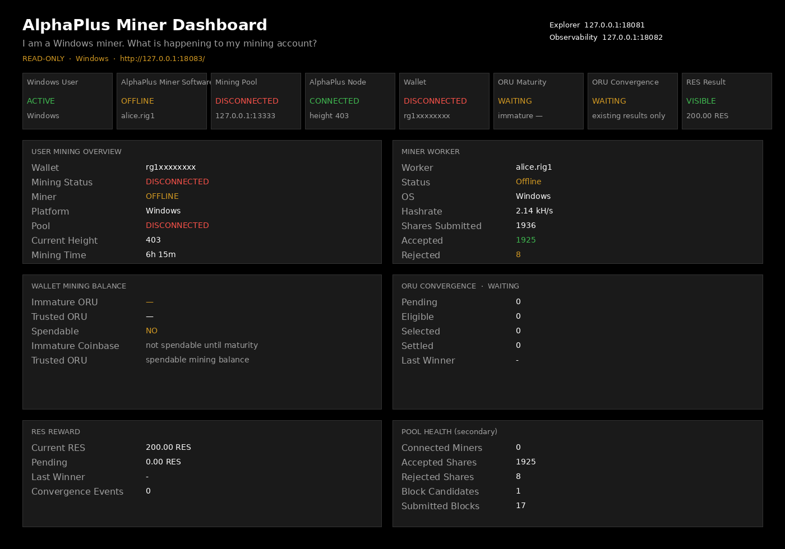

# AlphaPlus Windows Miner Dashboard MVP

| Field | Value |
|-------|-------|
| **Task** | `TASK-ALPHAPLUS-POOL-OPERATOR-DASHBOARD-WINDOWS-MINER-MVP-001` |
| **Tree** | `~/rigor-official-tree` |
| **Surface** | `http://127.0.0.1:18083/` |
| **Mode** | Read-only visualization |
| **Consensus / kernel / PoW / validation / RES rules / wallet accounting** | **Unchanged** |

This dashboard is the first **AlphaPlus Mining Visualization Layer** for the real Windows miner workflow. It is not a backend operator console and it does not replace daemon logs.

---

## User workflow

A normal Windows user should be able to:

1. Install Miner  
2. Start Wallet  
3. Mine ORU  
4. Watch shares  
5. See maturity  
6. See convergence  
7. Understand RES  
8. Open Explorer  

without reading backend logs.

```
Windows User
   |
AlphaPlus Miner Software
   |
Mining Pool
   |
AlphaPlus Node
   |
Wallet
   |
ORU Maturity
   |
ORU Convergence
   |
RES Result
```

That path is the primary view. Pool health is secondary.

### Windows test scenario

1. Start Windows Wallet (`installer/windows/start-wallet.cmd`)  
2. Start Windows Miner (`installer/windows/rigor-miner.cmd` or pool `rigor-miner-agent`)  
3. Connect miner to pool  
4. Mine blocks  
5. Observe shares on the dashboard worker table  
6. Observe ORU maturity (Immature Coinbase vs Trusted ORU)  
7. Observe wallet balance  
8. Observe Convergence (WAITING / WINNER)  
9. Observe RES result  

The dashboard checklist on the main page tracks each step.

---

## Architecture

```
Windows browser  →  127.0.0.1:18083  (this dashboard, read-only)
                         |
         +---------------+----------------+
         |               |                |
   Explorer :18081   Pool status.json   Wallet RPC (opt-in cookie/CLI)
   Observability :18082  Miner agent log
```

Implementation lives in `mining/windows-miner-dashboard/`:

| Path | Role |
|------|------|
| `server.py` | Loopback HTTP, GET only |
| `aggregator.py` | Maps existing results into user-facing JSON |
| `public/` | Miner account UI |
| `installer/windows/start-miner-dashboard.cmd` | Windows launcher |

Mining behavior is unchanged:

```
Windows Miner
      |
    Pool
      |
    Node
```

The dashboard does **not** submit shares, assemble blocks, sign, or call consensus code.

### Design decision

Do not design around hidden backend operation. The primary question is:

> I am a Windows miner. What is happening to my mining account?

The UI does not assume the user monitors daemon logs, CLI output, or pool internal processes.

---

## Screenshots

Live capture from `http://127.0.0.1:18083/` field APIs (the same values the HTML UI polls). Regenerated with `mining/windows-miner-dashboard/capture_screenshot.py`. Open the HTML page in a Windows browser for the interactive dashboard.



The page shows:

- Lifecycle strip (Windows User → RES Result)
- Wallet / miner / pool / height / mining time
- Worker table (`alice.rig1` when that worker is present)
- Immature ORU vs Trusted ORU
- Convergence Pending / Eligible / Selected / Settled
- RES current / pending / last winner
- Secondary pool health
- Links to Explorer (`:18081`) and Observability (`:18082`)

---

## API

All routes are **GET**, localhost, no private data.

| Method | Path | Purpose |
|--------|------|---------|
| GET | `/` | Miner dashboard HTML |
| GET | `/healthz` | Liveness |
| GET | `/api/miner/status` | Wallet, miner, pool, height, mining time, lifecycle |
| GET | `/api/miner/workers` | Worker table |
| GET | `/api/oru/convergence` | WAITING / WINNER + contribution counts |
| GET | `/api/wallet/mining` | Immature ORU, Trusted ORU, spendable |
| GET | `/api/res/status` | Current RES, pending, last winner, events |
| GET | `/api/pool/status` | Secondary pool health |

POST / PUT / DELETE return `405`. Non-loopback bind is refused.

Wallet RPC is opt-in (`WALLET_CLI`, `WALLET_DATADIR`, cookie). Credentials are never copied into JSON, HTML, or logs of this service.

---

## Security review

| Rule | Result |
|------|--------|
| Localhost default (`127.0.0.1:18083`) | Yes |
| Read-only | Yes (GET only) |
| No wallet signing | Yes |
| No private key access | Yes |
| No RPC password exposure | Secret keys stripped; soak `rpcuser`/`rpcpassword` not returned |
| No seed exposure | Secret-key filter |

Never expose: `rpcuser`, `rpcpassword`, wallet seed, private keys.

---

## Start

```bash
cd ~/rigor-official-tree/mining/windows-miner-dashboard
python3 server.py
```

Windows:

```text
installer\windows\start-miner-dashboard.cmd
```

Then open `http://127.0.0.1:18083/` in the Windows browser (Edge / Chrome). Explorer remains `http://127.0.0.1:18081/`.

This validation session found soak mining **STOPPED** (`~/alphaplus-validation/soak/STOPPED`) and WSL could not exec `cmd.exe`, so the dashboard showed last worker `alice.rig1` as Offline and Wallet as DISCONNECTED. That is the correct user-facing state: do not invent a live Windows balance. Start Wallet + Miner on Windows, then refresh the dashboard.

---

## Tests

```bash
cd ~/rigor-official-tree/mining/windows-miner-dashboard
python3 -m unittest tests.test_dashboard -v
```

---

## Future improvements

- Per-worker live hashrate from the Windows miner process itself (not only pool log / status.json)
- Direct Windows wallet cookie discovery under `%APPDATA%\RIGOR` without env configuration
- Push updates (EventSource) instead of 5s polling
- Pack the dashboard into the Windows ZIP so `start-miner-dashboard.cmd` always has `server.py` beside the miner
- Address-scoped explorer enrichment when the user pastes their `rg1q…` payout address

None of those items require consensus changes.
