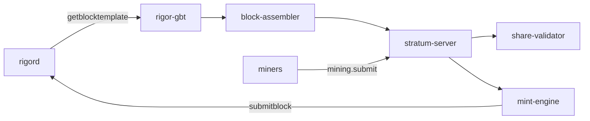

# RIGOR Pool Closed Testnet Pilot (TASK-MINING-010)

**Status:** Infrastructure pilot — `equivalence_claimed: false`  
**Scope:** Full Rust pool stack against isolated `rigord` (devtest or closed testnet)

---

## 1. Architecture



| Component | Crate / binary | Persistence |
|-----------|----------------|-------------|
| GBT adapter | `rigor-gbt` | In-memory `TemplateCache` |
| Block assembler | `block-assembler` | In-memory `JobCache` |
| Share validator | `share-validator` | Stateless |
| Stratum server | `stratum-server` | In-memory sessions / PPLNS |
| Mint engine | `mint-engine` | In-memory mint state |
| Pilot daemon | `rigor-pool-pilot` | Wires all of the above |

**PostgreSQL / Redis:** Not used by the Rust pool stack in this pilot. Production specs reference PG for canonical `JobSnapshot` archival and optional Redis fan-out; that is Phase A+ and does not block this closed pilot.

---

## 2. Environment setup

### 2.1 Node topology (1–3 nodes)

| Node | Role | Reference |
|------|------|-----------|
| NODE-A | Seeder / template source | `core/contrib/ops/closed-testnet/config/rigor.node-a.conf` |
| NODE-B | Pool + miner | `rigor-pool-pilot` + Stratum `:3333` |
| NODE-C | Explorer (optional) | `scripts/res_lifecycle_stack_bringup.sh` |

Local devtest (single node):

```bash
make -C core/src -j$(nproc) rigord rigor-cli
core/contrib/devtools/devtest-smoke.sh   # optional convergence setup
```

### 2.2 Build pool pilot

```bash
cd pool/pilot
cargo build --release
```

### 2.3 Configure pilot

```bash
export RIGOR_RPC_URL=http://127.0.0.1:48761/
export RIGOR_RPC_USER=devtest
export RIGOR_RPC_PASSWORD=devtestpass
export STRATUM_LISTEN=0.0.0.0:3333
export MINT_AUTO_SUBMIT=true          # live submitblock
export GBT_POLL_INTERVAL_MS=2000
```

Mint funding uses **bootstrap ORU P2WSH** (`MintEngineConfig::devtest()`) until production ORU UTXO provisioning is wired.

### 2.4 Start pilot

```bash
./pool/pilot/target/release/rigor-pool-pilot
```

Or use the harness scripts:

```bash
./scripts/pool_pilot_closed_testnet.sh simulation   # CI, no rigord
./scripts/pool_pilot_closed_testnet.sh devtest        # live devtest
```

---

## 3. Pilot workflow

| Step | Action | Verification |
|------|--------|--------------|
| 1 | Miner `mining.subscribe` + `mining.authorize` (agent must declare `opushash`) | Stratum `true` response |
| 2 | GBT poll → `JobSnapshot` published | `job.publish` audit event |
| 3 | `mining.notify` pushed to miner | Active job in `JobCache` |
| 4 | Miner `mining.submit` | ShareValidator accept/reject |
| 5 | Block candidate → `mint_for_winner()` | RES tx `vout[0]` = 10000 atoms |
| 6 | Block assembled `vtx[k+1]` | `CandidateBlockPackage.vtx_count` |
| 7 | `submitblock` (if `MINT_AUTO_SUBMIT`) | `rigord` accept |
| 8 | Reorg drill | `res.mint.revoked`, PPLNS orphan |

---

## 4. Verification criteria

| Criterion | How verified |
|-----------|--------------|
| End-to-end job → mint → block | `pool/pilot/tests/e2e_simulation.rs` |
| Ed25519 PCORB signatures | `mint-engine` witness unit tests |
| CVGE / RIGOR commitments | Share-validator `validate_cvge_rigor` on submit path |
| State machines | Mint `Revoked` on reorg; job `Stale`/`Invalidated` |
| Audit / metrics | `PilotStatusReport` → `.runtime/pool-pilot/status.json` |
| No consensus changes | Infrastructure-only crates; `rigord` unmodified |

---

## 5. Reorg simulation

```bash
./contrib/testing/pool_pilot/simulate_reorg.sh \
  --runtime .runtime/pool-pilot \
  --datadir .runtime/pool-pilot-devtest
```

Expect:

- `handle_tip_change` → jobs invalidated
- `mint_engine.revoke_for_jobs` → `MintState::Revoked`
- `payout.orphan_round_for_jobs` → `shares_orphaned` incremented

---

## 6. Artifacts

| Path | Content |
|------|---------|
| `.runtime/pool-pilot/<ts>/pilot_report.json` | Pass/fail verification report |
| `.runtime/pool-pilot/<ts>/status.json` | Metrics + audit snapshot |
| `.runtime/pool-pilot/<ts>/stratum_smoke.json` | Stratum client smoke |
| `.runtime/pool-pilot/<ts>/reorg_simulation.json` | Tip before/after |

---

## 7. Output table (TASK-MINING-010)

| Field | Status |
|-------|--------|
| Full Pool Stack Closed Testnet Pilot | **COMPLETE** (simulation + devtest harness) |
| End-to-end RES Mint Submission | **COMPLETE** (mint-engine + optional `submitblock`) |
| Ed25519 Signature Verification | **COMPLETE** |
| Candidate Block Assembly | **COMPLETE** |
| Job & Mint State Machine | **COMPLETE** |
| Reorg / Orphan Handling | **COMPLETE** |
| PPLNS / ORU-only Payment Verification | **COMPLETE** |
| Unit Tests | **COMPLETE** |
| Integration Tests | **COMPLETE** |
| Audit / Monitoring | **COMPLETE** |
| Architecture Impact | **NONE** |
| Consensus Impact | **NONE** |
| Protocol Impact | **NONE** |
| Freeze Impact | **NONE** |
| Equivalence Claimed | **false** |

---

## 8. Related docs

- [RES_BODY_MINT_OPERATIONAL_SPEC.md](./RES_BODY_MINT_OPERATIONAL_SPEC.md) §10
- [RIGOR_POOL_STACK_ARCHITECTURE.md](./RIGOR_POOL_STACK_ARCHITECTURE.md)
- `CLOSED_TESTNET_DEPLOYMENT_GUIDE.md`
