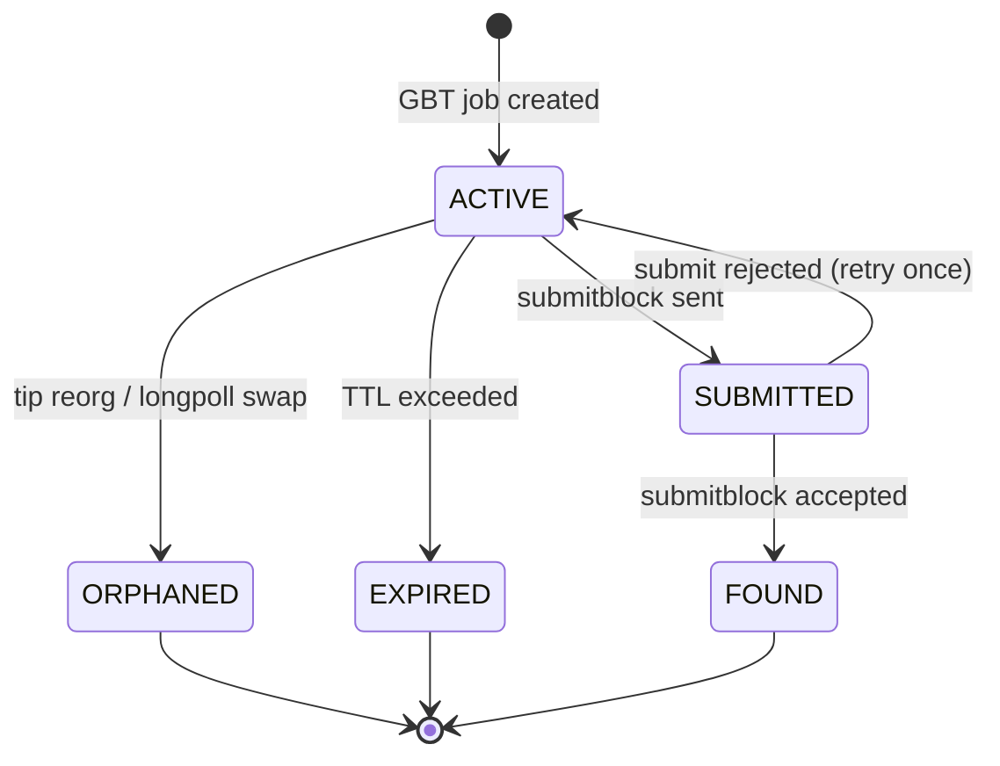
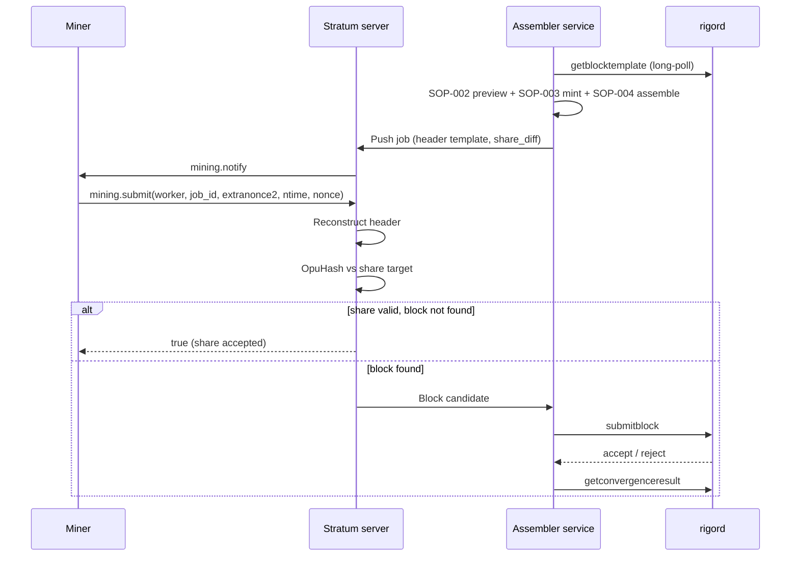

# Pool-Side RES Body Mint — Operational Specification

**Task:** `TASK-RESMINT-001`  
**Architecture:** `docs/mining/RES_BODY_MINT_ARCHITECTURE.md`  
**Constitution:** `TASK-CONSTITUTION-002`  
**Baseline:** `mainnet-freeze-rfc015-2026-05-26`  
**Status:** AUTHORITATIVE OPERATIONAL SPEC (documentation only)

---

## 1. Purpose

This document specifies **how pool operators run** the RES body mint subsystem defined in the architecture document. It covers RPC inventories, wallet interactions, database state, monitoring, step-by-step procedures, and operator runbooks.

**Audience:** Pool backend engineers, closed-testnet operators, SRE.

---

## 2. Operational Preconditions

### 2.1 Node requirements

| Requirement | Verification |
|-------------|--------------|
| `rigord` synced | `getblockchaininfo` → `"initialblockdownload": false` |
| `txindex=1` | Required for `getrawtransaction` on convergence txs |
| GBT available | `getblocktemplate '{"rules":["segwit"]}'` returns result |
| Peer connectivity | Mainnet-like chains require peers (test chains may relax) |
| `-miningresfeeaddr=<rg1p…>` | **Required on node** when mempool has RES-domain fee txs |

### 2.2 Pool wallet requirements

| Asset | Purpose | Minimum balance policy |
|-------|---------|------------------------|
| ORU | Fund body mint input + pay tx fee | ≥ 2× rolling average mint fee (operator-defined) |

The pool holds **no RES address**. `vout[0]` is dictated by the winning convergence transaction's
owner declaration, not by pool configuration — see §4.3.

The pool also holds **no key on the RES mint path** (SECURITY-001-A / A-7) — see §4.2. The only
secret material the mint pipeline needs is the ORU hot wallet key that funds and signs `vin[0]`.

### 2.3 Forbidden operations

| Operation | Why forbidden |
|-----------|---------------|
| `generatetoaddress` with convergence mempool on testnet | `bad-rigor-res-winner-mismatch` at template validity |
| Legacy yiimp coinbase extranonce in `scriptSig` | `bad-cb-convergence-root` |
| Using GBT `bits` for RIGOR / proof `target_prev` | `bad-rigor-target-mismatch` |
| `createresclaim` for body mint | RPC no longer exists — removed with the RES script path by SECURITY-001-A / A-7 |

---

## 3. Required RPC Inventory

### 3.1 Mandatory RPCs

| RPC | Caller | Frequency | Purpose |
|-----|--------|-----------|---------|
| `getblocktemplate '{"rules":["segwit"]}'` | Pool backend | Long-poll / 30s | Template + `convergence_txids` |
| `getbestblockhash` | Pool backend | Per job | Tip anchor |
| `getblock <hash> 1` | Pool backend | Per job | Parent context for bind hash |
| `submitblock <hex>` | Pool backend | On block find | Block submission |
| `getblockchaininfo` | Pool backend | 60s | Sync / IBD guard |
| `getrawtransaction <txid> true` | Pool backend | Per candidate | Convergence amount parse |

### 3.2 Strongly recommended RPCs

| RPC | Purpose |
|-----|---------|
| `getconvergenceresult <tip\|height>` | Post-confirm audit; bind_hash pattern reference |
| `getblockconvergence <hash>` | CVGE field verification |
| `testmempoolaccept '["<mint_hex>"]'` | Policy preflight on funded body mint |
| `decoderawtransaction <hex>` | Debug body mint structure |
| `decodescript <hex>` | Verify RES v1 program |
| `getrawmempool true` | Convergence tx presence before GBT |
| `getmininginfo` | Chain snapshot / monitoring |

### 3.3 Wallet RPCs (pool hot wallet)

| RPC | Purpose |
|-----|---------|
| `listunspent` | ORU UTXO selection for mint funding |
| `getbalances` | ORU liquidity monitoring |
| `sendrawtransaction` | **Not used** for body mint in block (mint goes via `submitblock`) |
| `walletprocesspsbt` | Optional if PSBT-based signing adopted |

### 3.4 RPCs explicitly not used for body mint path

| RPC | Reason |
|-----|--------|
| `createresclaim` | **Removed from the node** (SECURITY-001-A / A-7). Do not call; it is unregistered |
| `createconvergence` | Creates convergence tx only |
| `generatetoaddress` | No body mint on testnet |
| `generateblock` | Solo/lab path — pool uses own assembler |

### 3.5 GBT field extraction checklist

Per GBT response, persist:

```
job_id_internal     := hash(longpollid || previousblockhash)
previousblockhash
height
bits
prev_nbits
curtime
mintime
coinbasevalue
convergence_txids[]
transactions[].{data, txid, hash, fee, depends, weight}
default_witness_commitment
default_convergence_commitment
longpollid
```

---

## 4. Wallet Interactions

### 4.1 ORU UTXO selection policy

| Rule | Specification |
|------|---------------|
| Asset filter | ORU only (`listunspent` + script parse or `asset=ORU` if exposed) |
| Confirmation | ≥ 1 confirmation (operator may require 6 on mainnet) |
| Size | Single input preferred for v1; multi-input allowed if builder supports |
| Reservation | Mark UTXO `RESERVED` in pool DB when job emitted; release on orphan/timeout |
| Fee budget | `oru_fee` ≥ network min relay fee + margin |
| Change | Return to pool ORU change address (`vout[1]`) |

### 4.2 Mint-path key custody — none required (SECURITY-001-A / A-7)

**There is no mint key.** The PCORB witness carried a detached Ed25519 signature over σ and the
public key that verified it; A-7 removed both. The signature authorized nothing: σ is a pure
function of the six proof fields, consensus checks every one of those against the block
independently, and the verifying key was supplied by the witness itself, so any freshly generated
keypair satisfied the check. Treating it as a security boundary was misleading — leaking it would
have given an attacker nothing.

| Control | Requirement |
|---------|-------------|
| Mint signing key | **Does not exist.** `MintEngineConfig::ed25519_seed` and `RIGOR_POOL_MINT_ED25519_SEED_HEX` are removed |
| HSM / sealed secret manager | **Not applicable** to the mint path. No key ceremony, no rotation procedure, no custody control |
| Devtest key | `RIGOR_DEVTEST_AUTO_RES_MINT_V1` is gone from the node |
| ORU hot wallet key | Unchanged and still in scope: it signs `vin[0]` and is the mint transaction's only authentication |

This section governs the *ConvergeProof / RES mint witness* key only. RIGOR's other Ed25519 keys —
ORU and RES **spend** keys and wallet keys — are untouched and retain their custody requirements.

### 4.3 RES payout address — not configurable (SECURITY-001-A / A-5)

There is nothing to configure here, and that is the point. Consensus pays the minted RES to the
owner declared by the winning convergence transaction (`Consensus::CheckResRewardOwner`), so the
payout script is derived per mint from that transaction's `RESO` declaration. A pool RES treasury
address is not merely discouraged, it is unrepresentable: `MintEngineConfig` has no such field,
and a block paying anything else is rejected with `bad-rigor-res-owner-mismatch`.

| Formerly | Now |
|----------|-----|
| A — Pool RES treasury (`RIGOR_POOL_RES_PAYOUT_PROGRAM_HEX`) | **Removed.** The pool holds no RES address. |
| B — Node mirror (`-miningresfeeaddr`) | **Not applicable** to the payout target. |
| C — Per-miner split | **Never applies.** RES is not mining income; see below. |

**The pool's income is ORU**, not RES: the coinbase subsidy plus the fees of the convergence
transactions it includes — a positive fee is itself a condition of entering the draw
(`convergence_root.cpp`). RES is not produced by proof of work and is not shared over shares; it
belongs to whoever burned ORU to enter the draw, and is claimed by a wallet `convergence` action.
PPLNS accounting is ORU-only and has no RES ledger to configure.

**Validation:** none required at setup. To audit after the fact, confirm the mint's `vout[0]`
matches the `RESO` program in the winning convergence transaction.

### 4.4 Production ORU input witness (non-bootstrap)

Devtest uses P2WSH bootstrap (`auto_res_mint.cpp`). **Production pool** must:

1. Select standard ORU P2WPKH (or approved P2WSH) UTXO
2. Attach PCORB stack (**6 items**, `PCORB_BODY_RES_MINT_WITNESS_ITEMS`) to `vin[0].scriptWitness`
3. Append secp256k1 `[signature, pubkey]` for P2WPKH spend **after** PCORB items
4. Verify with `testmempoolaccept` before block assembly

**If witness ordering wrong:** `bad-rigor-res-witness` or standard script reject.

---

## 5. Required Database State

### 5.1 Core tables (logical schema)

#### `pool_jobs`

| Column | Type | Description |
|--------|------|-------------|
| `job_id` | INT PK | Internal job id |
| `stratum_job_id` | HEX | Exposed to miners |
| `prev_block_hash` | CHAR(64) | GBT `previousblockhash` |
| `height` | INT | Next block height |
| `longpollid` | VARCHAR | GBT longpollid |
| `convergence_root` | CHAR(64) | Computed C |
| `mint_required` | BOOL | Winner preview result |
| `winner_txid` | CHAR(64) NULL | If mint_required |
| `body_mint_txid` | CHAR(64) NULL | Built mint txid |
| `body_mint_hex` | TEXT NULL | Serialized mint (encrypted at rest) |
| `status` | ENUM | `ACTIVE`, `FOUND`, `ORPHANED`, `EXPIRED`, `SUBMITTED` |
| `created_at` | TIMESTAMP | Job creation |
| `expires_at` | TIMESTAMP | Staleness deadline |

#### `pool_utxo_reservations`

| Column | Type | Description |
|--------|------|-------------|
| `txid` | CHAR(64) | Fund input |
| `vout` | INT | |
| `job_id` | INT FK | |
| `status` | ENUM | `RESERVED`, `SPENT`, `RELEASED` |

#### `pool_blocks`

| Column | Type | Description |
|--------|------|-------------|
| `height` | INT | |
| `block_hash` | CHAR(64) | |
| `had_body_mint` | BOOL | |
| `winner_txid` | CHAR(64) NULL | |
| `body_mint_txid` | CHAR(64) NULL | |
| `submit_error` | TEXT NULL | |
| `convergence_result_json` | JSON NULL | `getconvergenceresult` snapshot |

#### `pool_mint_audit`

| Column | Type | Description |
|--------|------|-------------|
| `job_id` | INT FK | |
| `event` | VARCHAR | `PREVIEW`, `BUILD`, `SUBMIT`, `ACCEPT`, `REJECT` |
| `detail` | JSON | Proof fields, error strings |
| `ts` | TIMESTAMP | |

### 5.2 State transitions



---

## 6. Standard Operating Procedures

### 6.1 SOP-001 — Template acquisition

```bash
# Long-poll request (conceptual)
rigor-cli getblocktemplate '{"rules":["segwit"],"longpollid":"<id>"}'
```

| Step | Action |
|------|--------|
| 1 | Confirm `initialblockdownload=false` |
| 2 | Request GBT with `segwit` rule |
| 3 | Store full JSON + `received_at` timestamp |
| 4 | If `longpollid` changed → trigger job rebuild |
| 5 | If `convergence_txids` non-empty → flag `CONVERGENCE_JOB` |

### 6.2 SOP-002 — Winner preview

| Step | Action | Abort if |
|------|--------|----------|
| 1 | Deserialize all `transactions[].data` | Parse error |
| 2 | Validate `convergence_txids` ⊆ deserialized txids | Mismatch |
| 3 | Compute C from sorted F | — |
| 4 | `bind_hash = ConvergenceDrawBindHashFromParent(tip, height)` | Tip unavailable |
| 5 | For each candidate: σ, eligibility | — |
| 6 | Select winner or set `mint_required=false` | — |
| 7 | Log audit event `PREVIEW` with all fields | — |

### 6.3 SOP-003 — Body mint creation

**Precondition:** `mint_required=true`

| Step | Action |
|------|--------|
| 1 | `getrawtransaction <winner_txid> true` → `convergence_amount` |
| 2 | `listunspent` → select ORU UTXO; reserve in DB |
| 3 | Build PCORB proof fields (§4 architecture) — 6 witness pushes, no signature (A-7) |
| 4 | Assemble `CMutableTransaction` v2 |
| 5 | **Mandatory (M-07):** `testmempoolaccept` — reject-before-submit | Fail → abort; do not assemble/submit |
| 6 | Store `body_mint_hex`, `body_mint_txid` in `pool_jobs` |
| 7 | Log audit `BUILD` |

### 6.4 SOP-004 — Block assembly and commitment refresh

| Step | Action |
|------|--------|
| 1 | `vtx[0]` = coinbase skeleton (`coinbasevalue` → pool ORU payout) |
| 2 | `vtx[1..k]` = GBT transactions in order |
| 3 | `vtx[k+1]` = body mint (if required) |
| 4 | Coinbase `scriptSig` = BIP34(height) ‖ C (exactly 2 pushes) |
| 5 | Regenerate witness commitment (all txs in merkle) |
| 6 | Recompute CVGE; append OP_RETURN |
| 7 | Append RIGOR OP_RETURN (`prev_nbits` LE32) |
| 8 | Compute merkle root + 80-byte header |
| 9 | Split coinbase for Stratum `coinb1`/`coinb2` if applicable |

### 6.5 SOP-005 — Miner share flow (Stratum)



| Share path rule | Specification |
|-----------------|---------------|
| Share validation | OpuHash(header) ≤ share_target |
| Block validation | OpuHash(header) ≤ network `bits` target |
| Extranonce | Witness reserved value only — **not** scriptSig |
| Job expiry | 120s without tip change (configurable) |

### 6.6 SOP-006 — submitblock flow

```bash
rigor-cli submitblock "<full_block_hex_with_witness>"
```

| Response | Meaning | Action |
|----------|---------|--------|
| `null` | Accepted | SOP-007 verification |
| `"duplicate"` | Already known | Mark FOUND; reconcile |
| `"inconclusive"` | Uncertain | Retry once after 1s; else log |
| Error string | Rejected | Log + classify via failure matrix |

**Pre-submit gate:** Internal `TestBlockValidity` equivalent (optional local rigord) — must pass before network submit.

### 6.7 SOP-007 — Post-confirmation verification

```bash
rigor-cli getconvergenceresult "<new_block_hash>"
rigor-cli getblock "<new_block_hash>" 2
```

| Check | Expected |
|-------|----------|
| `draw_winner_txid` | Matches preview `winner_txid` |
| Body mint txid present in block | `getblock` tx list |
| RES output amount | 100.00 RES on body mint `vout[0]` |
| `pool_blocks.had_body_mint` | `true` |

---

## 7. Reorg Recovery Runbook

### 7.1 Detection triggers

| Trigger | Source |
|---------|--------|
| Tip hash ≠ job `prev_block_hash` | GBT poll |
| `blocknotify` script | Node webhook |
| ZMQ `hashblock` | Real-time |
| `getblockchaininfo.blocks` regression | Impossible on valid chain — alert |

### 7.2 Runbook steps

| Step | Operator action |
|------|-----------------|
| R-1 | Set pool mode `PAUSED_NEW_JOBS` |
| R-2 | Mark all `ACTIVE` jobs → `ORPHANED` |
| R-3 | Release all `RESERVED` UTXOs |
| R-4 | Wait for `initialblockdownload=false` |
| R-5 | Fetch GBT at new tip |
| R-6 | Resume `ACTIVE` job creation |
| R-7 | Audit `pool_blocks` for confirmed blocks still on main chain (`getblockheader`) |
| R-8 | Reconcile payouts for orphaned-but-submitted blocks |

### 7.3 Stale job TTL policy

| Parameter | Default | Notes |
|-----------|---------|-------|
| `job_max_age_sec` | 300 | After this, mark `EXPIRED` |
| `longpoll_timeout_sec` | 60 | Matches node GBT |
| `mempool_rescan_sec` | 30 | Force GBT refresh if convergence mempool busy |

---

## 8. Monitoring Requirements

### 8.1 Metrics (required)

| Metric | Type | Alert threshold |
|--------|------|-----------------|
| `pool_gbt_fetch_errors_total` | Counter | > 3 in 5 min |
| `pool_gbt_staleness_seconds` | Gauge | > 120 |
| `pool_convergence_jobs_total` | Counter | Info |
| `pool_mint_required_total` | Counter | Info |
| `pool_body_mint_build_failures_total` | Counter | > 0 → page |
| `pool_submitblock_reject_total` | Counter by reason | Any `bad-rigor-*` → page |
| `pool_orphan_jobs_total` | Counter | > 5/hour |
| `pool_oru_utxo_available` | Gauge | < minimum threshold |

### 8.2 Logs (structured JSON required)

| Event | Fields |
|-------|--------|
| `gbt_received` | `height`, `prev_hash`, `|F|`, `longpollid` |
| `winner_preview` | `mint_required`, `winner_txid`, `C`, `B`, `eligible_count` |
| `body_mint_built` | `txid`, `oru_input`, `res_vout_value` |
| `submitblock` | `block_hash`, `result`, `reject_reason` |
| `reorg_detected` | `old_tip`, `new_tip`, `orphaned_jobs` |

### 8.3 Dashboards (operator-facing)

| Panel | Content |
|-------|---------|
| Chain sync | `blocks`, `verificationprogress`, IBD flag |
| Convergence mempool | Count of convergence-shaped mempool txs |
| Mint pipeline | Preview → build → submit funnel |
| Reject breakdown | Pie chart of `bad-rigor-*` strings |
| RES issuance | Cumulative body mints per day (from `getconvergenceresult` audit) |

### 8.4 Alerts (P1)

| Alert | Condition |
|-------|-----------|
| `MintRequiredButNoBuild` | `mint_required=true` and no `body_mint_hex` within 10s |
| `ConvergenceRejectSpike` | `bad-rigor-res-winner-mismatch` > 0 in production |
| `ConvergenceRootMismatch` | Internal V-02 validation failure |
| `UtxoStarvation` | No spendable ORU for > 5 min with `mint_required` |

---

## 9. Failure Handling Matrix (Operational)

| ID | Operator symptom | Diagnosis | Remediation |
|----|------------------|-----------|-------------|
| O-01 | All convergence blocks reject | Body mint missing | Enable mint builder path |
| O-02 | Reject `bad-rigor-res-proof` | Stale winner, or a proof field that no longer matches the block (the proof carries no signature — A-7) | Re-preview; re-derive `bind_hash`, `target_prev`, `convergence_root` against the current tip |
| O-03 | Reject `bad-cb-convergence-root` | scriptSig layout | Audit extranonce placement |
| O-04 | Reject `bad-convergence-draw-candidate-root` | Stale CVGE | Force commitment regenerator |
| O-05 | Reject `bad-rigor-target-mismatch` | Used `bits` not `prev_nbits` | Fix RIGOR builder |
| O-06 | `testmempoolaccept` fails | ORU witness incomplete | Fix P2WPKH stack |
| O-07 | High orphan rate | Slow block propagation / job TTL too long | Lower TTL; check network |
| O-08 | `convergence_txids` mismatch log | Node/pool version skew | Pin node tag; bug report |
| O-09 | Mint built but no winner at submit | Mempool changed between preview and submit | Narrow window; lock template at build |
| O-10 | Duplicate submit | Two miners found same block | Idempotent submit handling |

---

## 10. Closed Testnet Pilot Procedure

### 10.1 Phase A — Dry-run (no submit)

1. Start synced node with convergence txs in mempool
2. Run GBT fetch + winner preview only
3. Build body mint hex
4. `decoderawtransaction` + schema validation
5. `testmempoolaccept` (if ORU funded)

### 10.2 Phase B — Single block submit

1. Complete SOP-001 through SOP-004
2. Solve PoW (node `generate` helper or pool miner)
3. `submitblock`
4. SOP-007 verification

### 10.3 Phase C — Stratum soak

1. Attach Stratum server per `STRATUM_GAP_ANALYSIS.md` Phase 4
2. Mine ≥10 blocks with mixed convergence / empty mempool
3. Induce 1-block reorg on test network; verify runbook §7

### 10.4 Exit criteria for production Stratum

| Criterion | Evidence |
|-----------|----------|
| ≥1 convergence block accepted | `submitblock` + `getconvergenceresult` |
| Zero `bad-rigor-res-winner-mismatch` in soak | Log audit |
| Reorg recovery executed | Runbook drill log |
| ORU UTXO reservation works | DB audit |
| Monitoring dashboards live | Screenshot / URL |

---

## 11. Pool-Side Integration Checklist (Operational)

### 11.1 Infrastructure

- [ ] `rigord` RPC reachable from assembler (localhost or VPN)
- [ ] Pool hot wallet funded with ORU
- [ ] Confirmed the pool holds **no** RES payout address (A-5: payout comes from the winner's declaration)
- [ ] Confirmed the pool holds **no** mint signing key (A-7: no `ed25519_seed`, no `RIGOR_POOL_MINT_ED25519_SEED_HEX`, no HSM enrollment for the mint path)
- [ ] Database schema §5 deployed
- [ ] Monitoring §8 deployed

### 11.2 Per-job pipeline

- [ ] SOP-001 GBT acquired
- [ ] SOP-002 preview logged
- [ ] SOP-003 mint built if required
- [ ] SOP-004 commitments regenerated
- [ ] UTXO reserved / released correctly
- [ ] Stratum job emitted with `clean_jobs` on tip change

### 11.3 Submission

- [ ] OpuHash on share and block paths
- [ ] `submitblock` response logged
- [ ] SOP-007 post-confirm audit
- [ ] `pool_blocks` row inserted

### 11.4 Resilience

- [ ] Reorg runbook §7 tested
- [ ] Stale job TTL configured
- [ ] P1 alerts firing in staging
- [ ] `PAUSED_NEW_JOBS` kill switch documented

---

## 12. Required Output Table

| Field | Status |
|-------|--------|
| **Winner Discovery Model** | **COMPLETE** (see architecture §3) |
| **Body Mint Construction Model** | **COMPLETE** (see architecture §4) |
| **Block Assembly Integration** | **COMPLETE** (see architecture §5) |
| **Reorg Handling** | **COMPLETE** (§7) |
| **Pool Workflow** | **COMPLETE** (§6) |
| **Operational Specification** | **COMPLETE** |
| **Architecture Impact** | **NONE** |
| **Consensus Impact** | **NONE** |
| **Protocol Impact** | **NONE** |
| **Freeze Impact** | **NONE** |
| **Equivalence Claimed** | **false** |

---

## 13. Document Cross-References

| Document | Relationship |
|----------|--------------|
| `RES_BODY_MINT_ARCHITECTURE.md` | Normative architecture (this doc implements) |
| `STRATUM_GAP_ANALYSIS.md` | Stratum Phase 3–4 depends on this spec |
| `MINIMAL_RES_MINT_MINING_PROCEDURE.md` | Solo/lab procedural subset |
| `RES_BODY_MINT_FAILURE_MATRIX.md` | Consensus reject codes |
| `RES_BODY_MINT_SCHEMA.md` | Wire-level tx schema |
| `GBT_BODY_MINT_INSERTION_STRATEGY.md` | Insertion ordering |
| `core/doc/mining-pool-gbt.md` | GBT + coinbase normative wire doc |

---

*End of RES_BODY_MINT_OPERATIONAL_SPEC.md — TASK-RESMINT-001*
