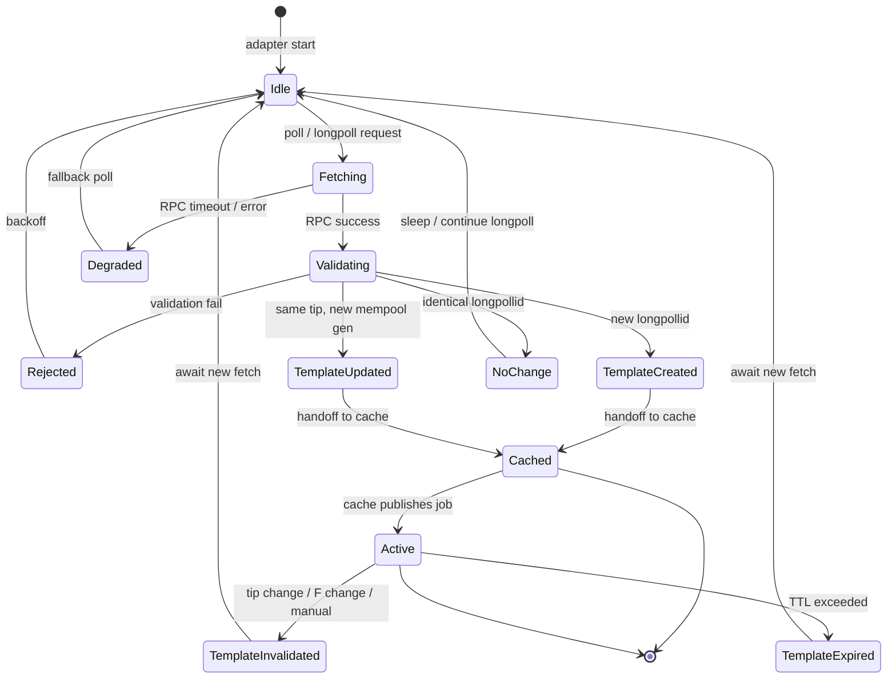
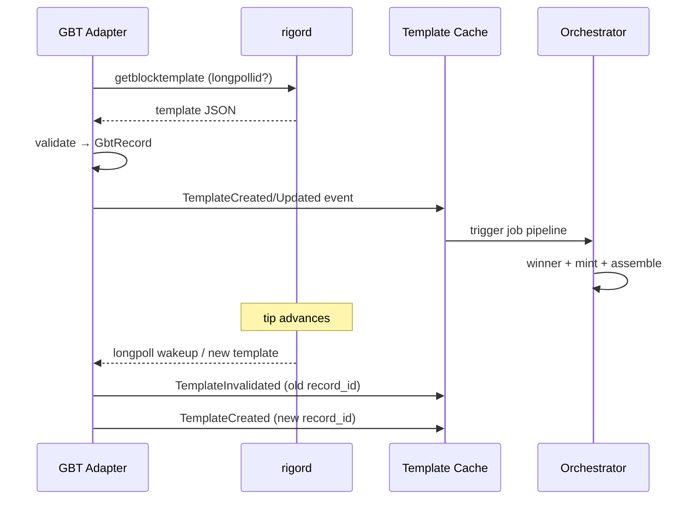
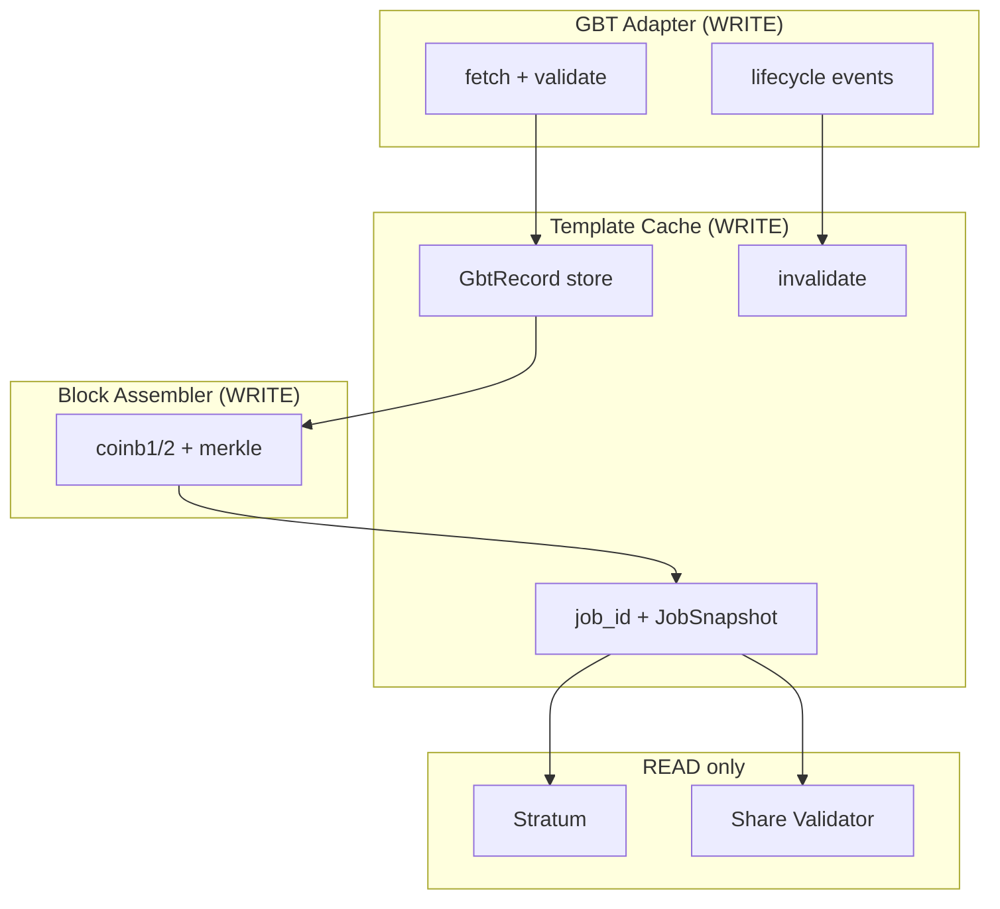
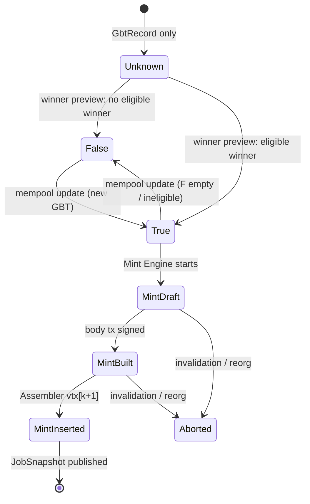
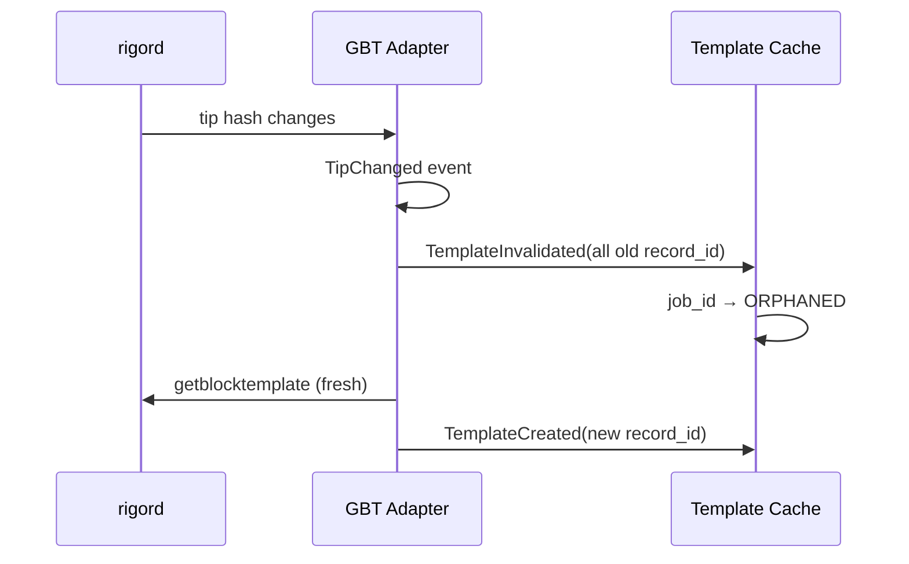
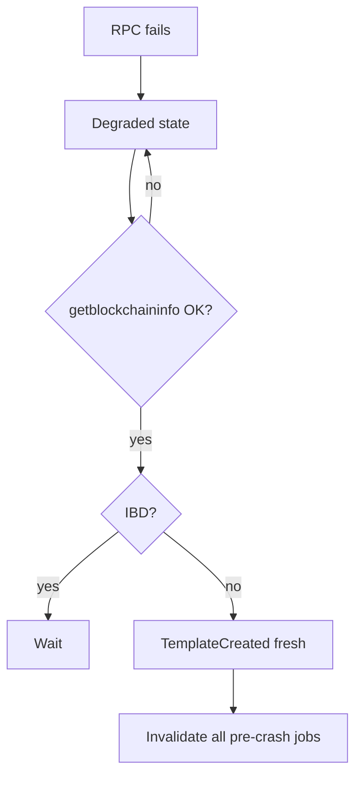
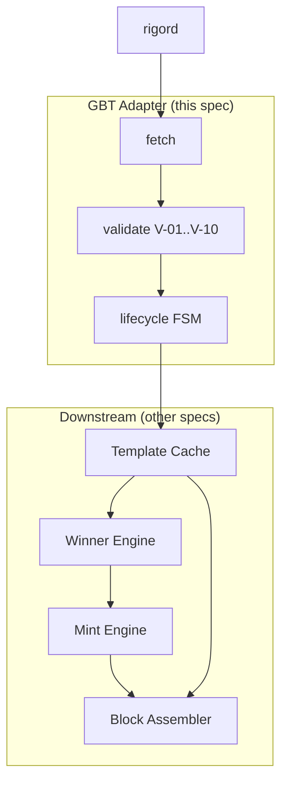

# RIGOR GBT Adapter — Implementation Specification

**Document status:** Production documentation  
**Constitution:** historical verification record (INFRASTRUCTURE MODE)  
**Parent documents:**

- `RIGOR_POOL_STACK_ARCHITECTURE.md` (historical verification record)
- `RIGOR_POOL_ARCHITECTURE_AUDIT.md` (historical verification record)
- `STRATUM_GAP_ANALYSIS.md` (historical verification record)
- `RES_BODY_MINT_ARCHITECTURE.md` (historical verification record)
- `core/doc/mining-pool-gbt.md` (normative wire)

**Freeze compliance:** PROOF-031–034, `MAINNET_PROTOCOL_FREEZE_DECLARATION`  
**Baseline:** `mainnet-freeze-rfc015-2026-05-26`  
**Status:** AUTHORITATIVE IMPLEMENTATION-FACING SPEC (documentation only)

**P0-014 SOLO overlay (shipped `rigord`):** GBT advertises `mutable: ["time"]` only, serves `default_coinbase_scriptsig` / `default_coinbase_tx` / `rigor_coinbase_immutable`. BIP141 reserved nonce is 32 zero bytes.

**RFC-020 pool path (2026-09-14):** `rigor-gbt` parses shipping fields and **rejects** lottery JSON keys (`paid_winner_txid`, `default_res_mint`, `default_pcorb_carrier`, `convergence_root`, `convergence_draw`, `convergence_txids`, `default_convergence_commitment`). `coinbasevalue` is ORU `vout[0]` only: 0 at height 0, **128 ORU** for every `h ≥ 1`, no halving. Winner / mint-engine sections below are leftover design notes, not the live assembler.

---

## SECTION 1 — Purpose

### 1.1 Role

The **GBT Adapter** is the **sole ingress authority** from `rigord` into the RIGOR Pool Stack. It fetches, validates, and normalizes chain templates; it **does not** assemble mining jobs, mint RES body transactions, or serve Stratum clients.

```
rigord  ──(JSON-RPC)──►  GBT Adapter  ──(GbtRecord)──►  Template Cache / downstream
                              │
                              └── auxiliary chain context (tip, parent block)
```

### 1.2 Single authority boundary

| Zone | Authority |
|------|-----------|
| **rigord** | Consensus template generation, F membership for node's mempool package, `submitblock` acceptance |
| **GBT Adapter** | Template fetch cadence, field validation, normalization, lifecycle events, tip-change detection |
| **Template Cache + Block Assembler** | Job materialization, coinbase, mint insert, Stratum packaging |
| **Miners** | `nNonce`, `nTime` (bounds), witness extranonce only |

### 1.3 Inputs

#### 1.3.1 Primary RPC

| RPC | Request | When |
|-----|---------|------|
| `getblocktemplate` | `{"rules":["segwit"]}` + optional `longpollid` | Every poll / long-poll cycle |

Signet chains add `"signet"` to `rules` (node-enforced).

#### 1.3.2 Auxiliary RPCs (adapter-owned per historical verification record P-02)

| RPC | Purpose |
|-----|---------|
| `getblockchaininfo` | `initialblockdownload`, `blocks`, sync guard |
| `getbestblockhash` | Tip anchor |
| `getblock <prevhash> 1` | Parent header context (`prev_nbits` cross-check, bind-hash walk) |
| `getblockcount` | Height sanity vs GBT `height` |

**Not adapter-owned:** `submitblock` (Share Validator), `getconvergenceresult` (post-confirm audit), `testmempoolaccept` (Mint Engine).

### 1.4 Outputs

#### 1.4.1 `GbtRecord` (normalized struct)

Immutable snapshot emitted on successful fetch:

| Field group | Members |
|-------------|---------|
| **Identity** | `record_id`, `fetched_at`, `source_node_id` |
| **Chain anchor** | `tip_hash`, `previousblockhash`, `height`, `longpollid` |
| **PoW** | `bits`, `prev_nbits`, `target`, `mintime`, `curtime` |
| **Package** | `transactions[]`, `convergence_txids[]` |
| **Coinbase hints** | `coinbasevalue`, `coinbaseaux`, `default_witness_commitment`, `default_convergence_commitment` |
| **Limits** | `version`, `mutable[]`, `noncerange`, `weightlimit`, `sigoplimit`, `sizelimit` |
| **Meta** | `rules[]`, raw JSON hash (integrity), `validation_status` |

#### 1.4.2 Lifecycle events

| Event | Payload |
|-------|---------|
| `TemplateCreated` | New `GbtRecord` |
| `TemplateUpdated` | `GbtRecord` with changed `longpollid` |
| `TemplateInvalidated` | `record_id` + reason |
| `TemplateExpired` | `record_id` + TTL |
| `TipChanged` | `old_tip`, `new_tip` |

### 1.5 Ownership boundaries (summary)

| Owns | Does not own |
|------|--------------|
| RPC session to rigord | Coinbase `scriptPubKey` payout |
| `GbtRecord` validation | `convergence_root` computation (downstream) |
| Tip / IBD guards | Winner preview |
| Template lifecycle state transitions | Body mint construction |
| `record_id` (adapter UUID) | `job_id` (Template Cache / Stratum) |

---

## SECTION 2 — Data Ownership

### 2.1 Classification legend

| Class | Meaning |
|-------|---------|
| **CONSENSUS_AUTHORITY** | Value fixed by node template / consensus rules; pool **must reproduce exactly** on `submitblock` or block fails |
| **POOL_AUTHORITY** | Pool constructs or derives; must still pass `ConnectBlock` |
| **MINER_MUTABLE** | Miner may alter per BIP22 `mutable` + RIGOR coinbase constraints |

**Note:** Some fields are **hybrid** — classification shows primary owner; footnotes clarify.

### 2.2 `getblocktemplate` field ownership table

| Field | Class | Notes |
|-------|-------|-------|
| `version` | CONSENSUS_AUTHORITY | Preferred block version from node |
| `rules` | CONSENSUS_AUTHORITY | Active deployment rules |
| `vbavailable` | CONSENSUS_AUTHORITY | Informational |
| `vbrequired` | CONSENSUS_AUTHORITY | Must be satisfied in submission |
| `capabilities` | CONSENSUS_AUTHORITY | Echo of client capabilities |
| `previousblockhash` | CONSENSUS_AUTHORITY | Chain tip parent for next block |
| `height` | CONSENSUS_AUTHORITY | Next block height (BIP34) |
| `bits` | CONSENSUS_AUTHORITY | PoW target for block being mined |
| `target` | CONSENSUS_AUTHORITY | Expanded target hash |
| `prev_nbits` | CONSENSUS_AUTHORITY | Parent compact target — RIGOR commitment + proof binding |
| `mintime` | CONSENSUS_AUTHORITY | Lower bound for `nTime` |
| `curtime` | CONSENSUS_AUTHORITY | Suggested header time; miner may adjust if `time` ∈ `mutable` |
| `coinbasevalue` | CONSENSUS_AUTHORITY | ORU `vout[0]` value only (subsidy + ORU fees) |
| `transactions[]` | CONSENSUS_AUTHORITY | Node-selected package; pool **may append** body mint only |
| `transactions[].data` | CONSENSUS_AUTHORITY | Full tx bytes |
| `transactions[].txid` | CONSENSUS_AUTHORITY | Witness-stripped txid |
| `transactions[].hash` | CONSENSUS_AUTHORITY | Witness hash (merkle) |
| `transactions[].depends` | CONSENSUS_AUTHORITY | Intra-block deps |
| `transactions[].fee` | CONSENSUS_AUTHORITY | ORU-domain fee accounting |
| `transactions[].sigops` | CONSENSUS_AUTHORITY | Limit accounting |
| `transactions[].weight` | CONSENSUS_AUTHORITY | Limit accounting |
| `convergence_txids` | CONSENSUS_AUTHORITY | Node-computed F for **this** template package |
| `default_witness_commitment` | CONSENSUS_AUTHORITY* | *Valid only until vtx set changes; pool must regenerate after body mint |
| `default_convergence_commitment` | CONSENSUS_AUTHORITY* | *Informational checksum; stale after mint insert — pool recomputes |
| `coinbaseaux` | POOL_AUTHORITY | Pool may merge aux data into witness path per BIP22 |
| `longpollid` | CONSENSUS_AUTHORITY | `{tip_hash}\|{nTxUpdated}` — invalidation signal |
| `mutable` | CONSENSUS_AUTHORITY | Declares allowed miner/pool mutations: `time`, `transactions`, `prevblock` |
| `noncerange` | CONSENSUS_AUTHORITY | Nonce search space hint |
| `sigoplimit` | CONSENSUS_AUTHORITY | Block limit |
| `sizelimit` | CONSENSUS_AUTHORITY | Block limit |
| `weightlimit` | CONSENSUS_AUTHORITY | Block limit |
| `signet_challenge` | CONSENSUS_AUTHORITY | Signet only |

### 2.3 Fields NOT in GBT (downstream ownership)

| Field | Class | Owner component |
|-------|-------|-----------------|
| `convergence_root` (C) | POOL_AUTHORITY | Winner Engine / Block Assembler — **must match consensus formula** |
| `bind_hash` (B) | POOL_AUTHORITY | Winner Engine — derived from parent + height |
| `draw_winner_txid` | POOL_AUTHORITY | Winner Engine — preview only |
| `mint_required` | POOL_AUTHORITY | Winner Engine |
| `body_mint_tx` | POOL_AUTHORITY | RES Body Mint Engine |
| `coinbase scriptSig` | POOL_AUTHORITY | Block Assembler — **byte-exact consensus encoding** |
| `coinbase vout[0] scriptPubKey` | POOL_AUTHORITY | Block Assembler — pool payout address |
| `CVGE OP_RETURN` (final) | POOL_AUTHORITY | Block Assembler — recomputed |
| `RIGOR OP_RETURN` | POOL_AUTHORITY | Block Assembler — `prev_nbits` from GBT |
| `job_id` | POOL_AUTHORITY | Template Cache |
| `coinb1` / `coinb2` | POOL_AUTHORITY | Block Assembler |
| `merkle_branch[]` | POOL_AUTHORITY | Block Assembler |

### 2.4 Coinbase script field decomposition

| Coinbase region | Class | Mutable by miner? |
|-----------------|-------|-------------------|
| `scriptSig` push #1 (height) | CONSENSUS_AUTHORITY | **NO** |
| `scriptSig` push #2 (ConvergenceRoot) | CONSENSUS_AUTHORITY | **NO** — not extranonce |
| `scriptSig` additional pushes | **FORBIDDEN** | **NO** — consensus reject |
| `vin[0].scriptWitness` reserved (extranonce) | MINER_MUTABLE | **YES** |
| `vout[0].nValue` | CONSENSUS_AUTHORITY | **NO** — equals `coinbasevalue` |
| `vout[0].scriptPubKey` | POOL_AUTHORITY | **NO** per job (pool payout) |
| Witness commitment output | POOL_AUTHORITY* | Regenerated after vtx change |
| CVGE OP_RETURN | POOL_AUTHORITY* | Regenerated after vtx change |
| RIGOR OP_RETURN | CONSENSUS_AUTHORITY + POOL_AUTHORITY | Payload from `prev_nbits`; pool places bytes |

### 2.5 MINER_MUTABLE summary (RIGOR constraints)

Per GBT `mutable` and `mining-pool-gbt.md`:

| Field | BIP22 mutable? | RIGOR allowed? |
|-------|----------------|----------------|
| `nTime` | YES (`time`) | YES within `[mintime, now+7200]` |
| `nNonce` | implicit | YES |
| Witness extranonce | via `coinbaseaux`/witness | YES |
| `transactions` reorder | YES (`transactions`) | **DISCOURAGED** — changes F, C, winner, mint |
| `scriptSig` extranonce | Bitcoin pools often yes | **FORBIDDEN** |
| ConvergenceRoot | — | **FORBIDDEN** |
| `prev_nbits` / RIGOR payload | — | **FORBIDDEN** |

---

## SECTION 3 — Template Lifecycle

### 3.1 State machine



### 3.2 State definitions

| State | Entry condition | `GbtRecord` status |
|-------|-----------------|-------------------|
| **TemplateCreated** | First `GbtRecord` for `(previousblockhash, longpollid)` | `NEW` |
| **TemplateCached** | Cache acknowledged storage | `CACHED` |
| **TemplateUpdated** | Same `previousblockhash`, `longpollid` changed | `UPDATED` |
| **TemplateInvalidated** | Tip change, manual kill, validation drift | `INVALID` |
| **TemplateExpired** | `now > fetched_at + TTL` without block find | `EXPIRED` |

### 3.3 Lifecycle sequence



### 3.4 TTL policy

| Parameter | Default | Owner |
|-----------|---------|-------|
| `gbt_record_ttl_sec` | 300 | GBT Adapter config |
| `longpoll_timeout_sec` | 60 (+ node recheck) | rigord |
| `fallback_poll_sec` | 30 | GBT Adapter |

**Rule:** `TemplateExpired` fires at TTL even if Stratum job still active — cache must invalidate downstream job.

---

## SECTION 4 — Template Cache Authority

### 4.1 Authority matrix

| Action | GBT Adapter | Template Cache | Block Assembler | Stratum / Validator |
|--------|-------------|----------------|-----------------|---------------------|
| Fetch raw GBT | **WRITE** | — | — | — |
| Validate fields | **WRITE** | — | — | — |
| Store `GbtRecord` | EMIT | **WRITE** | — | — |
| Compute C, winner | — | — | **WRITE** | — |
| Build body mint | — | — | **WRITE** (Mint Engine) | — |
| Assemble coinb1/2 | — | — | **WRITE** | — |
| Publish `JobSnapshot` | — | **WRITE** | READ | — |
| Assign `job_id` | — | **WRITE** | — | READ |
| Serve Stratum notify | — | READ | — | **WRITE** |
| Validate shares | — | READ | — | **WRITE** |
| Invalidate on tip change | **EMIT** | **WRITE** | READ | READ |

### 4.2 Identifier ownership

| ID | Owner | Format | Scope |
|----|-------|--------|-------|
| `record_id` | GBT Adapter | UUID v4 | One GBT fetch snapshot |
| `cache_key` | Template Cache | `SHA256(longpollid ‖ previousblockhash)` | Deduplication |
| `job_id` | Template Cache | Monotonic hex / DB serial | Stratum `mining.notify` |
| `stratum_job_id` | Stratum Server | Exposed to miners | May equal `job_id` |

**Rule:** GBT Adapter **never** assigns `job_id`. Adapter `record_id` → Cache may produce **one or zero** `job_id` (zero if validation abort).

### 4.3 Cache consistency rules

| Rule ID | Rule |
|---------|------|
| CC-01 | One active `JobSnapshot` per `previousblockhash` at a time (per pool instance) |
| CC-02 | `JobSnapshot.gbt_record_id` must reference immutable `GbtRecord` |
| CC-03 | Invalidation cascades: `GbtRecord INVALID` → all derived `job_id` → `ORPHANED` |
| CC-04 | Redis (if used) is **replica** of DB-canonical `JobSnapshot` — DB wins on conflict |
| CC-05 | Readers never mutate `GbtRecord` in place — copy-on-write for derivatives |

### 4.4 Authority boundary diagram



---

## SECTION 5 — Block Assembler Boundary

### 5.1 Responsibility split

| Concern | GBT Adapter | Block Assembler |
|---------|-------------|-----------------|
| Call `getblocktemplate` | ✅ | ❌ |
| Parse JSON → `GbtRecord` | ✅ | ❌ |
| IBD / tip guards | ✅ | ❌ |
| Validate `convergence_txids` ⊆ txs | ✅ (structural) | ❌ |
| Compute ConvergenceRoot C | ❌ | ✅ |
| Winner preview | ❌ | ❌ (Winner Engine) |
| Build body mint tx | ❌ | ❌ (Mint Engine) |
| Insert `vtx[k+1]` body mint | ❌ | ✅ |
| Build coinbase `scriptSig` | ❌ | ✅ |
| Set pool payout `scriptPubKey` | ❌ | ✅ |
| Regenerate witness + CVGE + RIGOR | ❌ | ✅ |
| Split coinb1 / coinb2 | ❌ | ✅ |
| Compute merkle branches | ❌ | ✅ |

### 5.2 Modification permissions

#### MAY be modified (Block Assembler / pool)

| Item | Condition |
|------|-----------|
| Coinbase `vout[0].scriptPubKey` | Pool payout address |
| Witness reserved value / extranonce | Miner + pool extranonce merge |
| `nTime` | Within `mintime` bounds |
| `nNonce` | Miner search |
| Append body RES mint tx | When `mint_required` |
| Regenerate commitments | After any vtx change |

#### MUST NOT be modified

| Item | Consequence if violated |
|------|-------------------------|
| `bits` / PoW target source | Invalid block |
| `prev_nbits` in RIGOR payload | `bad-rigor-target-mismatch` |
| F membership / `convergence_txids` semantic reorder | Wrong C → `bad-cb-convergence-root` |
| ConvergenceRoot bytes in `scriptSig` | `bad-cb-convergence-root` |
| Third+ `scriptSig` push | `bad-cb-convergence-root` |
| `coinbasevalue` ORU amount | Subsidy/fee mismatch |
| Draw inequality RHS from `bits` | Freeze violation (FVR-M) |
| Remove convergence txs from node package without cause | Wrong winner / mint mismatch |

#### GBT Adapter MUST NOT

| Action | Reason |
|--------|--------|
| Assemble coinbase | Boundary violation |
| Call `submitblock` | Share Validator owns submission |
| Run winner selection | Winner Engine owns preview |
| Cache `job_id` | Template Cache authority |

### 5.3 Handoff contract: `GbtRecord` → Block Assembler

```typescript
// Documentation-only interface (not code)
interface AssemblerInput {
  gbt: GbtRecord;           // immutable
  pool_payout_script: bytes;
  res_payout_script: bytes; // for body mint vout[0]
  mint_required: boolean;   // from Winner Engine
  body_mint_tx?: bytes;     // from Mint Engine if required
}
```

**Adapter delivers `GbtRecord` only.** Assembler input is orchestrator concern.

---

## SECTION 6 — Convergence Integration

### 6.1 `convergence_txids`

| Property | Specification |
|----------|---------------|
| Source | GBT field — node authority |
| Adapter duty | Store verbatim; verify each txid appears in `transactions[]` |
| Adapter duty | Verify array order is **not** assumed for root — downstream sorts |
| On mismatch | `validation_status=FAIL`; emit no `TemplateCreated` |
| On empty | Valid — standard (non-convergence) job path |

### 6.2 `convergence_root`

| Property | Specification |
|----------|---------------|
| In GBT? | **NO** — derived downstream |
| Formula | `ComputeConvergenceRootFromEligibilityTxids(sorted(F))` |
| Adapter role | **None** — pass `convergence_txids` unchanged |
| Cache role | Store derived C on `JobSnapshot` after Winner Engine |

### 6.3 Winner preview inputs (from `GbtRecord`)

| Input | GBT field / source |
|-------|-------------------|
| F txids | `convergence_txids` |
| Tx hex | `transactions[].data` |
| `height` | `height` |
| `target_prev` | `prev_nbits` |
| Parent context | `previousblockhash` → adapter `getblock` |
| `bits` (PoW only) | `bits` — **not** for draw inequality |

### 6.4 Winner confirmation inputs (post-submit — not adapter)

| Input | RPC | Owner |
|-------|-----|-------|
| Confirmed winner | `getconvergenceresult(block_hash)` | Monitoring / Orchestrator |
| Expected winner | `winner_jobs.winner_txid` | DB |

**Adapter does not call `getconvergenceresult`.**

### 6.5 Cache consistency rules (convergence)

| Rule | Behavior |
|------|----------|
| CV-01 | `convergence_txids` change → `TemplateInvalidated` + new `record_id` |
| CV-02 | Same `longpollid` → same F snapshot (immutable) |
| CV-03 | `JobSnapshot.convergence_root` must match coinb1 bytes |
| CV-04 | Winner change with same tip → invalidate `job_id`, `clean_jobs=true` |
| CV-05 | Adapter logs `\|F\|` on every `TemplateCreated` |

---

## SECTION 7 — RES Mint Integration

### 7.1 `mint_required` lifecycle



**GBT Adapter states:** `Unknown` only — adapter does **not** set `mint_required`.

### 7.2 Body mint insertion point

| Stage | Component | vtx state |
|-------|-----------|-----------|
| 1 | GBT Adapter | `vtx` = GBT `transactions` only (no mint) |
| 2 | Block Assembler | Append `body_mint` at `k+1` |
| 3 | Block Assembler | Regenerate witness + CVGE + merkle |

### 7.3 Template rebuild requirements

| Trigger | Rebuild scope |
|---------|---------------|
| `mint_required: false → true` | Full assembler pass + new `job_id` |
| `mint_required: true`, winner txid change | New body mint sign + full rebuild |
| Body mint inserted | **Must** regenerate `default_witness_commitment` equivalent |
| Body mint inserted | **Must** recompute CVGE — ignore stale `default_convergence_commitment` |

### 7.4 Cache invalidation requirements (mint)

| Event | Cache action |
|-------|--------------|
| `mint_required` flip | Invalidate active `job_id` |
| Mint build failure | Hold `PAUSED_NEW_JOBS`; keep `GbtRecord` valid |
| `bad-rigor-res-*` submit | Invalidate all convergence-class jobs for tip |
| ORU UTXO reservation stuck | Invalidate mint jobs; release reservations |

**Adapter role on mint failure:** None — adapter continues fetching; orchestrator handles pause.

---

## SECTION 8 — Reorganization Handling

### 8.1 Event detection (adapter-owned)

| Event | Detection |
|-------|-------------|
| **New tip** | `previousblockhash` ≠ cached tip OR `getbestblockhash` change |
| **1-block reorg** | `getblockcount` same, tip hash changes |
| **Deep reorg** | `getblockcount` decreases or tip hash not ancestor |

Adapter emits `TipChanged` → Cache `TemplateInvalidated` for all active records on old tip.

### 8.2 Required cache behavior

| Scenario | Adapter | Template Cache | Winner / Mint |
|----------|---------|----------------|---------------|
| New tip (extend) | `TemplateCreated` | Invalidate old; cache new | Re-preview |
| 1-block reorg | `TipChanged` | `ORPHANED` all old jobs | Drop drafts |
| Deep reorg | `TipChanged` + alert | Bulk `ORPHANED` | Release UTXO |
| Winner invalidation (mempool) | `TemplateUpdated` | New `job_id` | Re-preview |
| Mint invalidation (reject) | No change to GBT | Invalidate `job_id` | Rebuild mint |

### 8.3 Reorg sequence



### 8.4 What adapter does NOT do on reorg

- Does not reverse payouts (Payout Engine)
- Does not cancel in-flight `submitblock` (Share Validator)
- Does not rewind miner shares (DB retention with `ORPHANED` flag)

---

## SECTION 9 — Failure Recovery

### 9.1 Failure matrix

| Failure | Detection | Adapter behavior | Cache behavior | Recovery |
|---------|-----------|----------------|----------------|----------|
| **rigord restart** | RPC connection refused | `Degraded`; exponential backoff | Serve no new jobs; mark stale | Wait for `getblockchaininfo` healthy |
| **GBT timeout** | Long-poll > 90s | Fallback 30s poll | Continue active jobs until TTL | Resume long-poll |
| **IBD true** | `initialblockdownload` | **Stop fetch**; emit alert | `PAUSED_NEW_JOBS` | Resume when IBD false |
| **Template corruption** | JSON/hash mismatch, field fail | `Rejected`; no handoff | No change | Log + skip cycle |
| **convergence_txids mismatch** | Validation gate | `Rejected` | No change | Requires node consistency |
| **PostgreSQL outage** | DB write fail | **Continue fetch** (adapter stateless) | Cannot publish jobs | Queue events in memory (bounded) |
| **Redis outage** | Pub fail | Continue fetch | DB canonical path only | Stratum reads DB |
| **Leader crash** | Heartbeat loss | Standby takeover (Phase B) | Fencing stale leader | historical verification record P-09 |

### 9.2 rigord restart recovery



### 9.3 Template corruption checks (adapter validation gate)

| Check ID | Validation |
|----------|------------|
| V-01 | `height >= 1` |
| V-02 | `previousblockhash` 32-byte hex |
| V-03 | `bits`, `prev_nbits` 8 hex chars |
| V-04 | `coinbasevalue >= 0` |
| V-05 | Each `transactions[i].data` decodes |
| V-06 | `convergence_txids` ⊆ txid set |
| V-07 | `longpollid` non-empty |
| V-08 | `weightlimit` present (segwit) |
| V-09 | `prev_nbits` ≠ confused with `bits` in stored record |
| V-10 | Raw JSON SHA256 stored for audit |

### 9.4 Backpressure policy

| Condition | Action |
|-----------|--------|
| 3 consecutive `Rejected` | Alert P1 |
| 5 min no successful `TemplateCreated` | `PAUSED_NEW_JOBS` |
| Mint engine pause | Adapter **continues** fetch (templates still valid for non-convergence) |

---

## SECTION 10 — Freeze Review

### 10.1 Classification definitions

| Class | Meaning |
|-------|---------|
| **GS_OPEN** | Spec incomplete — cannot implement |
| **GS_PARTIAL** | Implementable with documented gaps |
| **GS_READY** | Spec complete for target phase implementation |
| **GS_FROZEN** | Locked — changes require governance |

### 10.2 Assessment

| Criterion | Status |
|-----------|--------|
| All GBT fields classified | ✅ |
| Lifecycle state machine defined | ✅ |
| Cache authority documented | ✅ |
| Block Assembler boundary explicit | ✅ |
| Convergence + mint integration | ✅ |
| Reorg + failure recovery | ✅ |
| Implementation code exists | ❌ |
| Closed testnet validation | ❌ |
| Golden test vectors attached | ❌ (Phase A deliverable) |

### 10.3 Classification

## **GS_READY**

**Rationale:**

- Specification is **complete and internally consistent** with historical verification record/003 and RESMINT-001.
- Resolves audit finding **P-02** (auxiliary RPCs) and **P-01** (assembler boundary).
- Safe to begin **Phase A implementation** of `rigor-gbt` adapter module against this document.

**Not GS_FROZEN because:**

- No running code has validated edge cases (long-poll race, corruption recovery).
- GBT leader failover remains Phase B (referenced, not fully specified here).
- Field classification may gain **hybrid footnotes** from implementation without consensus impact.

**Not GS_PARTIAL because:**

- No material spec gaps remain for adapter-only scope.
- Downstream gaps (HA, deep-reorg payout) are **outside GBT Adapter boundary** per historical verification record.

### 10.4 Freeze promotion criteria (future GS_FROZEN)

| Gate | Evidence required |
|------|-------------------|
| G-01 | `rigor-gbt` library passes V-01–V-10 unit tests |
| G-02 | Golden `GbtRecord` fixtures from live `rigord` devtest |
| G-03 | 72h closed-testnet fetch soak without validation failure |
| G-04 | Architecture review sign-off after Phase A |

---

## Appendix A — `GbtRecord` JSON normalization example (documentation)

Fields stored exactly as received; types normalized:

```json
{
  "record_id": "uuid",
  "previousblockhash": "…",
  "height": 12345,
  "bits": "1d00ffff",
  "prev_nbits": "1d00ffff",
  "convergence_txids": ["…", "…"],
  "longpollid": "tiphash|42",
  "coinbasevalue": 12800000000,
  "validation_status": "PASS"
}
```

---

## Appendix B — Component interaction (full stack)



---

## Required Output Table

| Field | Status |
|-------|--------|
| **GBT Adapter Specification** | **COMPLETE** |
| **Ownership Model** | **COMPLETE** |
| **Template Lifecycle** | **COMPLETE** |
| **Cache Authority** | **COMPLETE** |
| **Block Assembler Boundary** | **COMPLETE** |
| **Convergence Integration** | **COMPLETE** |
| **RES Mint Integration** | **COMPLETE** |
| **Reorganization Handling** | **COMPLETE** |
| **Failure Recovery** | **COMPLETE** |
| **Freeze Readiness** | **COMPLETE** (`GS_READY`) |
| **Architecture Impact** | **NONE** |
| **Consensus Impact** | **NONE** |
| **Protocol Impact** | **NONE** |
| **Freeze Impact** | **NONE** |
| **Equivalence Claimed** | **false** |

---

## Document lineage

| Document | Relationship |
|----------|--------------|
| `RIGOR_POOL_STACK_ARCHITECTURE.md` | Parent — §1 GBT Adapter |
| `RIGOR_POOL_ARCHITECTURE_AUDIT.md` | Prerequisites P-01, P-02 addressed |
| `RES_BODY_MINT_ARCHITECTURE.md` | Mint pipeline §7 |
| `core/doc/mining-pool-gbt.md` | Normative wire reference |
| `core/src/rpc/mining.cpp` | Field source of truth |

---


