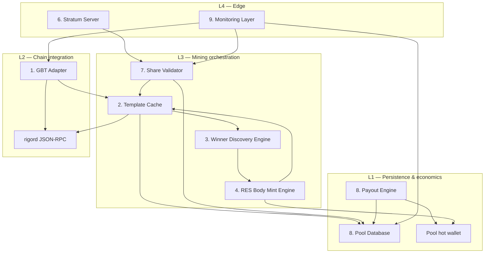
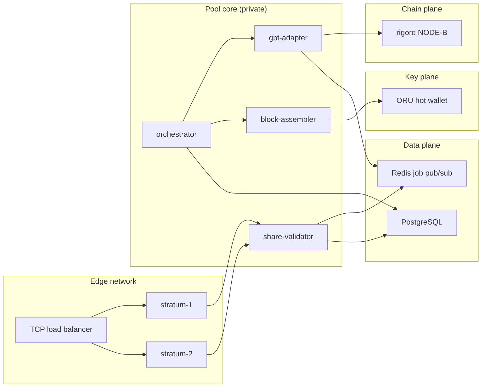
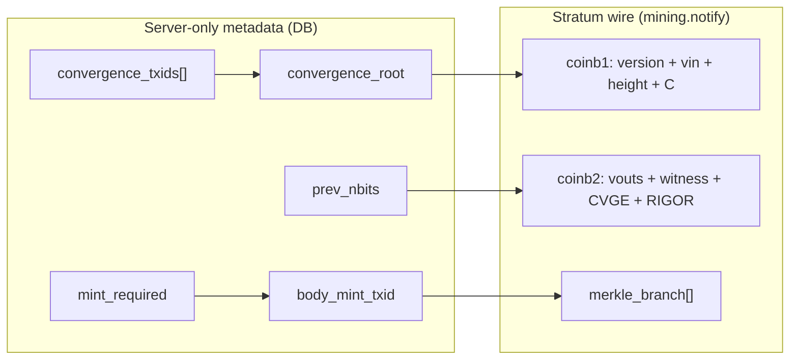
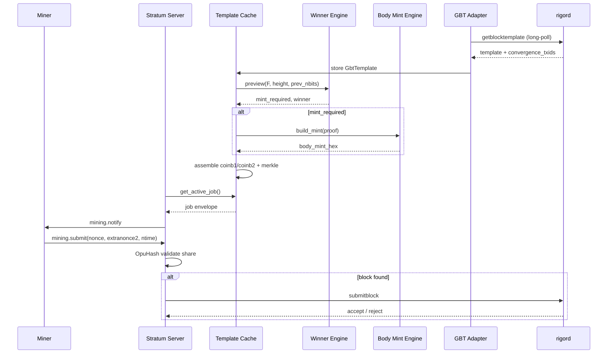
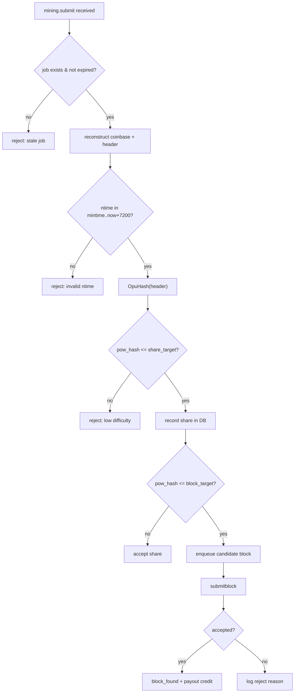
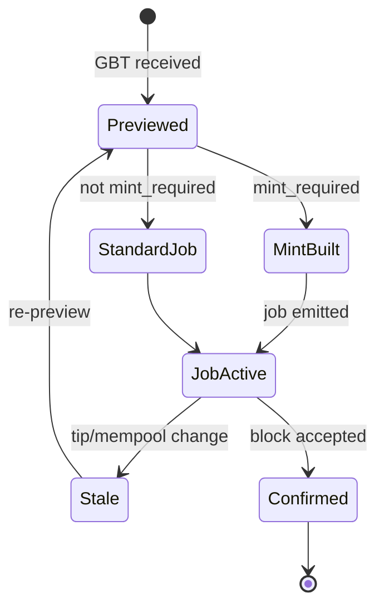
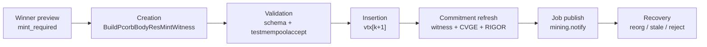
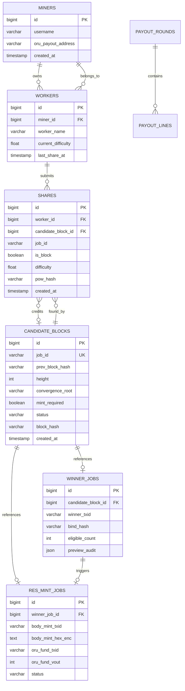
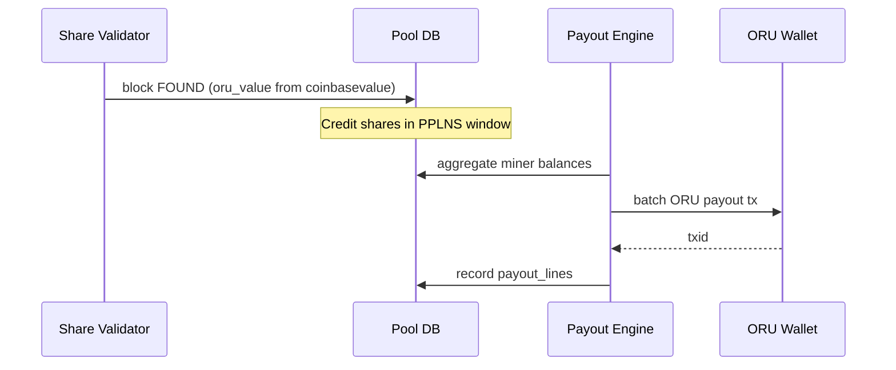
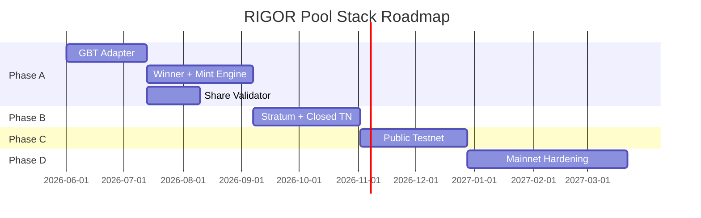

# RIGOR Pool Stack Architecture — Production Specification

**Task:** `TASK-MINING-002`  
**Constitution:** `TASK-CONSTITUTION-002` (INFRASTRUCTURE MODE)  
**Supersedes:** Simple Stratum-only design (`TASK-MINING-001` gap analysis)  
**Integrates:** `STRATUM_GAP_ANALYSIS.md`, `RES_BODY_MINT_ARCHITECTURE.md`, `RES_BODY_MINT_OPERATIONAL_SPEC.md`  
**Freeze compliance:** PROOF-031, PROOF-032, PROOF-033, PROOF-034, `MAINNET_PROTOCOL_FREEZE_DECLARATION`  
**Baseline:** `mainnet-freeze-rfc015-2026-05-26`  
**Status:** AUTHORITATIVE (documentation only — no implementation)

---

## Executive Summary

The **RIGOR Pool Stack** is a greenfield mining infrastructure layer that sits between `rigord` (frozen consensus + GBT) and OpuHash-capable miners. It **does not** reuse legacy `pool/` yiimp PoW or coinbase paths.

**Core invariant:** The pool is the **authoritative block assembler** for convergence-aware work. Miners mutate only header fields and witness extranonce; the pool owns winner preview, RES body mint, commitment regeneration, and `submitblock`.

| Principle | Source |
|-----------|--------|
| OpuHash PoW only | `pow_opus.cpp` (frozen) |
| Body mint off-node on testnet/mainnet | `RES_BODY_MINT_ARCHITECTURE.md` |
| `coinbasevalue` = ORU only | `mining-pool-gbt.md` |
| No consensus / protocol / mining rule changes | TASK-CONSTITUTION-002 |
| `equivalence_claimed = false` | PROOF-033 |

---

## SECTION 1 — Pool Stack Architecture

### 1.1 Layered architecture



### 1.2 Component specifications

#### 1. GBT Adapter

| Attribute | Specification |
|-----------|---------------|
| **Purpose** | Sole interface to `rigord` for block templates |
| **RPC** | `getblocktemplate '{"rules":["segwit"]}'` + long-poll |
| **Outputs** | Normalized `GbtTemplate` struct (all BIP22 + Rigor fields) |
| **Cadence** | Long-poll primary (60s node timeout); 30s poll fallback |
| **Guards** | Refuse if `initialblockdownload`; require `txindex` on node |
| **Does not** | Modify template semantics; call `generatetoaddress` in production |

**Frozen fields consumed:**

`previousblockhash`, `height`, `bits`, `prev_nbits`, `curtime`, `mintime`, `coinbasevalue`, `transactions[]`, `convergence_txids`, `default_witness_commitment`, `default_convergence_commitment`, `longpollid`, `mutable`, `weightlimit`.

#### 2. Template Cache

| Attribute | Specification |
|-----------|---------------|
| **Purpose** | Immutable job snapshots keyed by tip + mempool generation |
| **Key** | `SHA256(longpollid ‖ previousblockhash)` |
| **TTL** | `job_max_age_sec` (default 300); invalidated on tip change |
| **Stores** | Raw GBT JSON, derived `convergence_root`, winner preview result, assembled `coinb1`/`coinb2`, merkle branches, extranonce2_size |
| **Concurrency** | Read-heavy; single writer per `longpollid` generation |
| **Does not** | Mutate template after publish to Stratum |

#### 3. Winner Discovery Engine

| Attribute | Specification |
|-----------|---------------|
| **Purpose** | Deterministic replay of `CollectConvergenceWinnerTxid` |
| **Input** | `GbtTemplate` + parent block context |
| **Output** | `WinnerPreviewResult { mint_required, winner_txid?, C, B, eligible_count }` |
| **Reference** | `convergence_logic.cpp`, `auto_res_mint.cpp::EvaluateAutoResConvergenceDraw` |
| **Validation** | Cross-check `convergence_txids` vs deserialized `transactions[]` |
| **Does not** | Use GBT `bits` for draw inequality; does not call consensus RPC for unmined preview |

#### 4. RES Body Mint Engine

| Attribute | Specification |
|-----------|---------------|
| **Purpose** | Build, fund, validate body mint tx when `mint_required=true` |
| **Input** | `WinnerPreviewResult` + ORU UTXO + the winner's declared RES owner (A-5: read from the convergence tx, never from pool config). No mint key — the PCORB witness is unsigned (A-7) |
| **Output** | `BodyMintTx { raw_hex, txid, proof_audit }` |
| **Reference** | `RES_BODY_MINT_ARCHITECTURE.md`, `res_mint_witness.cpp` |
| **Preflight** | Optional `testmempoolaccept` |
| **Does not** | Hold any mint signing key; use devtest bootstrap funding on production |

#### 5. Stratum Server

| Attribute | Specification |
|-----------|---------------|
| **Purpose** | Stratum v1 TCP edge for miners |
| **Protocol** | `mining.subscribe`, `mining.authorize`, `mining.notify`, `mining.submit`, `mining.set_difficulty` |
| **Job source** | Template Cache (assembled block header + coinbase split) |
| **Does not** | Expose JSON-RPC credentials to miners; use Bitcoin SHA256d PoW |

#### 6. Share Validator

| Attribute | Specification |
|-----------|---------------|
| **Purpose** | Validate miner submissions at pool difficulty |
| **PoW** | OpuHash(header) — **not** SHA256d |
| **Paths** | Share target (pool diff) vs block target (network `bits`) |
| **Does not** | Re-validate convergence consensus (already in assembled template) |

#### 7. Pool Database

| Attribute | Specification |
|-----------|---------------|
| **Purpose** | Authoritative state for jobs, shares, blocks, payouts |
| **Engine** | PostgreSQL recommended (yiimp used MySQL — not reused) |
| **Schema** | Section 6 |

#### 8. Payout Engine

| Attribute | Specification |
|-----------|---------------|
| **Purpose** | ORU-denominated miner rewards from found blocks |
| **Model** | PPLNS (recommended — Section 7) |
| **Treasury** | RES body mint → pool RES treasury (separate from miner ORU payout) |
| **Does not** | Pay miners in RES from `coinbasevalue` (semantic mismatch) |

#### 9. Monitoring Layer

| Attribute | Specification |
|-----------|---------------|
| **Purpose** | Metrics, logs, alerts, dashboards |
| **Sources** | GBT Adapter, Share Validator, submitblock results, DB |
| **Spec** | Section 8 |

### 1.3 Service topology (deployment)



### 1.4 Process boundaries

| Service | Scaling | Stateful? |
|---------|---------|-----------|
| Stratum Server | Horizontal | Session state per connection |
| Share Validator | Horizontal | Stateless (job from Redis/DB) |
| GBT Adapter | **Single leader** per node | Long-poll connection |
| Block Assembler | Single leader | UTXO reservations |
| Payout Engine | Batch cron | DB transactions |

---

## SECTION 2 — Stratum Protocol

### 2.1 Protocol baseline

**Wire format:** Stratum v1 JSON-line TCP (unchanged — no protocol modification).

**Miner requirement:** OpuHash-capable client. Pool rejects unknown user-agents without `rigor` + `opushash` capability declaration.

### 2.2 Message: `mining.subscribe`

**Client → Server:**

```json
{"id": 1, "method": "mining.subscribe", "params": ["rigor-miner/1.0-opushash", null]}
```

**Server → Client:**

```json
{
  "id": 1,
  "result": [
    [["mining.set_difficulty", "subscription_id"], ["mining.notify", "subscription_id"]],
    "extranonce1_hex",
    extranonce2_size
  ],
  "error": null
}
```

| RIGOR policy | Rule |
|--------------|------|
| User-agent gate | Reject if agent lacks `opushash` marker (configurable allowlist) |
| `extranonce1` | Pool-unique per connection; encodes worker routing |
| `extranonce2_size` | Default 4 bytes; must fit witness reserved value budget |
| Extensions | **No new subscribe RPC methods** — capability via user-agent string only |

### 2.3 Message: `mining.authorize`

**Client → Server:**

```json
{"id": 2, "method": "mining.authorize", "params": ["worker_name", "password"]}
```

| RIGOR policy | Rule |
|--------------|------|
| Worker format | `account.worker` or `address.worker` |
| Password | Pool secret; **must not** encode ConvergenceRoot or winner data |
| Authorization | DB lookup `workers` table; rate-limit failures |

### 2.4 Message: `mining.notify`

**Server → Client (unsolicited):**

```json
{
  "id": null,
  "method": "mining.notify",
  "params": [
    "job_id_hex",
    "prevhash_hex_reversed",
    "coinb1_hex",
    "coinb2_hex",
    ["merkle_branch_hex", "..."],
    "version_hex",
    "nbits_hex",
    "ntime_hex",
    true
  ]
}
```

#### RIGOR-specific server-side job construction (not wire extensions)

These fields are **embedded in coinb1/coinb2** by the pool — miners see standard Stratum:

| RIGOR field | Where encoded | Miner mutable? |
|-------------|---------------|----------------|
| BIP34 height | `coinb1` (fixed per job) | **NO** |
| `convergence_root` (32 B) | `coinb1` scriptSig push #2 (fixed) | **NO** |
| Witness extranonce | Witness reserved value slot | **YES** (via extranonce2) |
| `prev_nbits` / RIGOR OP_RETURN | `coinb2` (fixed per job) | **NO** |
| CVGE OP_RETURN | `coinb2` (fixed per job) | **NO** |
| Body mint tx | **Not on wire** — already in merkle tree | **NO** |
| `convergence_txids` | Server metadata only (`winner_jobs` DB) | **NO** |



**`clean_jobs`:** `true` on every tip change, winner change, or `convergence_txids` change.

### 2.5 Message: `mining.submit`

**Client → Server:**

```json
{
  "id": 4,
  "method": "mining.submit",
  "params": ["worker_name", "job_id", "extranonce2", "ntime", "nonce"]
}
```

**Server → Client:**

```json
{"id": 4, "result": true, "error": null}
```

| Validation step | Action |
|-----------------|--------|
| 1 | Resolve `job_id` → Template Cache entry |
| 2 | Reconstruct coinbase = coinb1 + extranonce1 + extranonce2 + coinb2 |
| 3 | Rebuild merkle root from branch + coinbase hash |
| 4 | Assemble 80-byte header (version, prevhash, merkle, ntime, nbits, nonce) |
| 5 | `pow_hash = OpuHash(SHA256d(header))` |
| 6 | If `pow_hash ≤ share_target` → credit share |
| 7 | If `pow_hash ≤ block_target` → enqueue `submitblock` |

### 2.6 RIGOR interaction matrix (Stratum ↔ consensus fields)

| Consensus field | Stratum exposure | Pool responsibility |
|-----------------|------------------|---------------------|
| `convergence_txids` | **Hidden** — drives fixed `C` in coinb1 | Validate F; abort job on mismatch |
| `convergence_root` | **Fixed bytes in coinb1** | Compute once per job; never extranonce |
| `prev_nbits` | **Fixed in coinb2** RIGOR OP_RETURN | From GBT; never template `bits` |
| RES body mint | **In merkle tree** (tx data not sent) | Pool inserts before job emit |
| `bits` (PoW target) | `nbits` param in notify | OpuHash vs this target for block |
| `coinbasevalue` | ORU value in coinbase vout[0] | Payout engine ORU accounting only |

### 2.7 End-to-end Stratum sequence



---

## SECTION 3 — Share Validation

### 3.1 Difficulty model

| Term | Definition | Source |
|------|------------|--------|
| **Network difficulty** | Target from GBT `bits` | Node ASERT + OpuHash |
| **Block target** | `target = ExpandCompact(bits)` | Compare OpuHash digest |
| **Pool difficulty** | `share_target = block_target / pool_diff` | `mining.set_difficulty` |
| **Share difficulty** | Floating value per worker/session | VarDiff optional |

**OpuHash pipeline (mandatory):**

```
header_hash = SHA256d(serialize_80_byte_header)
pow_hash    = OpuHash(header_hash)    // pow_opus.cpp
valid_share = UintToArith256(pow_hash) <= share_target
valid_block = UintToArith256(pow_hash) <= block_target
```

### 3.2 Validation pipeline



### 3.3 Convergence-aware validation

Share validation **does not re-run** winner selection. Convergence correctness is enforced at **job creation**:

| Gate | When | Failure action |
|------|------|----------------|
| G-CV-01 | Job build | `convergence_txids` ⊄ transactions |
| G-CV-02 | Job build | `mint_required` but no body mint |
| G-CV-03 | Job build | coinb1 `C` ≠ computed root |
| G-CV-04 | submitblock | Node returns `bad-rigor-*` → invalidate job class |

**Post-submit audit:** `getconvergenceresult` confirms winner + mint on accepted blocks.

### 3.4 VarDiff policy (recommended defaults)

| Parameter | Default |
|-----------|---------|
| Target shares per worker per 60s | 20 |
| Min pool diff | 0.001 |
| Max pool diff | network_diff / 100 |
| Retarget interval | 120s |

---

## SECTION 4 — Winner Processing

### 4.1 Winner preview (pre-job)

**Trigger:** New `GbtTemplate` stored in Template Cache.

**Algorithm:** Identical to `RES_BODY_MINT_ARCHITECTURE.md` §3.

**Output record (`winner_jobs` table):**

| Field | Description |
|-------|-------------|
| `mint_required` | bool |
| `winner_txid` | nullable |
| `convergence_root` | 32-byte hex |
| `bind_hash` | 32-byte hex |
| `eligible_count` | int |
| `preview_at` | timestamp |

### 4.2 Winner confirmation (post-block)

**Trigger:** `submitblock` accepted.

```bash
rigor-cli getconvergenceresult <block_hash>
```

| Check | Match |
|-------|-------|
| `draw_winner_txid` | `winner_jobs.winner_txid` |
| Block contains body mint | if `mint_required` |

**Mismatch →** P1 alert `WinnerConfirmationDrift` (investigate pool bug; block already on chain).

### 4.3 Stale winner handling

| Event | Detection | Action |
|-------|-----------|--------|
| Mempool tx evicted | New GBT: `convergence_txids` changed | `clean_jobs=true`; rebuild |
| Winner changed | Preview diff | Cancel body mint signature draft; rebuild |
| Winner cleared | `mint_required: true → false` | Drop in-flight mint; standard job |
| Job TTL exceeded | `expires_at` | Mark `EXPIRED`; release UTXO |



### 4.4 Reorg handling

Integrated from `RES_BODY_MINT_OPERATIONAL_SPEC.md` §7:

1. Detect tip regression or `previousblockhash` change
2. `PAUSED_NEW_JOBS` mode
3. Mark `ACTIVE` jobs → `ORPHANED`
4. Release UTXO reservations
5. Re-fetch GBT; full preview pipeline
6. Resume with `clean_jobs=true`
7. Payout engine: orphan block credits rolled back (PPLNS natural fit)

---

## SECTION 5 — RES Body Mint Pipeline

### 5.1 Pipeline overview (no protocol changes)



### 5.2 Creation

| Step | Reference |
|------|-----------|
| Gather proof fields | `RES_BODY_MINT_ARCHITECTURE.md` §4.2 |
| Build 6-push PCORB witness (unsigned — A-7) | `res_mint_witness.cpp` |
| Fund ORU input | Pool hot wallet |
| Assemble tx v2 | `vout[0]` RES + `vout[1]` ORU change |

### 5.3 Validation

| Layer | Check |
|-------|-------|
| Schema | Amount = `RES_REWARD_AMOUNT`; ORU input domain |
| Local | `decoderawtransaction` round-trip |
| Policy | `testmempoolaccept` (optional) |
| Consensus | Deferred to `submitblock` |

### 5.4 Insertion

| Rule | Value |
|------|-------|
| Position | `vtx[k+1]` after GBT mempool txs |
| Count | Exactly 1 when `mint_required` |
| Coinbase | `scriptSig` = height ‖ C (unchanged by mint) |
| Regenerate | Witness commitment, CVGE, merkle root |

### 5.5 Recovery

| Failure | Recovery |
|---------|----------|
| `bad-rigor-res-winner-mismatch` | Halt convergence jobs; audit mint builder |
| `bad-rigor-res-proof` | Re-preview and rebuild the witness; re-derive proof fields against the current tip |
| Stale ORU UTXO | Release reservation; select new input |
| Reorg | §4.4 full pipeline reset |

---

## SECTION 6 — Pool Database

### 6.1 Entity relationship



### 6.2 Table schemas

#### `miners`

| Column | Type | Notes |
|--------|------|-------|
| `id` | BIGSERIAL PK | |
| `username` | VARCHAR(64) UNIQUE | |
| `oru_payout_address` | VARCHAR(128) | Witness v0/v1 ORU |
| `created_at` | TIMESTAMPTZ | |

#### `workers`

| Column | Type | Notes |
|--------|------|-------|
| `id` | BIGSERIAL PK | |
| `miner_id` | BIGINT FK → miners | |
| `worker_name` | VARCHAR(64) | |
| `password_hash` | VARCHAR(128) | Stratum auth |
| `current_difficulty` | DOUBLE | VarDiff |
| `last_share_at` | TIMESTAMPTZ | |
| UNIQUE | `(miner_id, worker_name)` | |

#### `shares`

| Column | Type | Notes |
|--------|------|-------|
| `id` | BIGSERIAL PK | |
| `worker_id` | BIGINT FK | |
| `candidate_block_id` | BIGINT FK nullable | Set on block find |
| `job_id` | VARCHAR(32) | Stratum job id |
| `share_diff` | DOUBLE | Pool difficulty |
| `is_block` | BOOLEAN | Block solution |
| `pow_hash` | VARCHAR(64) | OpuHash result |
| `ntime` | VARCHAR(8) | |
| `nonce` | VARCHAR(8) | |
| `created_at` | TIMESTAMPTZ | Indexed |

**Index:** `(worker_id, created_at DESC)` for PPLNS window.

#### `candidate_blocks`

| Column | Type | Notes |
|--------|------|-------|
| `id` | BIGSERIAL PK | |
| `job_id` | VARCHAR(32) UNIQUE | Stratum hex id |
| `gbt_longpollid` | VARCHAR(128) | |
| `prev_block_hash` | VARCHAR(64) | |
| `height` | INT | |
| `convergence_root` | VARCHAR(64) | |
| `mint_required` | BOOLEAN | |
| `status` | ENUM | `ACTIVE`, `FOUND`, `ORPHANED`, `EXPIRED`, `REJECTED` |
| `block_hash` | VARCHAR(64) nullable | |
| `submit_error` | TEXT nullable | |
| `created_at` | TIMESTAMPTZ | |

#### `winner_jobs`

| Column | Type | Notes |
|--------|------|-------|
| `id` | BIGSERIAL PK | |
| `candidate_block_id` | BIGINT FK UNIQUE | |
| `winner_txid` | VARCHAR(64) nullable | |
| `bind_hash` | VARCHAR(64) | |
| `eligible_count` | INT | |
| `convergence_txids` | JSONB | Snapshot of F |
| `preview_audit` | JSONB | σ values, eligibility flags |

#### `res_mint_jobs`

| Column | Type | Notes |
|--------|------|-------|
| `id` | BIGSERIAL PK | |
| `winner_job_id` | BIGINT FK | |
| `body_mint_txid` | VARCHAR(64) | |
| `body_mint_hex_enc` | BYTEA | Encrypted at rest |
| `oru_fund_txid` | VARCHAR(64) | |
| `oru_fund_vout` | INT | |
| `res_payout_script` | VARCHAR(256) | Audit record of the owner-declared payout actually built (A-5); not a policy input |
| `status` | ENUM | `DRAFT`, `BUILT`, `INSERTED`, `SPENT`, `FAILED` |

#### `payout_rounds` / `payout_lines` (Section 7)

| Table | Purpose |
|-------|---------|
| `payout_rounds` | One row per found block |
| `payout_lines` | Per-miner ORU credit |

#### `utxo_reservations`

| Column | Type | Notes |
|--------|------|-------|
| `txid` | VARCHAR(64) | |
| `vout` | INT | |
| `res_mint_job_id` | BIGINT FK | |
| `status` | ENUM | `RESERVED`, `SPENT`, `RELEASED` |

---

## SECTION 7 — Payout Architecture

### 7.1 Revenue sources (frozen semantics)

| Source | Asset | In `coinbasevalue`? | Miner payout? |
|--------|-------|---------------------|----------------|
| Block subsidy + ORU fees | ORU | **YES** | **YES** (PPLNS) |
| RES body mint (`GetResMintReward(h)`) | RES | **NO** | **NO** (pool treasury default) |
| RES mempool fees (coinbase vout) | RES | **NO** | **NO** |

### 7.2 Model comparison

| Model | Mechanism | ORU fit | Pool risk | Complexity |
|-------|-----------|---------|-----------|------------|
| **PPS** | Fixed pay per share regardless of blocks | Good | **HIGH** — orphans + invalid convergence blocks | Low |
| **PPLNS** | Pay ORU from last N shares when block found | **Best** | Medium — pays only on accepted blocks | Medium |
| **PROP** | Proportional in current round | Good | Medium — round boundary disputes | Low |

### 7.3 Recommendation: **PPLNS (ORU-only)**

**Rationale:**

1. `coinbasevalue` is ORU — natural PPLNS denomination
2. Convergence blocks have higher assembly risk (`bad-rigor-*`); PPS would expose pool to unrecoverable overpay
3. Orphan blocks pay zero automatically — aligns with reorg handling
4. RES treasury separable — no miner confusion about dual-asset rewards

**Parameters:**

| Parameter | Default |
|-----------|---------|
| PPLNS window | 8 × network difficulty shares (operator-tunable) |
| Min payout threshold | 0.01 ORU |
| Payout asset | **ORU only** |
| RES policy | Pool treasury; optional off-chain RES distribution (out of scope) |

### 7.4 Payout flow



### 7.5 ORU-only implications

| Topic | Policy |
|-------|--------|
| Miner dashboard | Show ORU earnings only; label RES as pool economics |
| Block finder bonus | Optional ORU bonus from pool fee (off-chain policy) |
| RES mint visibility | Informative; not in payout formula |
| Wallet addresses | Miners register ORU `rg1q…` addresses only |

---

## SECTION 8 — Monitoring

### 8.1 Required metrics

| Metric | Type | Description |
|--------|------|-------------|
| `rigor_pool_orphan_rate` | Gauge | `orphaned_blocks / submitted_blocks` |
| `rigor_pool_winner_rate` | Gauge | `mint_required_jobs / total_jobs` |
| `rigor_pool_res_mint_success_rate` | Gauge | `accepted_mint_blocks / mint_required_jobs` |
| `rigor_pool_stale_share_rate` | Gauge | `stale_shares / total_shares` |
| `rigor_pool_gbt_staleness_seconds` | Gauge | Time since last GBT |
| `rigor_pool_submitblock_reject_total` | Counter | By `bad-rigor-*` reason |
| `rigor_pool_opushash_validate_latency_ms` | Histogram | Share validation |
| `rigor_pool_active_workers` | Gauge | Connected workers |
| `rigor_pool_oru_treasury_balance` | Gauge | Hot wallet ORU |

### 8.2 Alert thresholds (P1)

| Alert | Condition |
|-------|-----------|
| OrphanRateHigh | orphan_rate > 5% over 1h |
| ResMintSuccessLow | res_mint_success_rate < 95% over 24h |
| StaleShareSpike | stale_share_rate > 20% over 15m |
| GbtStale | gbt_staleness > 120s |
| ConvergenceReject | any `bad-rigor-res-winner-mismatch` |

### 8.3 Dashboard panels

1. Chain sync + GBT health
2. Winner / mint funnel (preview → build → submit → confirm)
3. OpuHash share rate + block find rate
4. Reject reason breakdown
5. ORU payout pipeline + RES treasury balance

---

## SECTION 9 — Security Review

### 9.1 Threat model

| Actor | Capability |
|-------|------------|
| External miner | Stratum submit only |
| Compromised miner | Flood shares / stale jobs |
| Network attacker | MITM Stratum (if no TLS) |
| Insider | DB / wallet / HSM access |
| Chain attacker | Reorg, mempool manipulation |

### 9.2 Attack surfaces

| Surface | Risk | Mitigation |
|---------|------|------------|
| Stratum TCP | Credential theft | TLS wrapper (stunnel); IP allowlist option |
| JSON-RPC to rigord | Block submission abuse | Localhost bind; dedicated RPC user |
| ORU hot wallet | Fund theft | Min balance; multi-sig (phase D) |
| Template manipulation | Invalid blocks / rejects | Immutable Template Cache; audit logs |
| Share replay | Double credit | Job-bound extranonce + job expiry |
| Pool diff manipulation | Economic exploit | VarDiff bounds; audit trail |
| `convergence_txids` spoofing | Internal bug only | Cross-validation gate G-CV-01 |

### 9.3 Security controls (required)

| Control | Phase |
|---------|-------|
| RPC least-privilege user | A |
| Stratum TLS | C |
| ORU treasury multi-sig | D |
| Rate limits on authorize failures | A |
| Encrypted `body_mint_hex` at rest | B |
| `PAUSED_NEW_JOBS` kill switch | A |

### 9.4 Freeze compliance security note

Pool stack **must not** implement draw equivalence claims or modify frozen consensus paths (PROOF-033 non-closability). Winner preview is **replay**, not re-interpretation.

---

## SECTION 10 — Roadmap

### Phase A — Reference implementation (8–10 weeks)

| Deliverable | Exit criteria |
|-------------|---------------|
| `rigor-gbt` adapter library | Parses all frozen GBT fields; long-poll |
| Winner engine port | Golden tests vs `convergence_logic.cpp` |
| Body mint engine port | Golden tests vs `res_mint_witness.cpp` |
| Block assembler | Non-convergence `submitblock` accept on regtest/devtest |
| Share validator | OpuHash golden vector CI |
| PostgreSQL schema | Migrations for Section 6 |
| CLI tools | `rigor-pool-dump-job`, `rigor-pool-submit` |

### Phase B — Closed testnet (6–8 weeks)

| Deliverable | Exit criteria |
|-------------|---------------|
| Stratum server v1 | ≥2 miners connected |
| Convergence block | ≥1 `submitblock` with body mint accepted |
| Reorg drill | Runbook §4.4 executed |
| Monitoring | All Section 8 metrics live |
| Soak | 72h continuous mining per `CLOSED_TESTNET_MINER_SETUP.md` |

### Phase C — Public testnet (6–8 weeks)

| Deliverable | Exit criteria |
|-------------|---------------|
| Stratum TLS | Production config |
| PPLNS payout | ≥1 payout batch executed |
| Public docs | Operator + miner guides |
| E1–E5 explorer alignment | Mint visible in explorer-indexer |
| Incident runbooks | Published |

### Phase D — Mainnet readiness (ongoing)

| Deliverable | Exit criteria |
|-------------|---------------|
| HSM custody | ORU multi-sig (mint-key custody struck by A-7) |
| Load test | Target worker count |
| External audit | Pool backend security review |
| `MINING_CONTRACT_CPUMINER_COMPAT_v*.md` | Published |
| GO/NO-GO | Mining infra sign-off independent of PROOF-033 |



---

## Risk Matrix

| ID | Risk | L | I | Mitigation | Phase |
|----|------|---|---|------------|-------|
| RK-01 | Legacy yiimp accidentally deployed | M | CRIT | Block in ops; CI guard | A |
| RK-02 | OpuHash mismatch | M | CRIT | Golden vectors in CI | A |
| RK-03 | Body mint missing | H | HIGH | `mint_required` gate | A |
| RK-04 | scriptSig extranonce | M | CRIT | Fixed coinb1 layout review | A |
| RK-05 | Stale CVGE | H | HIGH | Commitment regenerator | A |
| RK-06 | Ed25519 mint key leak | — | — | **ELIMINATED** by SECURITY-001-A / A-7 — the mint witness carries no signature and the pool holds no mint key, so there is nothing to leak | — |
| RK-07 | PPS economic drain | M | HIGH | Use PPLNS only | C |
| RK-08 | Reorg payout drift | M | MED | PPLNS + orphan rollback | B |
| RK-09 | GBT long-poll stall | M | MED | Poll fallback + alert | A |
| RK-10 | Miner incompatible (SHA256d) | H | HIGH | User-agent gate | B |

---

## Legacy `pool/` disposition

| Item | Decision |
|------|----------|
| yiimp Stratum C++ | **Do not adapt** — reference only for Stratum wire format |
| yiimp PHP web | Optional future admin UI — **not** mining path |
| yiimp MySQL schema | **Do not migrate** — use Section 6 PostgreSQL schema |

---

## Document index

| Document | Role |
|----------|------|
| `STRATUM_GAP_ANALYSIS.md` | Gap analysis (TASK-MINING-001) |
| `RES_BODY_MINT_ARCHITECTURE.md` | Body mint architecture (TASK-RESMINT-001) |
| `RES_BODY_MINT_OPERATIONAL_SPEC.md` | Operational runbooks (TASK-RESMINT-001) |
| `core/doc/mining-pool-gbt.md` | Normative GBT wire contract |
| `core/doc/miner-opushash.md` | OpuHash miner guide |

---

## Required Output Table

| Field | Status |
|-------|--------|
| **Pool Architecture** | **COMPLETE** |
| **Stratum Architecture** | **COMPLETE** |
| **Winner Engine** | **COMPLETE** |
| **RES Body Mint Integration** | **COMPLETE** |
| **Database Model** | **COMPLETE** |
| **Payout Model** | **COMPLETE** |
| **Security Review** | **COMPLETE** |
| **Architecture Impact** | **NONE** |
| **Consensus Impact** | **NONE** |
| **Protocol Impact** | **NONE** |
| **Freeze Impact** | **NONE** |
| **Equivalence Claimed** | **false** |

---

*End of RIGOR_POOL_STACK_ARCHITECTURE.md — TASK-MINING-002*
