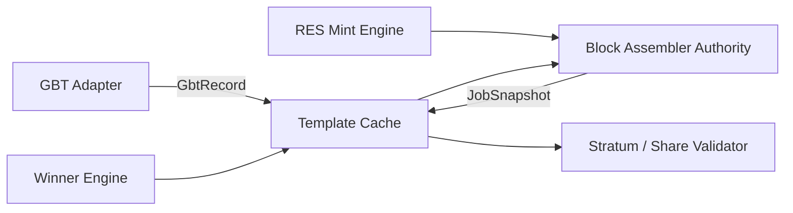
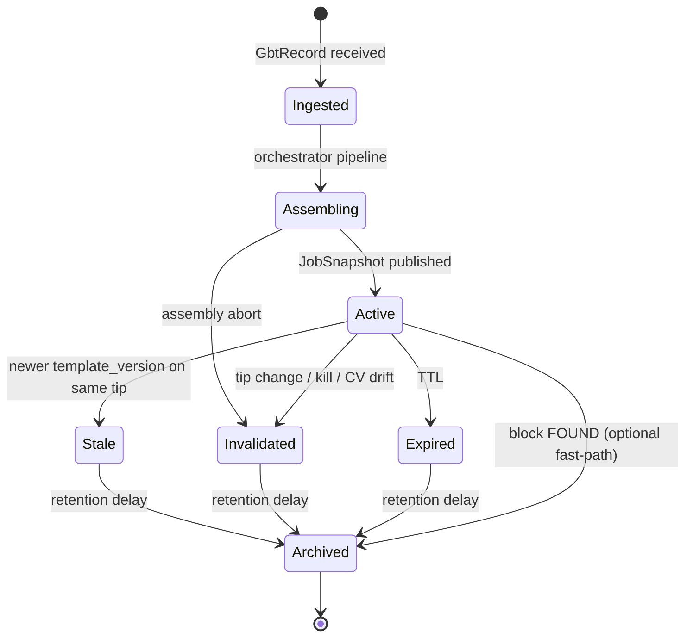
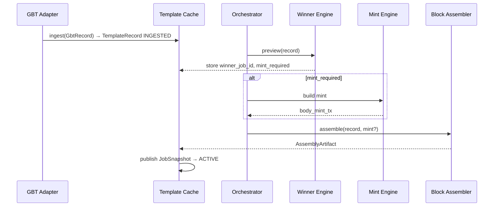
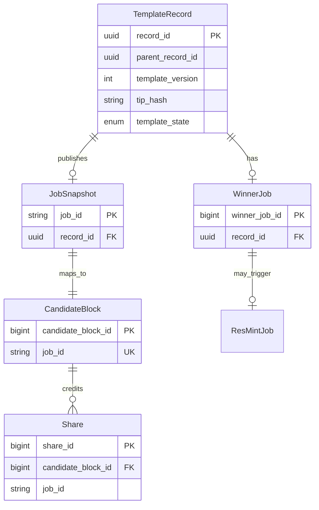
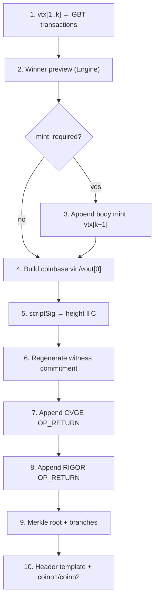
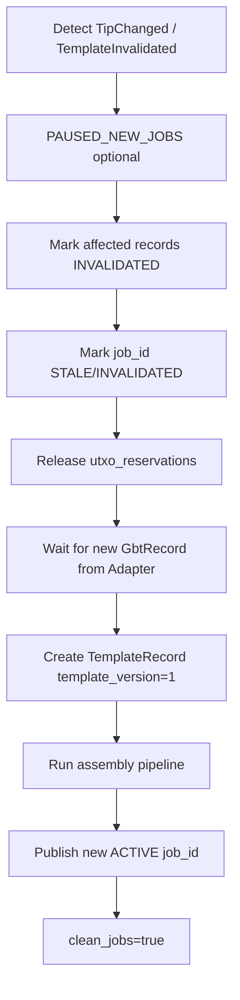
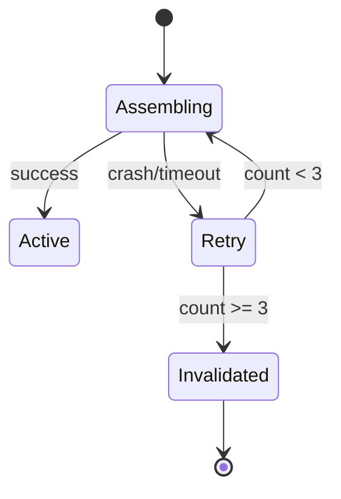

# Template Cache & Block Assembler — Implementation Specification

**Task:** `TASK-MINING-005`  
**Constitution:** `TASK-CONSTITUTION-002` (INFRASTRUCTURE MODE)  
**Parent documents:**

- `RIGOR_GBT_ADAPTER_SPEC.md` (TASK-MINING-004)
- `RIGOR_POOL_STACK_ARCHITECTURE.md` (TASK-MINING-002)
- `RIGOR_POOL_ARCHITECTURE_AUDIT.md` (TASK-MINING-003)
- `RES_BODY_MINT_ARCHITECTURE.md` (TASK-RESMINT-001)
- `core/doc/mining-pool-gbt.md`

**Freeze compliance:** PROOF-031–034, `MAINNET_PROTOCOL_FREEZE_DECLARATION`  
**Baseline:** `mainnet-freeze-rfc015-2026-05-26`  
**Status:** AUTHORITATIVE IMPLEMENTATION-FACING SPEC (documentation only)

---

## SECTION 1 — Purpose

### 1.1 Roles in the pool stack



| Component | Role |
|-----------|------|
| **Template Cache** | Persistent authority for template lineage, job identity, and published `JobSnapshot` immutability |
| **Block Assembler Authority** | Sole owner of coinbase assembly, vtx ordering with body mint, commitment regeneration, merkle/header materialization |

### 1.2 Responsibility summary

| Owns | Template Cache | Block Assembler |
|------|----------------|-----------------|
| `TemplateRecord` lifecycle | ✅ | ❌ |
| `job_id` assignment | ✅ | ❌ |
| `JobSnapshot` publication | ✅ | produces bytes |
| `GbtRecord` storage (immutable) | ✅ | read-only |
| Winner / mint **results** linkage | ✅ stores FK | ❌ computes |
| Coinbase `scriptSig` bytes | ❌ | ✅ |
| ConvergenceRoot in coinbase | ❌ | ✅ inserts |
| CVGE / RIGOR OP_RETURN | ❌ | ✅ |
| Body mint vtx position | ❌ | ✅ inserts |
| Merkle branches + coinb1/coinb2 | ❌ | ✅ |
| 80-byte header template | ❌ | ✅ (minus live nonce) |

### 1.3 Authority boundaries

| Boundary | Rule |
|----------|------|
| Adapter → Cache | Cache **accepts or rejects** `GbtRecord`; never re-fetches GBT |
| Cache → Assembler | Assembler receives **frozen** `TemplateRecord` + mint artifacts |
| Assembler → Cache | Assembler returns `AssemblyArtifact`; Cache publishes `JobSnapshot` |
| Cache → Stratum/Validator | **Read-only** `JobSnapshot`; no in-place mutation |
| Validator → rigord | `submitblock` uses bytes derived from `JobSnapshot` + miner deltas |

**Neither Template Cache nor Block Assembler** holds consensus authority. Both are **proposers**; `ConnectBlock` adjudicates.

---

## SECTION 2 — Template Cache Model

### 2.1 `TemplateRecord`

Canonical cache row wrapping one adapter snapshot and its derivatives.

| Field | Type | Mutable? | Description |
|-------|------|----------|-------------|
| `record_id` | UUID | **IMMUTABLE** | Primary key; equals GBT Adapter `GbtRecord.record_id` |
| `parent_record_id` | UUID nullable | **IMMUTABLE** | Prior record on same tip (mempool generation change) |
| `template_version` | UINT | **IMMUTABLE** | Monotonic per `tip_hash`; starts at 1 |
| `tip_hash` | hex32 | **IMMUTABLE** | `getbestblockhash` at ingest |
| `previousblockhash` | hex32 | **IMMUTABLE** | GBT field — work anchor |
| `longpollid` | string | **IMMUTABLE** | GBT invalidation token |
| `height` | int | **IMMUTABLE** | Next block height |
| `template_state` | enum | **state machine** | See §2.2 |
| `gbt_payload_hash` | hex32 | **IMMUTABLE** | SHA256 canonical GbtRecord JSON |
| `mint_required` | bool nullable | set once at assembly | From Winner Engine |
| `winner_job_id` | FK nullable | set once | Links convergence preview |
| `job_id` | FK nullable | set on publish | Stratum-facing id |
| `candidate_block_id` | FK nullable | set on publish | DB block candidate row |
| `created_at` | timestamp | **IMMUTABLE** | |
| `state_changed_at` | timestamp | updates on transition | |

### 2.2 `template_state` values

| State | Meaning | Stratum may use? |
|-------|---------|------------------|
| **ACTIVE** | `JobSnapshot` published; work valid | ✅ |
| **STALE** | Superseded on same tip by newer `template_version` | ❌ (reject shares) |
| **INVALIDATED** | Tip change, manual kill, validation failure | ❌ |
| **EXPIRED** | TTL exceeded | ❌ |
| **ARCHIVED** | Terminal; retained for audit only | ❌ |

### 2.3 State machine



### 2.4 `template_version` rules

| Event | `template_version` |
|-------|-------------------|
| New `tip_hash` | Reset to **1** |
| Same `tip_hash`, new `longpollid` | **parent_record_id** = old `record_id`; version = parent.version + 1 |
| Same `longpollid` duplicate ingest | Dedup — no new record |

### 2.5 `JobSnapshot` (published artifact)

Immutable once `ACTIVE`:

| Field | Source |
|-------|--------|
| `job_id` | Template Cache |
| `record_id` | Template Cache |
| `coinb1_hex`, `coinb2_hex` | Block Assembler |
| `merkle_branch[]` | Block Assembler |
| `version`, `nbits`, `ntime`, `prevhash` | GbtRecord + Assembler |
| `share_diff` | Template Cache / VarDiff |
| `block_target` | GbtRecord `bits` |
| `mint_required` | Winner Engine |
| `convergence_root` | Block Assembler (bytes in coinb1) |
| `body_mint_txid` | Mint Engine (nullable) |
| `assembly_hash` | SHA256(full vtx + coinbase template) |

---

## SECTION 3 — Cache Ownership

### 3.1 Ownership matrix

| Action | GBT Adapter | Template Cache | Orchestrator | Winner Engine | Mint Engine | Block Assembler | Stratum | Share Validator |
|--------|-------------|----------------|--------------|---------------|-------------|-----------------|---------|-----------------|
| Create `GbtRecord` | ✅ | ❌ | ❌ | ❌ | ❌ | ❌ | ❌ | ❌ |
| Create `TemplateRecord` | ❌ | ✅ | triggers | ❌ | ❌ | ❌ | ❌ | ❌ |
| Update `template_state` | ❌ | ✅ | ❌ | ❌ | ❌ | ❌ | ❌ | ❌ |
| Set `mint_required` | ❌ | ✅ stores | ✅ invokes | ✅ computes | ❌ | ❌ | ❌ | ❌ |
| Assign `job_id` | ❌ | ✅ | ❌ | ❌ | ❌ | ❌ | ❌ | ❌ |
| Publish `JobSnapshot` | ❌ | ✅ | ❌ | ❌ | ❌ | provides | ❌ | ❌ |
| Invalidate records | emit event | ✅ | ❌ | ❌ | ❌ | ❌ | ❌ | ❌ |
| Archive records | ❌ | ✅ | ❌ | ❌ | ❌ | ❌ | ❌ | ❌ |
| Read `JobSnapshot` | ❌ | ✅ | ✅ | ❌ | ❌ | ✅ | ✅ | ✅ |
| Mutate `JobSnapshot` | ❌ | ❌ | ❌ | ❌ | ❌ | ❌ | ❌ | ❌ |
| Mutate `GbtRecord` | ❌ | ❌ | ❌ | ❌ | ❌ | ❌ | ❌ | ❌ |

### 3.2 Who may **never** modify

| Actor | Forbidden mutations |
|-------|---------------------|
| **GBT Adapter** | `job_id`, `JobSnapshot`, coinbase bytes, `template_state` |
| **Block Assembler** | `TemplateRecord` state, `GbtRecord`, `job_id` |
| **Stratum Server** | Any cache record |
| **Share Validator** | Any cache record (read-only + submit) |
| **Miners** | All cache/assembler fields except live header nonce/time/witness |

### 3.3 Write path (canonical)



---

## SECTION 4 — Job Identity Model

### 4.1 Identifier definitions

| ID | Owner | Uniqueness | Lifetime |
|----|-------|------------|----------|
| **`record_id`** | GBT Adapter → Cache | Global UUID | Permanent (audit) |
| **`job_id`** | Template Cache | Unique per published `JobSnapshot` | ACTIVE → STALE/INVALIDATED/EXPIRED → ARCHIVED |
| **`share_id`** | Share Validator / DB | Unique per accepted share | Permanent; `stale` flag on reorg |
| **`candidate_block_id`** | Pool DB | Unique per `job_id` | Created at publish; links to block find |
| **`winner_job_id`** | Winner Engine / DB | Unique per `record_id` | Tied to convergence preview row |

### 4.2 Relationship diagram



### 4.3 Uniqueness constraints

| Constraint | Rule |
|------------|------|
| UK-01 | At most one `ACTIVE` `TemplateRecord` per `previousblockhash` per pool instance |
| UK-02 | `job_id` unique globally (not reused after ARCHIVED) |
| UK-03 | `record_id` 1:1 with ingested `GbtRecord` |
| UK-04 | `winner_job_id` 1:1 with `record_id` |
| UK-05 | `candidate_block_id` 1:1 with `job_id` |

### 4.4 Reorg behavior (identifiers)

| Event | `record_id` | `job_id` | `share_id` | `candidate_block_id` | `winner_job_id` |
|-------|-------------|----------|------------|----------------------|-----------------|
| New tip | new records | new `job_id` | unchanged (historical) | new rows | new previews |
| 1-block reorg | old → INVALIDATED | old → INVALIDATED | mark `stale=true` if job invalidated | `ORPHANED` | kept for audit |
| Deep reorg | bulk INVALIDATED | bulk INVALIDATED | stale flags | bulk ORPHANED | kept |
| Winner change (same tip) | new `record_id` | new `job_id` | old shares stay on old `job_id` | new candidate row | new `winner_job_id` |

**Rule:** `job_id` **never** recycled — prevents share replay ambiguity.

---

## SECTION 5 — Block Assembler Authority

### 5.1 Layer ownership matrix

| Construction step | Owner | Input authority | Output |
|-------------------|-------|-----------------|--------|
| **Coinbase construction** (vin, vout skeleton) | Block Assembler | `coinbasevalue`, pool payout script | `CMutableTransaction` coinbase |
| **ConvergenceRoot insertion** (`scriptSig` push #2) | Block Assembler | sorted F from `convergence_txids` | 32 bytes in coinb1 |
| **BIP34 height push** (`scriptSig` push #1) | Block Assembler | GBT `height` | coinb1 |
| **CVGE commitment** | Block Assembler | recomputed draw candidate root | coinb2 OP_RETURN |
| **RIGOR commitment** | Block Assembler | GBT `prev_nbits` LE32 | coinb2 OP_RETURN |
| **Body mint insertion** | Block Assembler | Mint Engine `body_mint_tx` | `vtx[k+1]` |
| **Witness commitment regen** | Block Assembler | full vtx[] | witness merkle → commitment |
| **Merkle rebuild** | Block Assembler | coinbase + vtx[] | `merkle_branch[]`, root |
| **Header construction** | Block Assembler | version, prevhash, merkle, nbits, curtime | 76-byte prefix; nonce placeholder |
| **coinb1 / coinb2 split** | Block Assembler | extranonce gap in witness | Stratum wire |
| **Winner preview** | Winner Engine | **not assembler** | `mint_required` |
| **Body mint signing** | Mint Engine | **not assembler** | raw tx hex |

### 5.2 Assembly pipeline (ordered)



### 5.3 Authority boundary: Assembler vs Cache

| Artifact | Producer | Consumer | Cache stores? |
|----------|----------|----------|---------------|
| `AssemblyArtifact` | Block Assembler | Template Cache | ✅ in `JobSnapshot` |
| `TemplateRecord` state | Template Cache | Orchestrator | ✅ |
| `GbtRecord` | GBT Adapter | Assembler (read) | ✅ embedded |

**Block Assembler MUST NOT** transition `template_state` or assign `job_id`.

### 5.4 vtx canonical layout (assembler output)

```
vtx[0]   = coinbase (ORU vout[0], optional RES fee vouts, witness, CVGE, RIGOR)
vtx[1..k]= GBT transactions (order preserved from GbtRecord)
vtx[k+1] = body RES mint (iff mint_required)
```

---

## SECTION 6 — Immutable vs Mutable Fields

### 6.1 Classification legend

| Class | Meaning |
|-------|---------|
| **IMMUTABLE** | Fixed for `job_id` lifetime; change requires new `job_id` |
| **POOL_MUTABLE** | Pool/assembler sets at job publish; miners cannot change |
| **MINER_MUTABLE** | Miner may change per share submit (within consensus bounds) |

### 6.2 Block / header fields

| Field | Class | Notes |
|-------|-------|-------|
| `version` | IMMUTABLE | Per `job_id` |
| `previousblockhash` / prevhash | IMMUTABLE | Work anchor |
| `bits` | IMMUTABLE | Network PoW target |
| `prev_nbits` | IMMUTABLE | RIGOR payload source |
| `height` | IMMUTABLE | BIP34 + proof binding |
| `mintime` | IMMUTABLE | Lower bound only |
| `curtime` (template default) | POOL_MUTABLE | Assembler suggests; miner may adjust |
| `nTime` (submitted) | MINER_MUTABLE | ∈ `[mintime, now+7200]` |
| `nNonce` | MINER_MUTABLE | PoW search |
| `merkle root` | IMMUTABLE | Fixed for `job_id` given extranonce slot |
| `target` (expanded) | IMMUTABLE | Derived from `bits` |

### 6.3 Transaction package

| Field | Class | Notes |
|-------|-------|-------|
| `transactions[]` (GBT package) | IMMUTABLE | Pool may **append** body mint only |
| `transactions[].data` | IMMUTABLE | No edits |
| `convergence_txids` | IMMUTABLE | Drives C |
| `body_mint_tx` | IMMUTABLE | Once inserted for `job_id` |
| `coinbasevalue` | IMMUTABLE | ORU vout[0] value |

### 6.4 Coinbase fields

| Field | Class | Notes |
|-------|-------|-------|
| `scriptSig` height push | IMMUTABLE | |
| `scriptSig` ConvergenceRoot | IMMUTABLE | **Not extranonce** |
| `scriptSig` extra pushes | **FORBIDDEN** | — |
| `vout[0].nValue` | IMMUTABLE | = `coinbasevalue` |
| `vout[0].scriptPubKey` | POOL_MUTABLE | Pool payout; fixed per `job_id` |
| Witness commitment script | IMMUTABLE | After assembly |
| CVGE OP_RETURN payload | IMMUTABLE | Per `job_id` |
| RIGOR OP_RETURN payload | IMMUTABLE | `prev_nbits` bytes |
| Witness reserved / extranonce | MINER_MUTABLE | Via extranonce2 |
| `coinbaseaux` merges | POOL_MUTABLE | Pre-publish only |

### 6.5 Derived / metadata

| Field | Class | Notes |
|-------|-------|-------|
| `convergence_root` C | IMMUTABLE | Bytes in coinb1 |
| `bind_hash` | IMMUTABLE | Preview binding |
| `winner_txid` | IMMUTABLE | Per `job_id` |
| `mint_required` | IMMUTABLE | Per `job_id` |
| `job_id` | IMMUTABLE | Identifier |
| `share_diff` | POOL_MUTABLE | VarDiff may change between jobs, not mid-job |
| `coinb1` / `coinb2` | IMMUTABLE | Except extranonce gap filled at submit |

### 6.6 MINER_MUTABLE summary

Miners may only alter: **`nNonce`**, **`nTime`** (bounded), **witness extranonce2** (and pool extranonce1 at connection). Any other change → new invalid share (not new `job_id`).

---

## SECTION 7 — Reorganization Rules

### 7.1 Scenario matrix

| Scenario | Template Cache | Block Assembler | Winner / Mint |
|----------|----------------|-----------------|---------------|
| **New tip** (extend chain) | INVALIDATE all non-matching `tip_hash`; ingest new `record_id` v1 | No carry-over; fresh assembly | Full re-preview |
| **1-block reorg** | All ACTIVE/STALE on orphaned tip → INVALIDATED; ARCHIVED after delay | Drop in-flight assembly | Release UTXO reservations |
| **Deep reorg** | Bulk INVALIDATE by `tip_hash` not on mainchain; alert P1 | Same | Same |
| **Winner invalidation** (mempool) | New `template_version`; old → STALE | Re-assemble; new `job_id` | New preview + optional re-mint |
| **Body mint invalidation** (submit reject) | ACTIVE → INVALIDATED for convergence class | Re-assemble with new mint tx | New sign |
| **Cache rebuilding** | Re-ingest from adapter events only — **never** synthesize GBT | Re-run pipeline on new `record_id` | Re-run |

### 7.2 Cache rebuilding procedure



### 7.3 STALE vs INVALIDATED

| Transition | Trigger | Miner behavior |
|------------|---------|--------------|
| ACTIVE → STALE | New `template_version` on **same** `previousblockhash` | Reject shares; issue new notify |
| ACTIVE → INVALIDATED | Tip change, corruption, mint reject class | Reject shares; `clean_jobs` |
| ACTIVE → EXPIRED | TTL | Reject shares |

### 7.4 Deep reorg (≥2 blocks)

| Step | Action |
|------|--------|
| 1 | Walk `candidate_blocks` where `block_hash` no longer on mainchain |
| 2 | Mark `ORPHANED`; reverse `payout_rounds` per TASK-MINING-003 REORG-01 |
| 3 | Invalidate all `TemplateRecord` with `tip_hash` not at best tip |
| 4 | Do not delete `share_id` rows — set `stale=true` |

---

## SECTION 8 — Failure Recovery

### 8.1 Failure matrix

| Failure | Detection | Template Cache | Block Assembler | Recovery |
|---------|-----------|----------------|-----------------|----------|
| **Cache corruption** | `assembly_hash` mismatch, bad coinb1 parse | Mark record INVALIDATED; alert P1 | Re-run assembly from `GbtRecord` | New `job_id` |
| **Redis loss** | Pub/sub down | DB-canonical read path (CC-04) | Stateless — OK | Rehydrate Redis from DB `JobSnapshot` |
| **PostgreSQL loss** | DB unreachable | Cannot publish jobs; PAUSED_NEW_JOBS | Complete assembly but cannot publish | Queue bounded in-memory; restore from backup |
| **Assembler crash** | Pipeline timeout | `Assembling` → INVALIDATED or retry | Idempotent re-run same `record_id` | Orchestrator retry ≤3 |
| **rigord restart** | Adapter Degraded event | Keep ACTIVE jobs until TTL | No new assembly until new `GbtRecord` | Invalidate all on fresh tip mismatch |
| **Template replay** | Duplicate `record_id` ingest | Dedup by `record_id` UK | N/A | Ignore duplicate |
| **Split-brain leader** | Two ACTIVE jobs same `previousblockhash` | **Forbidden** — UK-01 enforcement | N/A | Fencing token on leader (Phase B) |

### 8.2 Template replay policy

| Case | Behavior |
|------|----------|
| Same `record_id` re-delivered | No-op; return existing `TemplateRecord` |
| Same `longpollid`, new `record_id` | **Reject** — adapter bug; alert |
| Same `longpollid`, crash before ACTIVE | Retry assembly on same `record_id` |

### 8.3 Assembler crash recovery



### 8.4 Data authority during outages

| Store | Source of truth when degraded |
|-------|------------------------------|
| `JobSnapshot` | **PostgreSQL** (Redis optional cache) |
| `GbtRecord` | Embedded in `TemplateRecord.gbt_payload_hash` + cold storage |
| In-flight assembly | **Discard** — rebuild from `GbtRecord` |

---

## SECTION 9 — Audit Review

### 9.1 TASK-MINING-003 finding resolution

| Audit ID | Finding | Resolved by this spec? |
|----------|---------|------------------------|
| P-01 | Block Assembler implicit | ✅ §1, §5 explicit authority |
| P-02 | Auxiliary RPCs | ✅ (GBT Adapter spec); Cache consumes result |
| P-07 | Atomic job publish | ✅ §3 write path; §8 Redis/DB |
| P-08 | Payout reversal on reorg | ⚠️ Referenced §7.4 — payout out of scope |
| P-09 | GBT leader failover | ⚠️ Phase B — fencing noted §8 |
| P-10 | Duplicate block find | ⚠️ Share Validator — `candidate_block_id` unique |
| REORG-01 | PPLNS reversal | ⚠️ Flagged §7.4 — payout engine spec |
| REORG-05 | stale_share flag | ✅ §7.4 `share_id stale` |

### 9.2 Risk register cross-check (RK-01–RK-20)

| RK | Description | Mitigation in this spec | Status |
|----|-------------|-------------------------|--------|
| RK-01 | Legacy yiimp | Out of scope — architecture bans | ✅ N/A here |
| RK-02 | OpuHash mismatch | Validator not in scope | Open (Share Validator spec) |
| RK-03 | Body mint missing | §5 pipeline gate; `mint_required` | ✅ |
| RK-04 | scriptSig extranonce | §6 IMMUTABLE C; coinb1 layout | ✅ |
| RK-05 | Stale CVGE | §5 regen after mint | ✅ |
| RK-06 | Ed25519 leak | Mint Engine scope | Open (ops) |
| RK-07 | GBT leader SPOF | §8 rigord restart | ⚠️ Partial |
| RK-08 | Redis split-brain | §8 DB canonical; CC-04 | ✅ |
| RK-09 | PostgreSQL outage | §8 PAUSED_NEW_JOBS | ✅ |
| RK-10 | Incompatible miner | Stratum scope | Open |
| RK-11 | ORU witness ordering | Mint Engine + Assembler insert | ⚠️ Cross-ref RESMINT-001 |
| RK-12 | Duplicate block find | UK-05 `candidate_block_id` | ⚠️ Partial |
| RK-13 | Deep reorg PPLNS | §7.4 reference | ⚠️ Open |
| RK-14 | OpuHash CPU | Out of scope | Open |
| RK-15 | Pool avoids convergence | Monitoring | Open |
| RK-16 | convergence_txids bug | IMMUTABLE F; adapter validated | ✅ |
| RK-17 | Stratum cleartext | Out of scope | Open |
| RK-18 | Preview race | §7 winner invalidation; narrow window | ✅ |
| RK-19 | ORU treasury empty | Mint Engine | Open |
| RK-20 | Equivalence creep | Preview replay only | ✅ |

### 9.3 Remaining risks (post-spec)

| ID | Risk | Owner spec |
|----|------|------------|
| RR-01 | Share Validator + OpuHash golden tests | TASK-MINING-006 (future) |
| RR-02 | PPLNS `payout_rounds` reversal detail | Payout Engine spec |
| RR-03 | GBT leader HA + fencing | Phase B ops |
| RR-04 | Production ORU+PCORB witness stack | RESMINT-001 §4.4 implementation test |
| RR-05 | Duplicate simultaneous block finds | Share Validator idempotent submit |

---

## SECTION 10 — Freeze Assessment

### 10.1 Classification definitions

| Class | Meaning |
|-------|---------|
| **TS_OPEN** | Incomplete — cannot implement cache/assembler |
| **TS_PARTIAL** | Implementable with documented cross-spec gaps |
| **TS_READY** | Complete for Phase A implementation |
| **TS_FROZEN** | Locked after implementation evidence |

### 10.2 Assessment

| Criterion | Status |
|-----------|--------|
| `TemplateRecord` model + states | ✅ |
| Cache ownership matrix | ✅ |
| Job identity model | ✅ |
| Block Assembler authority matrix | ✅ |
| Immutable/mutable classification | ✅ |
| Reorg + failure recovery | ✅ |
| Alignment with GBT Adapter spec (004) | ✅ |
| Implementation exists | ❌ |
| Integration tests | ❌ |

### 10.3 Classification

## **TS_READY**

**Rationale:**

- Resolves TASK-MINING-003 **P-01** (Assembler authority) and cache identity ambiguities.
- Provides implementable state machines, UK constraints, and assembly ordering.
- Cross-spec gaps (payout reversal, HA fencing) are **outside** Template Cache / Assembler boundary and do not block Phase A.

**Not TS_FROZEN:** No code, no closed-testnet soak, no `assembly_hash` golden vectors.

**Not TS_PARTIAL:** No material internal gaps for cache + assembler scope.

### 10.4 Promotion to TS_FROZEN

| Gate | Evidence |
|------|----------|
| T-01 | Unit tests: state machine transitions |
| T-02 | Golden `coinb1/coinb2` vs devtest `submitblock` accept |
| T-03 | Reorg drill: INVALIDATED cascade |
| T-04 | 72h closed-testnet job churn soak |

---

## Appendix A — Full ownership matrix (components × artifacts)

| Artifact | GBT Adapter | Template Cache | Winner Engine | Mint Engine | Block Assembler | Stratum | Share Validator |
|----------|:-----------:|:--------------:|:-------------:|:-----------:|:---------------:|:-------:|:---------------:|
| GbtRecord | W | R | R | R | R | — | — |
| TemplateRecord | — | W | R | R | R | — | — |
| JobSnapshot | — | W | R | R | R | R | R |
| winner_job_id | — | W | W | R | R | — | — |
| body_mint_tx | — | R | — | W | R | — | — |
| coinb1/coinb2 | — | R | — | — | W | R | R |
| share_id | — | R | — | — | — | — | W |
| template_state | — | W | — | — | — | — | — |

`W` = write authority, `R` = read

---

## Required Output Table

| Field | Status |
|-------|--------|
| **Template Cache Model** | **COMPLETE** |
| **Cache Ownership** | **COMPLETE** |
| **Job Identity Model** | **COMPLETE** |
| **Block Assembler Authority** | **COMPLETE** |
| **Immutable/Mutable Classification** | **COMPLETE** |
| **Reorganization Rules** | **COMPLETE** |
| **Failure Recovery** | **COMPLETE** |
| **Risk Review** | **COMPLETE** |
| **Freeze Assessment** | **COMPLETE** (`TS_READY`) |
| **Architecture Impact** | **NONE** |
| **Consensus Impact** | **NONE** |
| **Protocol Impact** | **NONE** |
| **Freeze Impact** | **NONE** |
| **Equivalence Claimed** | **false** |

---

## Document lineage

| Document | Relationship |
|----------|--------------|
| `RIGOR_GBT_ADAPTER_SPEC.md` | Upstream ingest contract |
| `RES_BODY_MINT_ARCHITECTURE.md` | Mint + insertion ordering |
| `RIGOR_POOL_ARCHITECTURE_AUDIT.md` | RK / P-item traceability §9 |
| `RIGOR_POOL_STACK_ARCHITECTURE.md` | Parent stack §1 |

---

*End of TEMPLATE_CACHE_AND_ASSEMBLER_SPEC.md — TASK-MINING-005*
