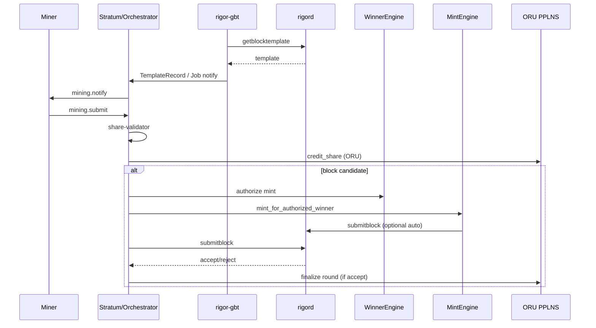

# POOL_MINER_NODE_FLOW_AUDIT

**Task:** `TASK-POOL-ARCHITECTURE-AUDIT-001` · Phase 2  
**Date:** 2026-08-12  
**Scope:** Map Miner → Pool → rigord → Block → Wallet relationships. Read-only.

---

## 1. Architecture map (as implemented)

```text
┌─────────────────┐
│  Miner          │  rigor-miner-agent  OR  (solo) cpuminer/minerd
│  (OpuHash)      │
└────────┬────────┘
         │ Stratum v1 TCP (pool path)
         │ mining.subscribe / authorize / notify / submit
         ▼
┌─────────────────────────────────────────────────────────────┐
│  rigor-pool-pilot  (pool/pilot)                             │
│  ┌─────────────┐  ┌────────────────┐  ┌──────────────────┐ │
│  │ rigor-gbt   │→ │ block-assembler│→ │ stratum-server   │ │
│  └──────┬──────┘  └───────┬────────┘  │  + share-validator│ │
│         │                 │           │  + winner-engine  │ │
│         │                 │           │  + mint-engine    │ │
│         │                 │           │  + ORU PPLNS      │ │
│         └─────────────────┴───────────┴─────────┬─────────┘ │
└─────────────────────────────────────────────────┼───────────┘
                                                  │ JSON-RPC
                     getblocktemplate / tip  ◄────┤
                     submitblock             ─────►
                                                  ▼
                                         ┌────────────────┐
                                         │  rigord        │
                                         │  (consensus)   │
                                         └───────┬────────┘
                                                 │ new tip / coinbase ORU
                                                 ▼
                                         ┌────────────────┐
                                         │ Pool ORU wallet│  (operator-configured
                                         │ + user wallets │   coinbase script /
                                         └────────────────┘   user payout addresses)
```

**Solo path (no pool):**

```text
cpuminer/minerd ──GBT RPC──► rigord ──► wallet (miner coinbase address)
```

---

## 2. How the miner receives work

### Pool path

1. Miner connects to `STRATUM_LISTEN` (default `127.0.0.1:3333`).
2. `mining.subscribe` — agent string **must** contain `opushash` (`stratum-server/src/protocol.rs`).
3. `mining.authorize` — worker credentials (`RIGOR_POOL_WORKER_CREDENTIALS` / auth module).
4. Pool pushes `mining.notify` with assembled job fields (header/coinbase split, merkle branch, bits, ntime, clean jobs).
5. Optional `mining.set_difficulty` via VarDiff session state.

**Job source:** Not raw GBT. Jobs come from `block-assembler` `PublishedJobSnapshot` after GBT ingest + commitment assembly (+ body-mint **placeholder** reservation when mint path is active).

### Solo path

- `cpuminer` polls `getblocktemplate` on `rigord` and builds its own work locally.
- No Stratum; no pool share accounting.

---

## 3. How the pool creates templates / jobs

```text
rigord.getbestblockhash / getblocktemplate
        │
        ▼
rigor-gbt::GbtAdapter
        │  normalize + validate (height, bits, convergence fields, …)
        ▼
TemplateCache / TemplateRecord
        │
        ▼
block-assembler::JobPublisher
        │  coinbase (ORU payout script)
        │  witness / convergence commitments
        │  merkle branches
        │  optional body-mint placeholder leaf
        ▼
WinnerRuntime::register_published_job + preview_winner
        │
        ▼
StratumJobEnvelope → mining.notify
```

**Important:** Template **semantics** remain node-authoritative. The pool does not change consensus rules; it packages GBT into miner-facing jobs.

---

## 4. How shares are submitted

```text
Miner: mining.submit(worker, job_id, extranonce2, ntime, nonce)
        │
        ▼
stratum-server::orchestrator
        │
        ▼
share-validator (OpuHash vs share target / network target)
        │
        ├── reject → Stratum false / error
        └── accept → ORU PPLNS credit_share(worker, job, difficulty)
                     if is_block_candidate → handle_block_candidate
```

Share accounting is **ORU weight only** (`payout.rs`: `oru_pending`, no RES balance field).

---

## 5. How blocks are submitted

On network-difficulty solution (`is_block_candidate`):

1. Confirm winner / attempt `mint_for_authorized_winner` (**current code** — RES body mint).
2. If mint unavailable, attempt `assemble_block_without_mint` (fails if job reserved a mint merkle slot).
3. Local structural pre-check (`validate_block`, advisory).
4. `BlockSubmitter::submit_block(block_hex)` → node `submitblock`.
5. **Only after node accept:** finalize PPLNS round (`record_block_found_for_job`).

C-5 design note (orchestrator comments): block submission is intended not to be gated by mint *success* for credit correctness; merkle-reserved jobs can still become unsubmittable without a mint.

---

## 6. How payouts are generated

| Asset | Who earns | Mechanism |
|-------|-----------|-----------|
| **ORU** | Pool miners (workers) | Coinbase `coinbasevalue` → PPLNS split by share weights → `oru_pending` / `payout_lines.oru_atoms` |
| **ORU** | Pool operator fee / treasury | Coinbase payout script configured via `RIGOR_POOL_PAYOUT_SCRIPT_HEX` (operator wallet) |
| **RES** | Convergence winner’s declared owner | **Currently** minted by `mint-engine` into the block (not PPLNS). See RES boundary audit. |

**Wallet interaction today:**

- Pool configures an **ORU coinbase script** (not a full wallet RPC payout robot in pilot).
- Mint path spends a configured **ORU funding UTXO** for the body-mint fee/input (`RIGOR_POOL_ORU_FUNDING_*`).
- No pool-held RES payout program (removed by SECURITY-001-A5).
- User RES claim / Convergence (W=32) remains a **wallet** action; pool does not start user Convergence.

Production “send ORU to miner addresses” settlement is **partial** (ledger yes; automated hot-wallet dispatch incomplete).

---

## 7. End-to-end sequence (pool find)



---

## 8. Flow risks (observation only)

| Risk | Severity | Notes |
|------|----------|-------|
| Merkle placeholder couples block submittability to mint | **High** | Policy + ops: mint failure can burn a found block |
| Stock cpuminer UA blocked on Stratum | **Medium** | Requires `opushash` agent / rigor-miner-agent |
| In-memory default state | **Medium** | Restart loses shares unless PG enabled |
| Dual lineage confusion (yiimp vs Rust) | **Low** | Operators must ignore `pool/web` + `pool/stratum` C++ |

---

## 9. Acceptance (Phase 2)

| Criterion | Result |
|-----------|--------|
| Miner → Pool → Node flow documented | **PASS** |
| Work / share / block / payout paths documented | **PASS** |
| No code changes | **PASS** |
