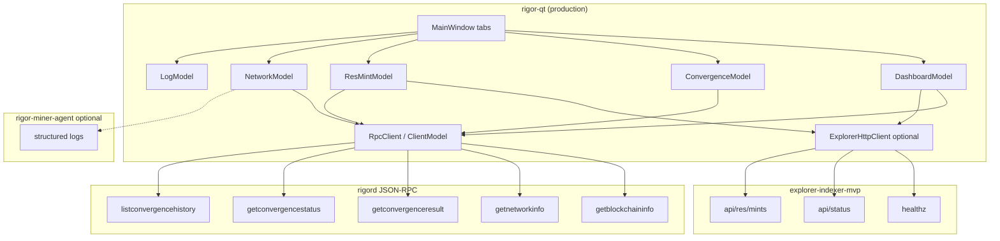
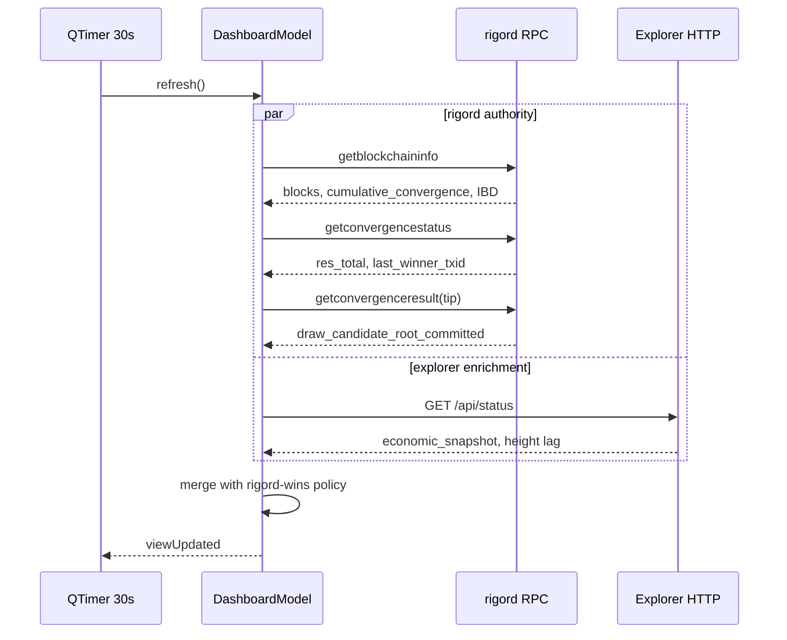
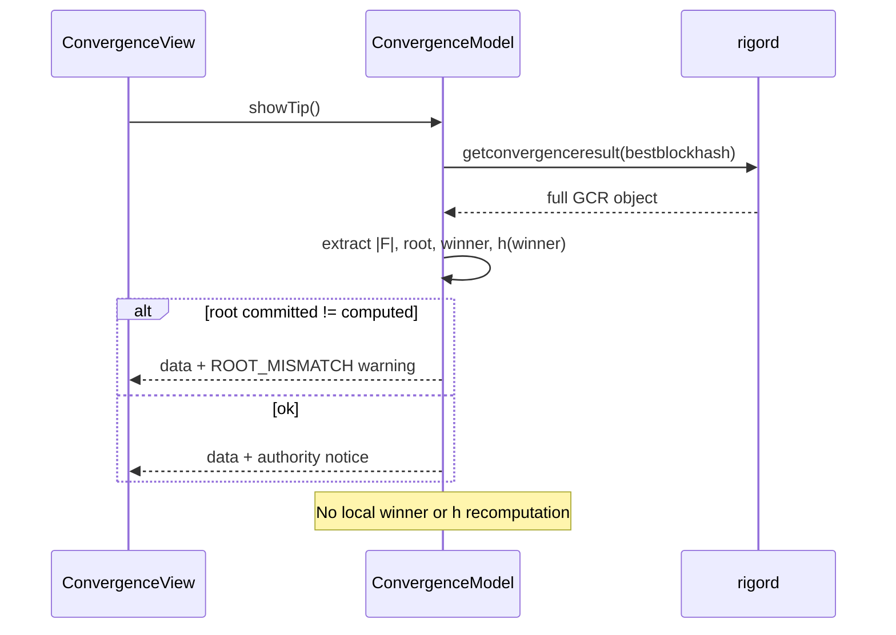
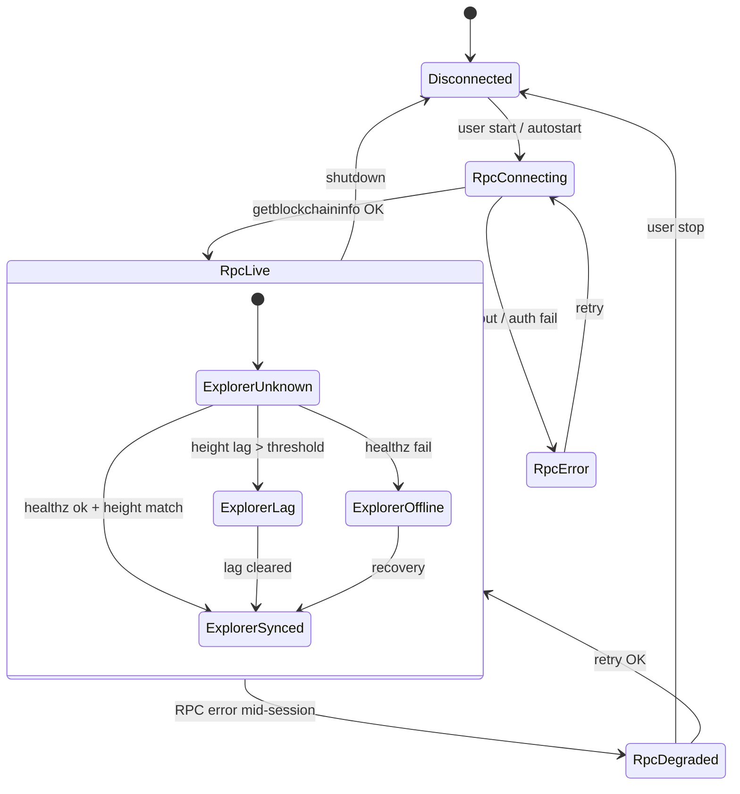
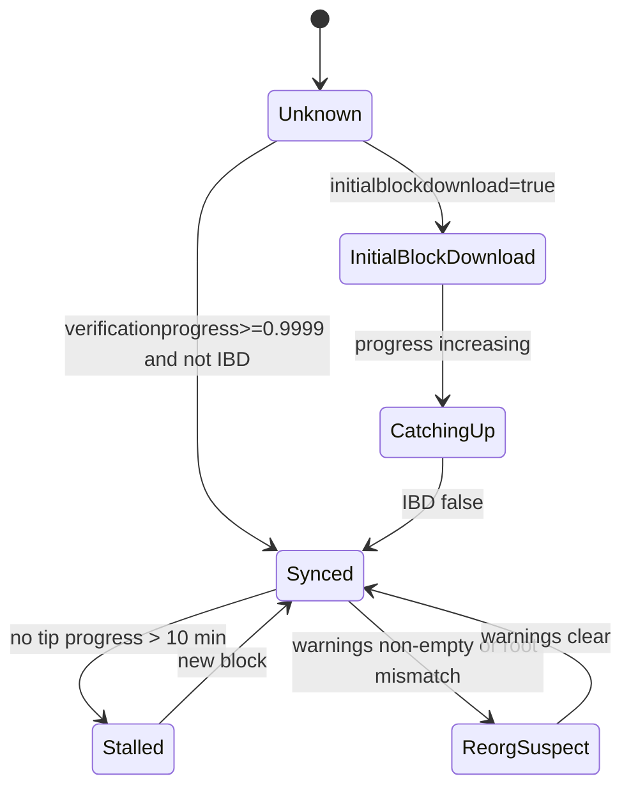
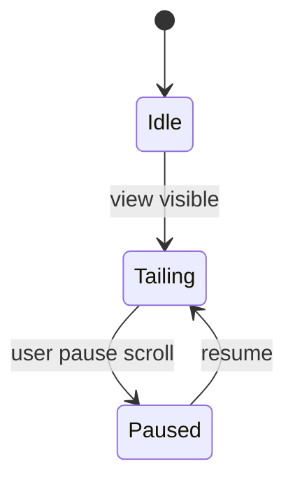

# rigor-qt GUI Interface & RPC Specification

**Task:** `TASK-P2-002`  
**Status:** AUTHORITATIVE (documentation only)  
**Baseline:** `mainnet-freeze-rfc015-2026-05-26`  
**Prototype reference:** `rigor-qt-prototype/` (TASK-P2-001 — **unchanged by this task**)

**Governing documents:**

| Document | Role |
|----------|------|
| [`WALLET_UI_MINIMUM_SPEC.md`](../wallet/WALLET_UI_MINIMUM_SPEC.md) | Required pages and display rules |
| ``RIGOR_EXPLORER_AI_EXECUTION_CONSTITUTION.md`` | Read-only presentation; RPC authority; no equivalence |
| Protocol Freeze Statement v1.0 ([`SPEC-000`](../specification/SPEC-000-CONSENSUS-SPECIFICATION.md)) | No semantic drift |
| [`RFC-015-OCCAM-REBALANCE.md`](../rfc/RFC-015-OCCAM-REBALANCE.md) | Terminology lock |
| [`WALLET_RPC_COMPATIBILITY.md`](../wallet/WALLET_RPC_COMPATIBILITY.md) | Stable source list |
| [`EXPLORER_RPC_COMPATIBILITY_MATRIX.md`](../explorer/EXPLORER_RPC_COMPATIBILITY_MATRIX.md) | Tier classification |
| PROOF-031, PROOF-032, PROOF-033 | Freeze / draw / equivalence boundaries |

**Hard constraints (this task):**

- No edits to `rigor-qt-prototype/` or `core/src/consensus/`
- No new RPC methods or protocol fields
- No local convergence / eligibility / winner recomputation
- `equivalence_claimed` remains **false** in all status surfaces
- ORU and RES remain **separate** native protocol assets

---

## 1. Current Mock Mapping

TASK-P2-001 defines five tabs with static `MockData`. This section maps each mock field to its **production data source** and **presentation label**.

### 1.1 Dashboard tab

| P2-001 mock field | Production source (priority order) | RPC / API field | Refresh |
|-------------------|-----------------------------------|-----------------|---------|
| Chain height | **rigord** | `getblockchaininfo.blocks` | 30s; immediate on `tipChanged` |
| ORU supply | **explorer** (preferred) → **rigord** (fallback) | Explorer `/api/status` → `economic_snapshot.oru_indexed_utxo_total_display`; fallback `gettxoutsetinfo.total_amount` (labeled “UTXO set total”) | 30s |
| RES supply | **rigord** | `getconvergencestatus.res_total` | 30s |
| Convergence events | **explorer** (preferred) → **rigord** (fallback) | Explorer DB count `convergence_events` via `/api/status` → `convergence_health`; fallback `getblockchaininfo.cumulative_convergence` (**relabeled** “Cumulative ORU converged”) | 30s |
| Last winner txid | **rigord** | `getconvergencestatus.last_winner_txid` | 30s; on tip |
| Last convergence root | **rigord** | `getconvergenceresult(tip).draw_candidate_root_committed` | 30s; on tip |

**Label correction vs mock:** Mock “Convergence events” as a block-adjacent integer should not be confused with `cumulative_convergence` (ORU amount). Production UI must use explicit labels from the table above.

### 1.2 Convergence tab

| P2-001 mock field | Production source | Field | Notes |
|-------------------|-------------------|-------|-------|
| Candidate set size \|F\| | **rigord** | `getconvergenceresult.convergence_root_set_size` | Display `|F| = N` |
| Convergence root | **rigord** | `draw_candidate_root_committed` | Monospace hex; mismatch flag if ≠ `draw_candidate_root_computed` |
| Winner txid | **rigord** | `draw_winner_txid` | Zero hash → “No winner” |
| Sigma digest | **rigord** | Winner row `candidates[].h` where `txid == draw_winner_txid` | UI label: **“Winner selection digest (h)”** — not Ed25519 witness σ |

Optional read-only context (not in P2-001 mock, required by wallet spec):

| Field | Source | Field |
|-------|--------|-------|
| RES inequality RHS | **rigord** | `res_probability_target` (verify == 2^240 hex) |
| Bind context | **rigord** | `bind_height`, `bind_blockhash` |

**Forbidden in UI:** `rigor_target`, `res_draw_target`, `T_conv`, bits-derived convergence target.

### 1.3 RES Mint tab

| P2-001 mock field | Production source (priority) | Field |
|-------------------|------------------------------|-------|
| Mint txid | **explorer** → **rigord** | `/api/res/mints[0].mint_txid` → `listconvergencehistory` + block parse |
| Mint output | **explorer** → **rigord** | `mint_vout_index` → `getrawtransaction.vout[i]` script/type label |
| Mint amount | **explorer** → **rigord** | `mint_amount` atoms → formatted `N RES` |
| Mint status | **derived (presentation)** | See §4.3 — never computed as consensus truth |

### 1.4 Network tab

| P2-001 mock field | Production source | Field |
|-------------------|-------------------|-------|
| Peer count | **rigord** | `getnetworkinfo.connections` |
| Sync status | **rigord** | `getblockchaininfo` (`initialblockdownload`, `verificationprogress`, `blocks` vs `headers`) |
| RPC endpoint | **local config** | `OptionsModel` RPC host:port (display only) |

### 1.5 Logs tab

| P2-001 mock field | Production source | Notes |
|-------------------|-------------------|-------|
| Log table rows | **local GUI buffer** | Tail of `debug.log` (if permitted) + in-app `RigorQtLogModel` ring buffer |
| Not from chain RPC | — | No `getconvergenceresult` / explorer rows in Logs |

### 1.6 Miner agent (optional supplementary — not a P2-001 tab)

When user configures a local `rigor-miner-agent` (TASK-MINING-022), the GUI **may** show read-only pool connection status on Network or a future Mining panel:

| Display | Source | Tier |
|---------|--------|------|
| Stratum endpoint | Agent config / log | Operational |
| Last job id | Agent structured log | Operational |
| Post-block audit | Agent optional `getconvergenceresult` compare | **Display-only**; `equivalence_claimed=false` |

Miner agent is **never** an authority for winner, mint, or convergence root in the wallet GUI.

---

## 2. Required RPC Endpoints & Fields

### 2.1 Source precedence

```text
1. rigord JSON-RPC (embedded or localhost)     — consensus authority
2. explorer-indexer-mvp REST (optional)       — indexed history / UTXO aggregates
3. rigor-miner-agent logs (optional)          — operational telemetry only
4. MockData (rigor-qt-prototype only)         — TASK-P2-001; not production
```

On conflict: **rigord wins**. Explorer stale data must show a warning, not override RPC.

### 2.2 rigord JSON-RPC — mandatory (STABLE)

#### `getblockchaininfo`

```json
{
  "chain": "test",
  "blocks": 1842560,
  "headers": 1842560,
  "bestblockhash": "<hex>",
  "verificationprogress": 1.0,
  "initialblockdownload": false,
  "cumulative_convergence": "12345.67",
  "current_convergence_sum": "2.50",
  "warnings": ""
}
```

| Field | GUI use |
|-------|---------|
| `blocks` | Dashboard height |
| `bestblockhash` | Tip hash (future tx viewer) |
| `verificationprogress` | Network sync % |
| `initialblockdownload` | Sync state machine input |
| `cumulative_convergence` | ORU converged total (amount, not event count) |
| `current_convergence_sum` | Window progress context |
| `warnings` | Banner / status bar |

**Poll:** 30s default; 5s while `initialblockdownload == true`.

#### `getnetworkinfo`

```json
{
  "version": 250000,
  "subversion": "/Rigor:…/",
  "connections": 8,
  "connections_in": 2,
  "connections_out": 6,
  "networkactive": true
}
```

| Field | GUI use |
|-------|---------|
| `connections` | Network peer count |
| `networkactive` | Offline / disabled state |

**Poll:** 30s; 10s when disconnected.

#### `getconvergenceresult`

Argument: tip height or `bestblockhash`.

```json
{
  "hash": "<blockhash>",
  "height": 1842560,
  "bind_height": 1842554,
  "bind_blockhash": "<hex>",
  "bind_hash": "<hex>",
  "res_probability_target": "00000000002af31dc4611873bf3f70834acdae9f0f4f534f5d60585a5f1c1a3c",
  "min_convergence": "1.00",
  "convergence_root_set_size": 127,
  "draw_candidate_root_committed": "<hex>",
  "draw_candidate_root_computed": "<hex>",
  "draw_winner_txid": "<hex>",
  "candidates": [
    {
      "txid": "<hex>",
      "convergence_amount": "1.00",
      "h": "<hex>",
      "draw_eligible": true,
      "convergence_type": "v1_cvg2"
    }
  ]
}
```

| Field | GUI use |
|-------|---------|
| `convergence_root_set_size` | Convergence \|F\| |
| `draw_candidate_root_committed` | Convergence root display |
| `draw_candidate_root_computed` | Mismatch detection only |
| `draw_winner_txid` | Winner txid |
| `candidates[].h` (winner row) | Winner selection digest |
| `res_probability_target` | Constitutional constant display |

**Poll:** On tip change + 30s. **Never** recompute `h` or winner locally.

#### `getconvergencestatus`

```json
{
  "res_total": "428.91",
  "window_progress": "2.50/6",
  "window_progress_percent": 41.67,
  "current_convergence_sum": "2.50",
  "last_winner_txid": "<hex>",
  "tip_height": 1842560,
  "last_res_height": 1842550
}
```

| Field | GUI use |
|-------|---------|
| `res_total` | Dashboard RES supply |
| `last_winner_txid` | Dashboard last winner |
| `window_progress*` | Optional cadence display (read-only) |
| `last_res_height` | RES Mint “last settled” context |

**Poll:** 30s.

#### `listconvergencehistory` (RES mint fallback)

```json
[
  {
    "height": 1842550,
    "blockhash": "<hex>",
    "winner_txid": "<hex>",
    "res_total": "428.91"
  }
]
```

**Poll:** 60s or on new tip when explorer unavailable.

#### `getblock` verbosity 1 (tip)

| Field | GUI use |
|-------|---------|
| `rigor_res_minted` | RES mint presence flag |
| `rigor_winner` | Cross-check winner txid |
| `res_probability_target` | Constant verification |

#### `gettxoutsetinfo` (ORU supply fallback — heavy)

Use only on explicit user refresh; label as “UTXO set scan”. **Poll:** manual / ≤1 per hour.

### 2.3 Explorer REST — optional (STABLE integrator surface)

Base URL: `http://127.0.0.1:8080` (configurable). All paths also available under `/api/…`.

| Endpoint | Method | Purpose |
|----------|--------|---------|
| `/healthz` | GET | Indexer liveness + `chain_state` |
| `/chain/tip` | GET | Indexer tip vs stats |
| `/api/status` | GET | Aggregated dashboard (dual RPC + index) |
| `/api/res/mints` | GET | RES mint history |
| `/api/res/events` | GET | Convergence event rows |
| `/api/block/:hash` | GET | Block + `convergence_panel` |
| `/api/tx/:txid` | GET | Tx + witness / converge proof panels |

#### `/healthz` schema

```json
{
  "ok": true,
  "chain": {
    "indexer_name": "rigor-explorer-mvp",
    "network": "testnet",
    "last_height": 1842560,
    "last_block_hash": "<hex>",
    "critical_root_mismatch": false,
    "updated_at": "2026-06-09T12:00:00.000Z"
  },
  "indexer_recovery": { "state": "idle" }
}
```

#### `/api/res/mints` row schema (latest mint)

```json
{
  "mints": [
    {
      "block_height": 1842550,
      "block_hash": "<hex>",
      "mint_txid": "<hex>",
      "mint_vout_index": 1,
      "mint_amount": "100",
      "winner_convergence_txid": "<hex>",
      "bind_hash": "<hex>",
      "bind_height": 1842544,
      "convergence_root": "<hex>",
      "draw_eligible": true,
      "res_probability_target": "<hex>",
      "committed_root": "<hex>",
      "computed_root": "<hex>"
    }
  ]
}
```

| Field | GUI RES Mint column |
|-------|---------------------|
| `mint_txid` | Mint txid |
| `mint_vout_index` | Mint output index |
| `mint_amount` | Mint amount (atoms → RES) |
| `block_height` | Confirmation context |

**Poll:** 60s; immediate when indexer `last_height` advances (via `/healthz`).

#### `/api/status` — selected fields

| JSON path | GUI use |
|-----------|---------|
| `chain_identity.equivalence_claimed` | Must remain `false` |
| `block_health.current_height_node` | Cross-check height |
| `block_health.current_height_indexer` | Lag warning |
| `economic_snapshot.oru_indexed_utxo_total_display` | ORU supply (indexed) |
| `economic_snapshot.res_minted_total_display` | RES supply cross-check |
| `system_integrity.critical_root_mismatch` | Banner |

**Poll:** 30s when explorer configured.

### 2.4 Miner agent — optional

No stable HTTP RPC in TASK-MINING-022 baseline. Integrations are **log-only**:

| Signal | Mechanism |
|--------|-----------|
| Connected to pool | Parse agent log: `stratum.connected` |
| Disconnected / fail-safe | Parse agent log: `failsafe.*` |
| Job received | `job.id` in structured JSON log line |

Future optional local status socket (out of scope for freeze): document as **v2** behind feature flag.

### 2.5 Internal / forbidden for product GUI

| Method | Tier | GUI policy |
|--------|------|------------|
| `getchainstatesummary` | INTERNAL | Audit tools only |
| `getdeterministicstatehash` | INTERNAL | Not in wallet tabs |
| `invalidateblock` / `submitblock` | FORBIDDEN | Never call from GUI observer |
| `getconvergeinfo` | UNSAFE | Do not bind |
| `rigor_target` / `res_draw_target` | UNSAFE | Never display |

---

## 3. Data Binding Diagrams

### 3.1 Production rigor-qt data plane



### 3.2 Dashboard bind sequence



### 3.3 Convergence tab bind sequence



### 3.4 C++ integration target (future task)

Production code should extend existing `ClientModel` (`core/src/qt/clientmodel.h`) rather than duplicating RPC in views:

| Model | Existing hook | Extension |
|-------|---------------|-----------|
| Dashboard | `numBlocksChanged` | Add `DashboardViewModel` fed by RPC batch |
| Convergence | `getConvergenceBlockResult` | Align fields with `getconvergenceresult` JSON |
| Network | `getNumConnections`, sync signals | Already partial |
| Explorer | — | New `ExplorerClient` QObject (optional) |

---

## 4. GUI State Machines

All state machines are **presentation-only**. They do not affect consensus, wallet signing, or mining.

### 4.1 Global connection state



| State | UI behavior |
|-------|-------------|
| Disconnected | Mock-style placeholder **only in prototype**; production shows offline panel (§5) |
| RpcLive + ExplorerSynced | Full tabs; indexed ORU supply allowed |
| RpcLive + ExplorerLag | Yellow banner; rigord fields still shown |
| RpcDegraded | Last-good cache + stale timestamp |

### 4.2 Network sync presentation



| State | Network tab label |
|-------|-------------------|
| InitialBlockDownload | `Synchronizing (IBD)` + progress % |
| CatchingUp | `Synchronizing` + `blocks/headers` |
| Synced | `Synchronized` |
| Stalled | `Stalled — check peers` |
| ReorgSuspect | `Warning — chain attention` |

### 4.3 RES Mint presentation status

Derived labels only — sourced from RPC/indexer flags:

| Condition | Display status |
|-----------|----------------|
| No `listconvergencehistory` / mint rows | `No RES mint on chain` |
| Latest mint block == tip - 0 | `Confirmed at tip` |
| Latest mint block depth ≥ 1 | `Settled (height H)` |
| `rigor_res_minted == 0` at tip | `No mint this block` |
| Explorer `critical_root_mismatch` | `Indexer mismatch — verify on node` |

### 4.4 Convergence panel presentation status

| Condition | Display |
|-----------|---------|
| `convergence_root_set_size == 0` | `No convergence activity` |
| \|F\| ≥ 1, winner zero | `Convergence candidate block` |
| winner non-zero | `Convergence winner block` |
| committed ≠ computed | `Root mismatch (display only)` + banner |

### 4.5 Logs tab



Ring buffer max 10,000 rows; no persistence requirement in P2-002.

---

## 5. Error Handling / Offline Fallback

### 5.1 Principles

1. **Fail visible** — RPC failures produce banner + per-field “unavailable”, never silent mock substitution in production.
2. **Last-good cache** — Store timestamped snapshot per tab; show stale badge after TTL.
3. **rigord authority** — Explorer errors alone must not blank rigord-backed fields.
4. **No signing fallback** — Offline does not enable local transaction construction beyond existing wallet locks.

### 5.2 Per-tab fallback matrix

| Tab | RPC down | Explorer down | Both down |
|-----|----------|---------------|-----------|
| Dashboard | Hide indexed ORU; show rigord fields if partial | rigord-only | Offline panel; cached snapshot if <5 min |
| Convergence | Unavailable | rigord `getconvergenceresult` only | Offline |
| RES Mint | `listconvergencehistory` path | rigord-only mint | Offline |
| Network | `Disconnected` state | N/A | Offline |
| Logs | Local logs still work | Local logs | Local logs |

### 5.3 Offline panel (production)

Replace mock banner text when RPC unavailable:

```text
NOT CONNECTED — Cannot reach rigord at {host}:{port}.
Showing last snapshot from {iso8601} (if any).
equivalence_claimed: false
```

Fields show `—` or last cached value with `(stale)` suffix.

### 5.4 Error codes → user messages

| Condition | Banner / field |
|-----------|----------------|
| HTTP 401 / RPC auth | `RPC authentication failed` |
| Connection refused | `Node not reachable` |
| Timeout > 10s | `Node slow or offline` |
| `draw_candidate_root_committed != draw_candidate_root_computed` | `Convergence root mismatch — verify on rigord` |
| Indexer height < node height - 3 | `Explorer lagging N blocks` |
| `critical_root_mismatch` | `Explorer integrity warning` |

### 5.5 Cache TTL defaults

| Data class | TTL | Invalidation |
|------------|-----|--------------|
| Tip height / hash | 30s | `tipChanged` signal |
| `getconvergenceresult` | 30s | tip change |
| Explorer `/api/status` | 30s | `healthz.last_height` change |
| RES mint list | 60s | new tip |
| `gettxoutsetinfo` | 1h | manual refresh only |

---

## 6. Compliance with CONSTITUTION / RIGOR Rules

### 6.1 Explorer execution constitution (wallet observer mode)

| Rule | rigor-qt compliance |
|------|---------------------|
| Read-only observation | P2-002 tabs are display-only; no `submitblock` / `send*` in observer foundation |
| No convergence recompute | Models consume `getconvergenceresult` verbatim |
| No draw / equivalence claims | Banner + `/api/status` pin `equivalence_claimed: false` |
| ORU / RES separation | Separate dashboard rows; no combined balance |
| RPC authority | Permanent notice on Convergence tab (matches explorer CP-06) |
| No token language | Labels use “ORU” / “RES” only |

### 6.2 Wallet design lock (from `overviewpage.cpp`)

- Wallet does not calculate or display probability
- Wallet does not simulate consensus outcome
- Convergence status ≠ wallet RES balances (future wallet tabs)

### 6.3 Architecture constitution / script-as-asset

- Asset classification from `scriptPubKey` / node decode only
- No parallel `asset` field in GUI storage models
- No account-balance table as truth source

### 6.4 Freeze compliance

| Check | Status |
|-------|--------|
| New RPC methods | **None** |
| Consensus code changes | **None** |
| `RES_PROBABILITY_TARGET` display | Allowed (constant) |
| `rigor_target` display | **Forbidden** |
| Draw closure implication | **Forbidden** (FVR-M) |

---

## 7. Versioning / Upgradability

### 7.1 Spec versioning

| Artifact | Version | Bump policy |
|----------|---------|-------------|
| `FUTURE_GUI_RPC_SPEC.md` | `1.0.0` (TASK-P2-002) | Minor: new optional fields; Major: binding changes |
| GUI `data_binding_schema` (future JSON) | `1` | Increment when view models change |

### 7.2 RPC compatibility policy

- Bind only **STABLE** tier methods per `EXPLORER_RPC_COMPATIBILITY_MATRIX.md`
- New rigord fields may be displayed when additive; never reinterpret semantics
- UNSAFE field grep gate in CI: wallet GUI strings + QML must not reference `rigor_target`, `res_draw_target`, `T_conv`

### 7.3 Explorer API drift

- Pin explorer package version in release manifest
- `/api/status` and `/healthz` are integration contracts; breaking changes require explorer version bump + rigor-qt release note

### 7.4 Feature flags (future implementation tasks)

| Flag | Default | Purpose |
|------|---------|---------|
| `gui.explorer.enabled` | false | Enable HTTP client |
| `gui.explorer.url` | `http://127.0.0.1:8080` | Base URL |
| `gui.miner_agent.log_path` | empty | Optional log tail |
| `gui.observer.equivalence_claimed` | false | **Frozen** — must not be true in release builds |

### 7.5 Upgrade path from prototype

| Phase | Task | Action |
|-------|------|--------|
| P2-001 | Done | Mock `rigor-qt-prototype/` |
| P2-002 | Done | This specification |
| P2-003+ | Future | Implement `*Model` classes in `core/src/qt/` per §3.4 |
| P2-00N | Future | Retire mock binary or gate behind `RIGOR_QT_PROTOTYPE` build flag |

**Do not modify** `rigor-qt-prototype/` during P2-003+ unless explicitly tasked.

---

## Required output table

| Field | Status |
|-------|--------|
| GUI Interface Mapping | **COMPLETE** |
| RPC Schema | **COMPLETE** |
| Data Binding Diagrams | **COMPLETE** |
| State Machine | **COMPLETE** |
| Error Handling Spec | **COMPLETE** |
| Documentation | **COMPLETE** |
| Architecture Impact | **NONE** |
| Consensus Impact | **NONE** |
| Protocol Impact | **NONE** |
| Freeze Impact | **NONE** |
| Equivalence Claimed | **false** |

---

## References

- TASK-P2-001: `rigor-qt-prototype/README.md`
- `core/src/rpc/blockchain.cpp` — `getconvergenceresult`, `getconvergencestatus`, `getblockchaininfo`
- `explorer-indexer-mvp/src/registerRoutes.ts` — REST mounts
- `docs/explorer/TASK-EXPLORER-004-CONVERGENCE-PANEL.md` — field mapping precedent
- `docs/wallet/WALLET_DATA_FLOW.md` — 30s refresh convention
