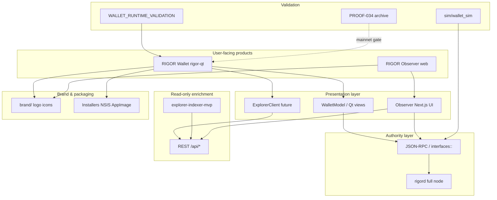
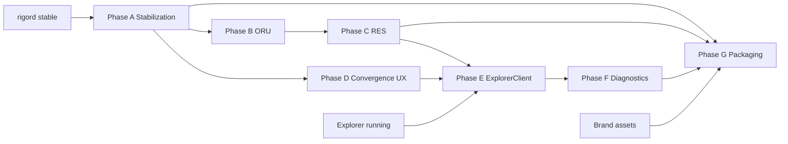

# RIGOR Wallet Dependency Graph

**Task:** `TASK-WALLET-PROGRAM-009`  
**Version:** 1.0  
**Date:** 2026-06-23  
**Type:** Read-only dependency map — **no implementation**

| Field | Value |
|-------|--------|
| Architecture Impact | **NONE** |
| Consensus Impact | **NONE** |
| Protocol Impact | **NONE** |
| **`equivalence_claimed`** | **false** |

Maps dependencies between **Wallet (rigor-qt)**, **Explorer**, **Observer**, **Node RPC**, **Brand assets**, **Installers**, and **Simulation**.

---

## 1. System context diagram



---

## 2. Dependency matrix

| From → To | Wallet | Explorer | Observer | Node RPC | Brand | Installer | Simulation |
|-----------|--------|----------|----------|----------|-------|-----------|------------|
| **Wallet** | — | optional read | shared contracts | **required** | needs icons | ships in | validated by |
| **Explorer** | enriches | — | primary data | cross-check height | favicon | bundled opt | not authority |
| **Observer** | separate app | **required** | — | optional RPC | header logo | separate | sim scenarios |
| **Node RPC** | **required** | independent | optional | — | — | ships rigord | harness target |
| **Brand** | blocks public RC | web chrome | web chrome | — | — | NSIS BMP/ico | — |
| **Installer** | delivers wallet | — | — | embeds rigord | uses brand | — | — |
| **Simulation** | informs QA | mock HTTP | mock API | mock/stub | — | — | — |

---

## 3. RIGOR Wallet (rigor-qt) dependencies

### 3.1 Hard dependencies (must have)

| Dependency | Interface | Failure mode |
|------------|-----------|--------------|
| **rigord** | `interfaces::Node`, `interfaces::Wallet` | ERR_NODE_OFFLINE — no send |
| **Wallet backend** | `core/src/wallet/` | Cannot sign |
| **Qt 5/6** | Build system | No GUI |
| **Chain params** | testnet/mainnet | Wrong network |

### 3.2 Soft dependencies (degraded mode OK)

| Dependency | Interface | Degraded behavior |
|------------|-----------|-------------------|
| **Explorer indexer** | ExplorerClient HTTP | Hide supply/mint enrich; node still works |
| **Brand assets** | PNG/ICO/SVG | Generic icon; blocks public RC not dev |
| **i18n** | `.ts` files | English only |

### 3.3 Internal component dependencies

```text
RigorGUI
  └── WalletFrame
        └── WalletView
              ├── OverviewPage ────── ClientModel, WalletModel
              ├── SendCoinsDialog ─── WalletModel, CoinControl
              ├── ReceiveCoinsDialog ─ WalletModel
              ├── TransactionView ──── TransactionTableModel
              └── ConvergencePage ──── WalletModel, ClientModel, Node RPC
```

---

## 4. Explorer dependencies

| Component | Depends on | Provides to Wallet |
|-----------|------------|------------------|
| explorer-indexer-mvp | rigord sync, block files | `/api/status`, `/api/res/mints`, `/healthz` |
| ExplorerClient (future) | OptionsModel URL, QNetwork | Dashboard supply, mint table, lag banner |
| ExplorerPage (future) | ExplorerClient | Search UI |

**Constitutional rule:** Wallet **never** depends on explorer for signing or balance truth.

---

## 5. Observer dependencies

| Component | Depends on | Independent of Wallet? |
|-----------|------------|------------------------|
| wallet-observer-mvp | Next.js, observer API routes | Yes — separate deploy |
| `/api/observer/*` | Explorer + optional rigord RPC | Yes |
| Watch Registry | Browser storage | Yes |

**Shared contracts:** RPC field names, explorer URL schema, RES display rules, `equivalence_claimed: false`.

**Wallet does not depend on Observer running.**

---

## 6. Node RPC dependencies

| RPC / API | Wallet screen | Required phase |
|-----------|---------------|----------------|
| `getbalances` | Dashboard, ORU/RES | A |
| `sendtoaddress` | ORU Send | A |
| `sendres` | RES Send | B |
| `createconvergence` | Convergence Send | C |
| `getconvergenceresult` | Convergence Overview | C |
| `getconvergencestatus` | Dashboard supply fallback | D |
| `listunspent` | Coin control | A |
| `getblockchaininfo` | Sync | A |
| `getnetworkinfo` | Network card | A |
| `backupwallet` | Backup | A |
| `listconvergencehistory` | RES mint fallback | C |

Full list: [RIGOR_RPC_REQUIREMENTS.md](./RIGOR_RPC_REQUIREMENTS.md)

---

## 7. Brand asset dependencies

| Asset | Blocks | Consumer |
|-------|--------|----------|
| `rigor-app-icon-1024.png` | Public RC | Wallet, installer, GitHub |
| `rigor.ico` / `.icns` | Public RC | Windows/macOS |
| Splash PNG | Public RC | rigor-qt |
| NSIS BMP | Windows RC | Installer |
| Favicon set | Web RC | Observer, website |
| Logo SVG masters | Marketing | All surfaces |

**Phase A engineering:** Does **not** require final artwork.

---

## 8. Installer dependencies

```text
Installer (NSIS / AppImage / DMG)
  ├── rigor-qt binary          ← Wallet build
  ├── rigord (optional embed)  ← Node build
  ├── rigor.ico                ← Brand pipeline
  ├── NSIS wizard BMP          ← Brand
  ├── rigor.conf example       ← Config naming
  └── COPYING / licenses       ← Legal
```

| Platform | Wallet depends on installer for testnet? |
|----------|------------------------------------------|
| Dev build | No |
| Public testnet | **Yes** |

---

## 9. Simulation dependencies

| Sim module | Validates | Does not replace |
|------------|-----------|------------------|
| `sim/wallet_sim` | Multi-client wallet flows | Runtime validation |
| `sim/unified` | Cross-subsystem | Product packaging |
| `sim/final/gate` | Mainnet NO_GO aggregate | Testnet RC |

**Wallet implementation may proceed without re-running sims.** Sims inform QA after phases complete.

---

## 10. Phase dependency chain



---

## 11. Critical path to public testnet

```
rigord RPC stable
  → Phase A–D wallet UI
  → Brand assets (parallel)
  → Runtime validation
  → Phase G installer
  → Public testnet RC
```

Explorer and Observer are **parallel** — not on critical path for signing wallet RC.

---

## 12. Output table

| Field | Status |
|-------|--------|
| Dependency Graph | **COMPLETE** |
| Architecture Impact | **NONE** |
| Consensus Impact | **NONE** |
| Protocol Impact | **NONE** |
| Equivalence Claimed | **false** |

---

*End of RIGOR_WALLET_DEPENDENCY_GRAPH — TASK-WALLET-PROGRAM-009*
