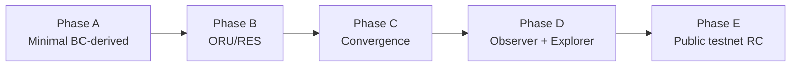

# RIGOR Wallet Implementation Plan

**Task:** `TASK-WALLET-PROGRAM-003`  
**Version:** 1.0  
**Date:** 2026-06-23  
**Type:** Read-only phased plan — **no implementation authorized by this document**

| Field | Value |
|-------|--------|
| Architecture Impact | **NONE** |
| Consensus Impact | **NONE** |
| Protocol Impact | **NONE** |
| **`equivalence_claimed`** | **false** |

Phased delivery plan for extending **Bitcoin Core v25 Qt wallet** to meet the [RIGOR Wallet Product Blueprint](./RIGOR_WALLET_PRODUCT_ARCHITECTURE.md). Assumes inheritance per [BITCOIN_V25_WALLET_INHERITANCE_ANALYSIS.md](./BITCOIN_V25_WALLET_INHERITANCE_ANALYSIS.md).

---

## 0. Strategic decision

**Extend, do not redesign.**

| Question | Answer |
|----------|--------|
| Can RIGOR achieve wallet goals by extending BC v25? | **Yes** |
| % wallet that can remain unchanged | **~68–70%** (shell, model, coin control, crypto, backup, address book, console) |
| Minimum delta to testnet RC | **~25–30%** of blueprint UI scope (mostly ADD layers + MODIFY labels/filters) |

---

## Phase A — Minimal Bitcoin-derived wallet

**Goal:** Shippable internal operator wallet on inherited Core UX with RIGOR dual-asset basics.

**Duration estimate:** 2–4 weeks (mostly validation + polish; much already in tree)

### Scope

| Work item | Inheritance | Files / area |
|-----------|-------------|--------------|
| Verify Overview dual balance | MODIFY (done) | `overviewpage.cpp` |
| Verify Send ORU/RES + ORU fee | MODIFY (done) | `sendcoinsdialog.cpp` |
| Verify Receive + address gen | KEEP | `receivecoinsdialog.cpp` |
| Verify Transactions list | MODIFY (done) | `transactionview.cpp` |
| Convergence tab functional | ADD (done) | `convergencepage.cpp` |
| Rebrand strings RigorGUI | MODIFY | `bitcoingui.cpp`, `.ts` files |
| Encrypt / backup / coin control smoke | KEEP | existing dialogs |
| First-run intro copy | MODIFY | `intro.cpp` |
| About: `equivalence_claimed = false` | EXTEND | About dialog |

### Out of scope

- ExplorerClient
- Dedicated ORU/RES nav tabs
- Public installers

### Exit criteria

- [ ] `WALLET_RUNTIME_VALIDATION.md` — core send/receive/encrypt/backup PASS
- [ ] GUI-10–12 partial: dual asset visible on Overview + Send
- [ ] No regression in Core wallet tests (`make check` wallet subset — user executes)
- [ ] Internal dogfood on testnet

### % complete vs blueprint

~**55%** (signing paths exist; dashboard/protocol polish missing)

---

## Phase B — ORU / RES integration

**Goal:** Blueprint-aligned asset surfaces without duplicating Send/Receive implementations.

**Duration estimate:** 3–5 weeks

### Scope

| Work item | Action |
|-----------|--------|
| ORU/RES context strip on Overview, Send, Receive | EXTEND nav context |
| History: ORU-only / RES-only / All filters | EXTEND `TransactionView` |
| RES mint history panel | ADD filtered view or sub-tab under History |
| RES probability read-only (Overview or RES section) | ADD label bound to node constant |
| Tx detail: ORU vs RES vs Convergence type badges | EXTEND `transactiondesc.cpp` |
| Unit display audit (ORU / Tharn) | KEEP — verify all screens |
| Watch-only import UX copy | KEEP Core flow; update strings |

### Inheritance rule

One `SendCoinsDialog`, one `ReceiveCoinsDialog`. ORU/RES entry points set `AssetType` default — **no second send stack**.

### Exit criteria

- [ ] Journeys A (ORU send) and B (RES receive) from [RIGOR_WALLET_UX_SPEC.md](./RIGOR_WALLET_UX_SPEC.md) PASS
- [ ] `WALLET_RES_DISPLAY_RULES.md` compliance review PASS
- [ ] RES mint history visible for test vectors

### % complete vs blueprint

~**75%**

---

## Phase C — Convergence integration

**Goal:** Operator-grade convergence UX aligned with cluster sim and GUI-13 gates.

**Duration estimate:** 2–4 weeks

### Scope

| Work item | Action |
|-----------|--------|
| `RES_PROBABILITY_TARGET` on ConvergencePage | ADD display |
| Convergence input validation UX | EXTEND `convergencepage.cpp` |
| Convergence entries in History with metadata | EXTEND tx model roles |
| Link Help → convergence runbook | ADD |
| Testnet `createconvergence` E2E | VALIDATE per `CONVERGENCE_RUNTIME_REPORT.md` |
| Post-convergence balance refresh | KEEP WalletModel signals |

### Dependencies

- RPC `createconvergence` stable on testnet
- SIM-UNIFIED / wallet-sim scenarios as regression references

### Exit criteria

- [ ] Journey C (Convergence) from UX spec PASS
- [ ] GUI-13 convergence checklist ≥ 90%
- [ ] `sim/wallet_sim` delayed_convergence scenario remains PASS

### % complete vs blueprint

~**85%**

---

## Phase D — Observer integration

**Goal:** Read-only surfaces in full wallet + packaged Observer app sharing contracts.

**Duration estimate:** 4–6 weeks

### Scope — rigor-qt

| Work item | Action |
|-----------|--------|
| ExplorerClient module | ADD — HTTP supply, height, RES lag |
| Explorer tab (or embedded view) | ADD |
| Dashboard supply cards | EXTEND Overview |
| Diagnostics tab | ADD — extend from RPCConsole |
| Explorer offline / lag warnings | ADD status bar + dashboard |
| Options: explorer base URL, refresh interval | EXTEND OptionsDialog |

### Scope — RIGOR Observer (`wallet-observer-mvp/`)

| Work item | Action |
|-----------|--------|
| Watch Registry → ORU/RES pages wired | MODIFY frontend |
| Convergence read-only panel | ADD |
| Explorer as primary data source | KEEP MVP architecture |
| Shared API contract doc | ADD cross-ref to ExplorerClient |

### Architecture constraints

- Explorer **never** required for signing
- Observer **never** holds signing keys
- No consensus / indexer dependency in validation path

### Exit criteria

- [ ] Journey D (Explorer) and E (Watch-only) from UX spec PASS
- [ ] GUI-10 ExplorerClient **EXECUTED**
- [ ] Diagnostics export (redacted) available
- [ ] RES lag visible when explorer ≠ wallet

### % complete vs blueprint

~**95%**

---

## Phase E — Public testnet wallet candidate

**Goal:** Unified product packaging for testnet participants — not mainnet.

**Duration estimate:** 4–8 weeks (includes Phase 2 roadmap items)

### Scope

| Work item | Platform |
|-----------|----------|
| App icons, splash, NSIS rebrand | Windows |
| `.dmg` / Qt deploy | macOS |
| AppImage or distro packages | Linux |
| Signed release manifest | All |
| `RIGOR_WALLET_RELEASE_CANDIDATE_CHECKLIST.md` | All |
| Combined download page: Wallet + Observer | Web |
| Runtime validation matrix EXECUTED with screenshots | QA |
| Constitution terminology audit | QA |
| Security: no hardcoded seeds; encrypt prompt on first send | Wallet |

### Gate alignment

| Gate | Requirement |
|------|-------------|
| PROGRAM-001 Phase 1 | Runtime validation PASS |
| PROGRAM-001 Phase 2 | Cross-platform installers |
| SIM-FINAL-001 | Independent — wallet RC ≠ mainnet NO_GO resolution |
| `equivalence_claimed` | **false** on all public materials |

### Exit criteria

- [ ] `RIGOR_WALLET_RELEASE_CANDIDATE_CHECKLIST.md` all P0 PASS
- [ ] Public testnet announcement pack (no mainnet claim)
- [ ] Known-issues document including explorer optional dependency

### % complete vs blueprint

**100%** testnet scope (mainnet gates explicitly out of scope)

---

## Phase dependency graph



**Parallel tracks allowed:**

- Observer frontend (Phase D) can start during Phase B if API contracts frozen
- Branding assets (Phase E) can start during Phase C

---

## Effort summary

| Phase | New LOC estimate | Risk | Reuses BC v25 |
|-------|------------------|------|---------------|
| A | ~500 (polish) | Low | ~95% |
| B | ~1.5k | Low | ~90% |
| C | ~800 | Medium (testnet RPC) | ~92% |
| D | ~2.5k | Medium (ExplorerClient) | ~85% |
| E | ~1k + packaging | Low (ops) | ~90% |

**Total net-new UI:** ~6k LOC vs **~50k+ LOC** inherited from Core Qt wallet.

---

## What we explicitly will not do

| Anti-pattern | Reason |
|--------------|--------|
| Rewrite SendCoinsDialog | Regression risk |
| Web-based signing wallet | Key exposure |
| Account balance model for RES | Constitution violation |
| Indexer in consensus path | Architecture violation |
| Taproot / BIP341 UI | Out of scope per RIGOR constitution |
| Claim Bitcoin Core equivalence | `equivalence_claimed = false` |

---

## Verification commands (user executes)

Per `.cursorrules`, full `make` is user-run:

```bash
cd ./core
./autogen.sh && ./configure && make -j$(nproc)
make check   # wallet + Qt subset

# Product sims (no full rebuild required)
python3 -m sim.wallet_sim.run_all
python3 -m sim.unified.run_full_system_sim
```

---

## Related documents

| Document | Role |
|----------|------|
| [BITCOIN_V25_WALLET_INHERITANCE_ANALYSIS.md](./BITCOIN_V25_WALLET_INHERITANCE_ANALYSIS.md) | KEEP/MODIFY/ADD per component |
| [RIGOR_WALLET_DELTA_MAP.md](./RIGOR_WALLET_DELTA_MAP.md) | Delta IDs |
| [RIGOR_WALLET_NAVIGATION_COMPARISON.md](./RIGOR_WALLET_NAVIGATION_COMPARISON.md) | Nav diff |
| [WALLET_RELEASE_ROADMAP.md](./WALLET_RELEASE_ROADMAP.md) | Product phases 1–4 |
| [RIGOR_WALLET_RELEASE_CANDIDATE_CHECKLIST.md](./RIGOR_WALLET_RELEASE_CANDIDATE_CHECKLIST.md) | Phase E gate |

---

## Output table

| Field | Status |
|-------|--------|
| Implementation Plan | **COMPLETE** |
| Architecture Impact | **NONE** |
| Consensus Impact | **NONE** |
| Protocol Impact | **NONE** |
| Equivalence Claimed | **false** |

---

*End of RIGOR_WALLET_IMPLEMENTATION_PLAN — TASK-WALLET-PROGRAM-003*
