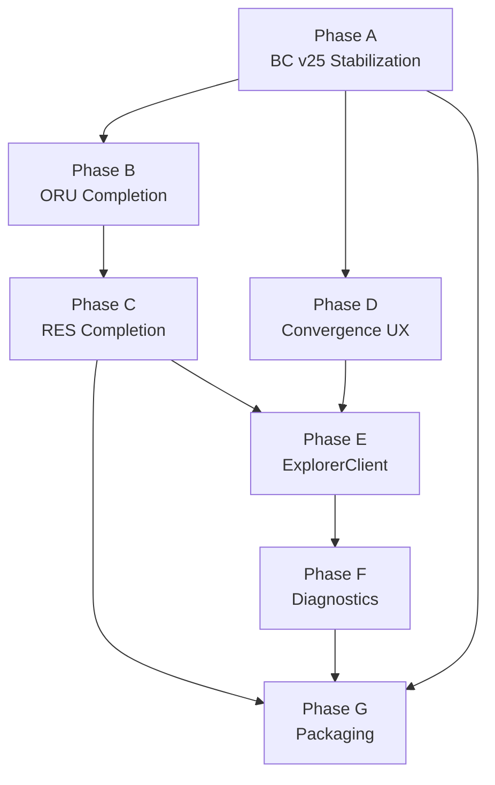

# RIGOR Wallet Phased Build Plan

**Task:** `TASK-WALLET-PROGRAM-004`  
**Version:** 1.0  
**Date:** 2026-06-23  
**Type:** Read-only phased build plan — **no implementation authorized**

| Field | Value |
|-------|--------|
| Architecture Impact | **NONE** |
| Consensus Impact | **NONE** |
| Protocol Impact | **NONE** |
| **`equivalence_claimed`** | **false** |

Build-ready engineering roadmap: **exact sequence**, file-first changes, testnet blockers vs optional work.

**Related:** [RIGOR_WALLET_IMPLEMENTATION_MAP.md](./RIGOR_WALLET_IMPLEMENTATION_MAP.md) · [RIGOR_QT_COMPONENT_MAP.md](./RIGOR_QT_COMPONENT_MAP.md) · [RIGOR_RPC_REQUIREMENTS.md](./RIGOR_RPC_REQUIREMENTS.md)

---

## 0. If implementation starts tomorrow

### Exact sequence

```
Phase A (week 1–2)  →  Phase B (week 2–3)  →  Phase C (week 3–5)
        ↓                      ↓                       ↓
Phase D (week 4–6, overlaps C)  →  Phase E (week 6–9)  →  Phase F (week 8–10)
        ↓
Phase G (week 6–12, parallel from Phase C)
        ↓
Public testnet wallet candidate gate
```

### Files that change first (Day 1–5)

1. `core/src/qt/utilitydialog.cpp` — About disclaimer, RFC links  
2. `core/src/qt/intro.cpp` — First-run RIGOR copy  
3. `core/src/qt/bitcoingui.cpp` — String audit, toolbar tooltips  
4. `core/src/qt/locale/bitcoin_en.ts` (+ sync translations)  
5. Smoke validation: `overviewpage.cpp`, `sendcoinsdialog.cpp`, `convergencepage.cpp` (no rewrite — test only)

### Public testnet blockers (P0)

| Item | Phase |
|------|-------|
| ORU send/receive/encrypt/backup validated | A |
| RES send validated | B–C |
| `createconvergence` E2E on testnet | D |
| Rebrand + installer (no bitcoin.org refs) | G |
| Runtime validation matrix EXECUTED | A–D |
| `equivalence_claimed = false` on all surfaces | A |

### Optional for first testnet RC (P1+)

| Item | Phase |
|------|-------|
| ExplorerClient + Explorer tab | E |
| Full Diagnostics tab | F |
| Dedicated ORU/RES top-level nav tabs | B (alt) |
| Inspector / Storyboard panels | Post-RC |
| macOS notarization | G |
| Observer Watch Registry polish | Parallel |

---

## Phase A — Bitcoin v25 stabilization

**Goal:** Confirm inherited Core wallet behavior on RIGOR testnet; close branding and About gaps.

| Attribute | Value |
|-----------|--------|
| **Duration** | 2 weeks |
| **Effort** | ~1.5 engineer-weeks |
| **Dependencies** | None — tree already forked |
| **Blueprint %** | ~55% → ~60% |

### Scope

| Work item | Files | Action |
|-----------|-------|--------|
| Validate dual Overview balances | `overviewpage.cpp` | VERIFY |
| Validate Send ORU + ORU fee | `sendcoinsdialog.cpp` | VERIFY |
| Validate Receive + QR | `receivecoinsdialog.cpp` | VERIFY |
| Validate Transactions list | `transactionview.cpp` | VERIFY |
| Validate Convergence tab loads | `convergencepage.cpp` | VERIFY |
| About: equivalence disclaimer | `utilitydialog.cpp` | EXTEND |
| Intro wizard copy | `intro.cpp` | MODIFY |
| Rebrand visible strings | `bitcoingui.cpp`, `.ts` | MODIFY |
| Encrypt / backup / coin control smoke | `askpassphrasedialog.cpp`, `walletview.cpp`, `coincontroldialog.cpp` | VERIFY |

### Exit criteria

- [ ] `WALLET_RUNTIME_VALIDATION.md` — encrypt, backup, ORU send/receive PASS  
- [ ] GUI-10–12 partial PASS (dual asset on Overview + Send)  
- [ ] About shows `equivalence_claimed = false` and RFC-000 link  
- [ ] No regression in wallet unit tests (`make check` — user executes)  
- [ ] Internal operator dogfood sign-off  

### Does not include

ExplorerClient, RES mint panel, public installers.

---

## Phase B — ORU integration completion

**Goal:** Blueprint-aligned ORU surfaces via context, not duplicate pages.

| Attribute | Value |
|-----------|--------|
| **Duration** | 1–2 weeks |
| **Effort** | ~1 engineer-week |
| **Dependencies** | Phase A exit |
| **Blueprint %** | ~60% → ~70% |

### Scope

| Work item | Files |
|-----------|-------|
| ORU default send asset | `optionsmodel.cpp`, `sendcoinsdialog.cpp` |
| ORU context on Receive copy | `receivecoinsdialog.cpp`, `forms/receivecoinsdialog.ui` |
| History filter: ORU / All | `transactionview.cpp`, `transactionfilterproxy.cpp` |
| ORU badge in tx detail | `transactiondesc.cpp` |
| Overview ORU card polish | `overviewpage.cpp` |
| Payment URI ORU default | `paymentserver.cpp`, `guiutil.cpp` |

### Exit criteria

- [ ] UX Journey A (ORU send) PASS — [RIGOR_WALLET_UX_SPEC.md](./RIGOR_WALLET_UX_SPEC.md)  
- [ ] History filter ORU-only shows no RES rows  
- [ ] Fee display always ORU on ORU send  

---

## Phase C — RES integration completion

**Goal:** RES send/receive/mint history complete.

| Attribute | Value |
|-----------|--------|
| **Duration** | 2–3 weeks |
| **Effort** | ~2 engineer-weeks |
| **Dependencies** | Phase B |
| **Blueprint %** | ~70% → ~80% |

### Scope

| Work item | Files |
|-----------|-------|
| RES send context lock | `sendcoinsdialog.cpp` |
| RES receive guidance (Bech32m) | `receivecoinsdialog.cpp` |
| History filter: RES | `transactionfilterproxy.cpp` |
| RES tx badges | `transactiondesc.cpp` |
| **ResMintPanel** (new) | `resmintpanel.cpp/h`, `walletview.cpp`, `bitcoingui.cpp` |
| RES immature/pending on Overview | `overviewpage.cpp`, `walletmodel.cpp` |
| RPC fallback for mint list | via `listconvergencehistory` if explorer down |

### Exit criteria

- [ ] UX Journey B (RES receive) PASS  
- [ ] RES send E2E on testnet  
- [ ] Mint history visible (explorer or RPC fallback)  
- [ ] `WALLET_RES_DISPLAY_RULES.md` review PASS  

---

## Phase D — Convergence UX

**Goal:** Operator-grade convergence page aligned with GUI-13 and FUTURE_GUI_RPC_SPEC.

| Attribute | Value |
|-----------|--------|
| **Duration** | 1–2 weeks |
| **Effort** | ~1 engineer-week |
| **Dependencies** | Phase A; parallel with C |
| **Blueprint %** | ~80% → ~85% |

### Scope

| Work item | Files |
|-----------|-------|
| Display `res_probability_target` | `convergencepage.cpp` |
| Root committed vs computed mismatch UX | `convergencepage.cpp` |
| \|F\| and winner on tip/prior rows | `convergencepage.cpp` |
| Convergence type in History | `transactiontablemodel.cpp`, `transactiondesc.cpp` |
| Help → convergence runbook link | `bitcoingui.cpp` |
| Testnet `createconvergence` E2E | validate `walletmodel.cpp` path |

### Exit criteria

- [ ] UX Journey C (Convergence) PASS  
- [ ] GUI-13 checklist ≥ 90%  
- [ ] `getconvergenceresult` fields visible on ConvergencePage  
- [ ] `CONVERGENCE_RUNTIME_REPORT.md` PASS or documented workaround  

---

## Phase E — ExplorerClient

**Goal:** Read-only explorer integration for supply, mint enrichment, lag warnings.

| Attribute | Value |
|-----------|--------|
| **Duration** | 2–3 weeks |
| **Effort** | ~2.5 engineer-weeks |
| **Dependencies** | Phase A; explorer-indexer-mvp running on testnet |
| **Blueprint %** | ~85% → ~92% |

### Scope

| Work item | Files |
|-----------|-------|
| **ExplorerClient** module | `explorerclient.cpp/h` *(new)* |
| Options: explorer URL, refresh | `optionsmodel.cpp`, `optionsdialog.cpp` |
| **ExplorerPage** (MVP list view) | `explorerpage.cpp/h` *(new)* |
| Dashboard supply cards | `overviewpage.cpp` |
| RES lag / mismatch banners | `bitcoingui.cpp`, `overviewpage.cpp` |
| Wire into build | `Makefile.qt.include` |

**Authority:** [EXPLORERCLIENT_ARCHITECTURE.md](../rigor-qt/EXPLORERCLIENT_ARCHITECTURE.md)

### Exit criteria

- [ ] GUI-10 ExplorerClient **EXECUTED**  
- [ ] Dashboard shows supply with “(indexed)” when explorer-sourced  
- [ ] Wallet functions with explorer stopped (offline mode)  
- [ ] Lag banner when indexer > N blocks behind  

---

## Phase F — Diagnostics

**Goal:** Operator diagnostics surface without replacing RPC Console.

| Attribute | Value |
|-----------|--------|
| **Duration** | 1.5–2 weeks |
| **Effort** | ~1.5 engineer-weeks |
| **Dependencies** | Phase E recommended (indexer health) |
| **Blueprint %** | ~92% → ~95% |

### Scope

| Work item | Files |
|-----------|-------|
| **DiagnosticsPage** | `diagnosticspage.cpp/h` *(new)* |
| Wallet + node health summary | `diagnosticspage.cpp`, `clientmodel.cpp`, `walletmodel.cpp` |
| Explorer health slice | `explorerclient.cpp` |
| Optional: redacted export bundle | `diagnosticspage.cpp` |
| Nav action Alt+7 | `bitcoingui.cpp`, `walletview.cpp` |

### Exit criteria

- [ ] Sync, peers, encryption, descriptor fingerprint visible  
- [ ] Explorer lag + mismatch surfaced  
- [ ] RPC Console still fully functional (no regression)  

---

## Phase G — Windows / Linux / macOS packaging

**Goal:** Installable public testnet wallet candidate.

| Attribute | Value |
|-----------|--------|
| **Duration** | 4–8 weeks (can start Phase C) |
| **Effort** | ~3 engineer-weeks + ops |
| **Dependencies** | Phases A–D minimum; E–F recommended |
| **Blueprint %** | ~95% → 100% testnet scope |

### Scope

| Platform | Work |
|----------|------|
| **Linux** | AppImage or distro package; desktop entry; `rigor-qt` icon |
| **Windows** | NSIS rebrand (`share/setup.nsi`); Authenticode (ops) |
| **macOS** | `macdeployqt`; DMG; icon set |
| **All** | Version manifest; release notes; `equivalence_claimed=false` |
| **Observer** | Docker or static deploy for `wallet-observer-mvp` |

### Exit criteria

- [ ] [RIGOR_WALLET_RELEASE_CANDIDATE_CHECKLIST.md](./RIGOR_WALLET_RELEASE_CANDIDATE_CHECKLIST.md) P0 PASS  
- [ ] No Arda/bitcoincore.org references in installers  
- [ ] Runtime validation matrix EXECUTED with screenshots  
- [ ] Public testnet download page (wallet + observer)  
- [ ] Known-issues doc published  

**Explicitly out of scope:** Mainnet claim, consensus changes, mining integration.

---

## Phase dependency graph



**Parallel tracks:**

| Track | Can start after |
|-------|-----------------|
| Observer frontend (`wallet-observer-mvp/`) | Phase A |
| Branding assets | Phase A |
| ExplorerClient dev (mock server) | Phase A |

---

## Effort summary

| Phase | Calendar | Engineer-weeks | Testnet blocker? |
|-------|----------|--------------|------------------|
| A | 2 wk | 1.5 | **Yes** |
| B | 1–2 wk | 1.0 | **Yes** |
| C | 2–3 wk | 2.0 | **Yes** |
| D | 1–2 wk | 1.0 | **Yes** |
| E | 2–3 wk | 2.5 | No (P1) |
| F | 1.5–2 wk | 1.5 | No (P2) |
| G | 4–8 wk | 3.0+ | **Yes** (for public RC) |
| **Total** | **~10–14 wk** | **~12.5** | |

---

## Verification (user executes)

```bash
cd ./core
./autogen.sh && ./configure && make -j$(nproc)
make check

python3 -m sim.wallet_sim.run_all
python3 -m sim.unified.run_full_system_sim
```

Follow `docs/wallet/WALLET_RUNTIME_VALIDATION.md` after each phase gate.

---

## Output table

| Field | Status |
|-------|--------|
| Phased Build Plan | **COMPLETE** |
| Architecture Impact | **NONE** |
| Consensus Impact | **NONE** |
| Protocol Impact | **NONE** |
| Equivalence Claimed | **false** |

---

*End of RIGOR_WALLET_PHASED_BUILD_PLAN — TASK-WALLET-PROGRAM-004*
