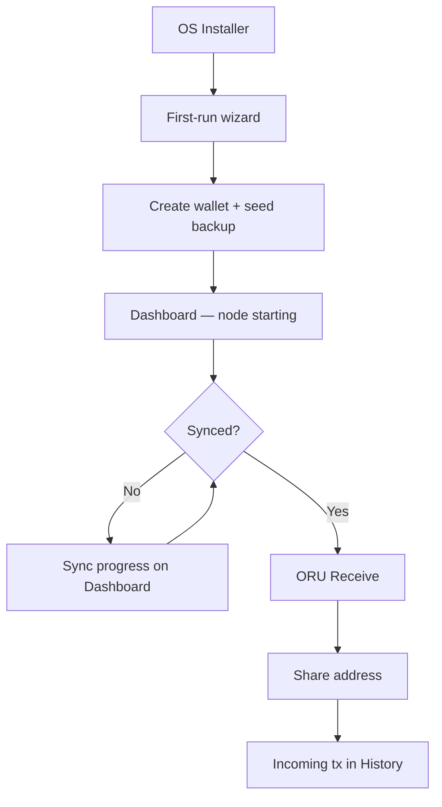
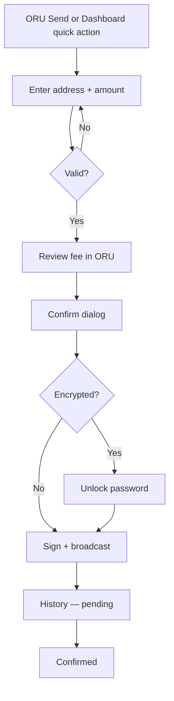
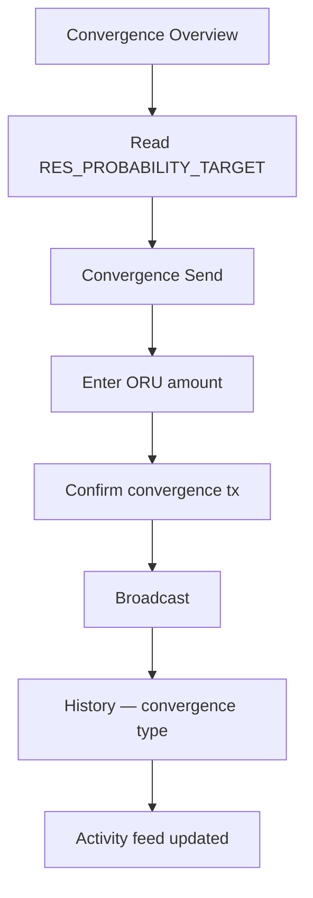
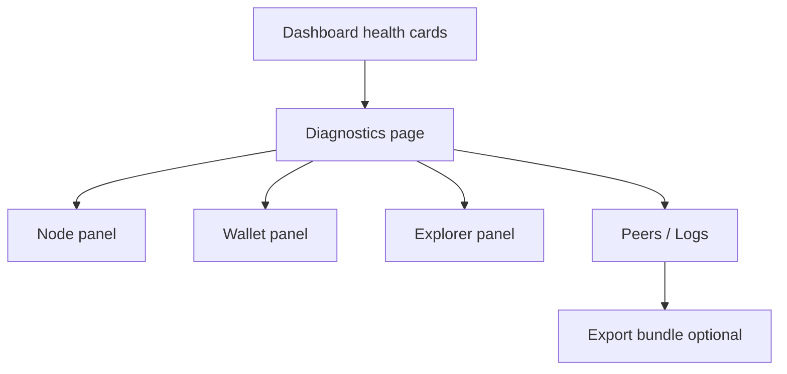

# RIGOR Wallet User Journeys

**Task:** `TASK-WALLET-PROGRAM-008`  
**Version:** 1.0  
**Date:** 2026-06-23  
**Type:** Build-ready journey specification — **no implementation**

| Field | Value |
|-------|--------|
| Architecture Impact | **NONE** |
| Consensus Impact | **NONE** |
| Protocol Impact | **NONE** |
| **`equivalence_claimed`** | **false** |

Complete user flows for RIGOR Wallet. Each journey includes steps, screens, system actions, success criteria, and failure paths.

**Related:** [RIGOR_WALLET_GUI_SPEC.md](./RIGOR_WALLET_GUI_SPEC.md) · [RIGOR_WALLET_UX_SPEC.md](./RIGOR_WALLET_UX_SPEC.md)

---

## Journey A — Install → Sync → Receive ORU

**Actor:** New testnet participant  
**Product:** RIGOR Wallet (full node)  
**Goal:** User installs wallet, syncs node, obtains a receive address, sees incoming ORU.

### Flow diagram



### Steps

| # | Screen | User action | System action | Success signal |
|---|--------|-------------|---------------|----------------|
| A1 | Installer | Run installer, accept license | Copy binaries, shortcuts | App in Start menu / Applications |
| A2 | Welcome | Choose "Create new wallet" | Open `Intro` wizard | Wallet creation path selected |
| A3 | Seed generation | Write down 12/24 words | Generate descriptor wallet | Seed displayed once |
| A4 | Seed confirm | Re-enter/check words | Validate mnemonic | Checkbox enabled |
| A5 | Encrypt (opt) | Set wallet password | `encryptwallet` or defer | Encryption status set |
| A6 | Datadir | Confirm data path | Start embedded `rigord` or detect local | Node process running |
| A7 | Dashboard | Wait | Poll `getblockchaininfo` | Progress visible |
| A8 | Dashboard | — | IBD completes | "Up to date" + height |
| A9 | ORU → Receive | Click "Receive ORU" | `getnewaddress` (witness v0) | QR + `oru1…` address |
| A10 | ORU Receive | Copy address | Clipboard | Copy confirmation toast |
| A11 | Dashboard / History | — | Detect incoming tx | ORU balance + history row |

### Copy (locked)

> "ORU is the native mined asset on RIGOR. Share this address to receive ORU. Mining uses OpuHash."

### Failure paths

| Failure | Screen | User recovery |
|---------|--------|---------------|
| No peers | Dashboard + Diagnostics | Check firewall; addnode docs |
| Sync stalled | Dashboard | Diagnostics → reindex guidance (advanced) |
| User skips seed backup | Wizard | Block proceed until acknowledgment |
| Node fails to start | Dashboard | Error banner + log path in Diagnostics |

### Observer variant

No installer journey — open URL / Docker. Watch Registry instead of seed. Read-only ORU balance for imported addresses.

---

## Journey B — Send ORU

**Actor:** Wallet holder with synced node and ORU balance  
**Product:** RIGOR Wallet  
**Goal:** Send ORU to external address with correct fee.

### Flow



### Steps

| # | Screen | User action | System | Success |
|---|--------|-------------|--------|---------|
| B1 | Send | Open Send (ORU locked) | Load spendable ORU | Balance shown |
| B2 | Send | Enter payee + amount | Validate address (v0/ORU) | Inline OK |
| B3 | Send | Optional: Coin control | Filter ORU UTXOs | Selected inputs |
| B4 | Send | Review fee | `prepareTransaction` | Fee in ORU only |
| B5 | Confirm | Confirm send | — | Summary dialog |
| B6 | Unlock | Enter password if locked | `walletpassphrase` | Unlocked |
| B7 | — | — | `sendCoins` / broadcast | txid returned |
| B8 | History | — | Mempool detection | Pending row |
| B9 | History | — | Confirmation | Confirmed + balance update |

### Validation rules

- Reject RES (v1) addresses for ORU send
- Insufficient ORU → inline error on amount field
- Double-submit guard on Confirm (disable 2 s)
- Send disabled while IBD or node offline

### Failure paths

| Error | UX |
|-------|-----|
| Invalid address | Red inline + "Not a valid ORU address" |
| Insufficient balance | Amount field error |
| Absurd fee | Confirm blocked + explanation |
| Broadcast failed | Modal with RPC reason + Diagnostics link |
| Wallet locked | Unlock dialog; cancel returns to Send |

---

## Journey C — Execute Convergence

**Actor:** Wallet holder participating in convergence draw  
**Product:** RIGOR Wallet  
**Goal:** Submit convergence ORU transaction via `createconvergence`.

### Flow



### Steps

| # | Screen | User action | System | Success |
|---|--------|-------------|--------|---------|
| C1 | Convergence Overview | Read explainer | Load tip draw via `getConvergenceBlockResult` | |F|, winner, roots visible |
| C2 | Convergence Overview | — | Display `res_probability_target` | Authority hex shown |
| C3 | Convergence Send | Enter ORU amount | Check spendable ORU | Max button optional |
| C4 | Convergence Send | Review fee | Estimate ORU fee | Fee line |
| C5 | Confirm | Confirm | — | Warning: irreversible commit |
| C6 | Unlock | Password if needed | Unlock wallet | — |
| C7 | — | — | `sendConvergenceOru` / `createconvergence` | txid |
| C8 | History | Click row | Tag type=convergence | Metadata in detail |
| C9 | Convergence Activity | — | Poll RPC/explorer | Event appears |

### Copy (locked)

> "A convergence transaction commits ORU toward a deterministic draw. If your transaction wins, RES is minted to your wallet."

### Failure paths

| Error | UX |
|-------|-----|
| RPC `createconvergence` fail | Modal + operator runbook link |
| Sync incomplete | Send section disabled + banner |
| Insufficient ORU | Inline on amount |
| Testnet path known failure | Documented workaround in error modal (ops) |

### Determinism / transparency

- UI never computes winner or eligibility
- Show committed vs computed root mismatch flag from RPC
- Label all draw fields `(node)`

---

## Journey D — Observe RES Mint

**Actor:** User or auditor tracking RES mint linkage  
**Product:** RIGOR Wallet + RIGOR Observer  
**Goal:** View RES mint history with full convergence linkage (read-only).

### Flow

```mermaid
flowchart TD
    A[RES Overview or Mint history] --> B[Load mint table]
    B --> C{Explorer up?}
    C -->|Yes| D[/api/res/mints]
    C -->|No| E[listconvergencehistory fallback]
    D --> F[Mint row]
    E --> F
    F --> G[Mint detail]
    G --> H[Tx viewer + Explorer link]
```

### Steps

| # | Screen | User action | System | Success |
|---|--------|-------------|--------|---------|
| D1 | RES Overview | Open Mint history | Fetch mint list | Table populated |
| D2 | Mint table | Scan rows | Display mandatory fields | All columns present |
| D3 | Mint row | Click row | Open detail | Full linkage |
| D4 | Mint detail | Copy mint txid | Clipboard | — |
| D5 | Mint detail | Open tx viewer | `gettransaction` + explorer | IO + witness |
| D6 | RES Overview | — | Balance reflects mint | RES increased (W) |

### Mandatory row fields

mint txid · bind txid · bind height · convergence root · convergence txid · RES amount

### Observer variant

Watch Registry filters mints to watched addresses/txids. No balance signing — indexed display only.

### Failure paths

| Error | UX |
|-------|-----|
| Explorer unavailable | Fallback RPC path + "(indexed unavailable)" banner |
| Mint pending | Status chip "Unconfirmed" — not "failed" |
| Partial indexer data | Show available fields + "indexed partial" label |

---

## Journey E — Backup & Restore

**Actor:** Security-conscious user or disaster recovery  
**Product:** RIGOR Wallet  
**Goal:** Backup wallet safely; restore ORU/RES access from seed.

### E.1 Backup flow

| # | Screen | Action | System | Success |
|---|--------|--------|--------|---------|
| E1 | Wallet overview | Click "Backup now" | File picker | `backupwallet` |
| E2 | — | Choose path | Write wallet.dat / descriptor backup | File exists |
| E3 | Wallet overview | — | Update backup timestamp | "Last backup: date" |
| E4 | First spend (opt) | Acknowledge reminder | Modal if never backed up | User confirmed |

### E.2 Restore flow

| # | Screen | Action | System | Success |
|---|--------|--------|--------|---------|
| E5 | First-run / File | Restore wallet | Open restore wizard | — |
| E6 | Restore | Enter seed | Validate mnemonic | Wallet loaded |
| E7 | Restore | Optional BIP39 passphrase | Derive descriptors | — |
| E8 | Restore | — | `rescanblockchain` | Progress bar |
| E9 | Dashboard | Wait sync | IBD if needed | Balances restored |
| E10 | ORU + RES | Verify | `getbalances` | Dual balances + history |

### Safety copy

> "Anyone with your seed controls your ORU and RES. Never share it. RIGOR will never ask for your seed online."

### Failure paths

| Error | UX |
|-------|-----|
| Invalid mnemonic | Word grid highlight |
| Backup write fail | Disk permission error |
| Rescan aborted | Offer resume; Diagnostics |

---

## Journey F — Diagnostics

**Actor:** Operator or advanced user  
**Product:** RIGOR Wallet (Observer parallel)  
**Goal:** Inspect node, wallet, explorer health; export support bundle.

### Flow



### Steps

| # | Screen | Action | System | Success |
|---|--------|--------|--------|---------|
| F1 | Dashboard | Notice warning | — | User opens Diagnostics |
| F2 | Diagnostics | View node panel | `getblockchaininfo` | Height, IBD, verification % |
| F3 | Diagnostics | View network | `getnetworkinfo` | Peers, relay fee |
| F4 | Diagnostics | View wallet | `getwalletinfo` | Encrypted, descriptor, tx count |
| F5 | Diagnostics | View explorer | ExplorerClient `/healthz` | Lag, mismatch flags |
| F6 | Diagnostics | Open RPC Console | Existing console | Full RPC access |
| F7 | Diagnostics | Export bundle (opt) | Redacted logs + versions | Zip file |
| F8 | About | Compliance | Static + links | `equivalence_claimed: false` |

### Transparency requirements

- Show raw + friendly values side by side for height/hash
- Never hide IBD state
- Explorer lag in blocks with timestamp
- `critical_root_mismatch` surfaces as critical — not dismissible permanently

---

## Journey summary matrix

| Journey | Primary screens | Signing? | Blocker today (audit) |
|---------|-----------------|----------|------------------------|
| A Install/Sync/Receive | Wizard, Dashboard, ORU Receive | Receive only | Public installer |
| B Send ORU | Send, Confirm, History | Yes | — |
| C Convergence | Convergence, History | Yes | Testnet RPC reliability |
| D Observe RES Mint | RES Mint history, Tx viewer | No | ExplorerClient missing |
| E Backup/Restore | Wallet, Wizard | Restore | — |
| F Diagnostics | Diagnostics, Console | No | Diagnostics page missing |

---

## Success criteria answers

| Question | Answer |
|----------|--------|
| How does a new user use the wallet? | **Journey A** — install, sync on Dashboard, Receive ORU |
| How does a user perform convergence? | **Journey C** — Convergence Overview → Send → confirm → History |
| How are ORU and RES displayed? | Separate panels/journeys; never combined total |
| How are diagnostics exposed? | **Journey F** — Diagnostics page + RPC Console + dashboard cards |
| How are failures communicated? | Inline + banners + modals per error spec |
| Deterministic transparency? | Authority labels, no local draw compute, txid-first identity |

---

## Output table

| Field | Status |
|-------|--------|
| User Journeys | **COMPLETE** |
| Architecture Impact | **NONE** |
| Consensus Impact | **NONE** |
| Protocol Impact | **NONE** |
| Equivalence Claimed | **false** |

---

*End of RIGOR_WALLET_USER_JOURNEYS — TASK-WALLET-PROGRAM-008*
