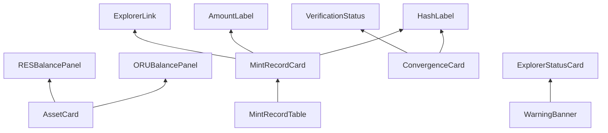

# RIGOR Wallet Widget Library

**Task:** `TASK-WALLET-PROGRAM-008`  
**Version:** 1.0  
**Date:** 2026-06-23  
**Type:** Reusable widget specification — **no Qt implementation**

| Field | Value |
|-------|--------|
| Architecture Impact | **NONE** |
| Consensus Impact | **NONE** |
| Protocol Impact | **NONE** |
| **`equivalence_claimed`** | **false** |

Defines **reusable GUI widgets** for rigor-qt construction. Each widget specifies purpose, anatomy, props/data, states, and Qt implementation hint.

**Visual tokens:** [RIGOR_COLOR_SYSTEM.md](../branding/RIGOR_COLOR_SYSTEM.md) · [RIGOR_VISUAL_LANGUAGE.md](../branding/RIGOR_VISUAL_LANGUAGE.md)

---

## 1. Library principles

| Principle | Rule |
|-----------|------|
| Composition | Screens assemble from widgets — no one-off duplicate balance cards |
| Asset separation | ORU and RES widgets never merge |
| Authority | Widgets show data source badge where ambiguous |
| Accessibility | Color + icon + text label (not color alone) |
| Phase A | Some widgets wrap existing Qt controls initially |

**Target namespace (implementation):** `RigorWidgets` or `GUIUtil` extensions in `core/src/qt/widgets/` (future).

---

## 2. Widget catalog

### 2.1 AssetCard

| Attribute | Value |
|-----------|--------|
| **Purpose** | Generic bordered panel for one native asset |
| **Used on** | Dashboard, ORU/RES hubs |

**Anatomy:**
```
┌─ 3px left border (asset color) ─────────────┐
│ [AssetMark]  ASSET NAME                      │
│              123.456789 ORU                   │
│              confirmed / pending lines        │
│              [optional CTA link]             │
└──────────────────────────────────────────────┘
```

| Property | Type | Notes |
|----------|------|-------|
| `assetType` | ORU \| RES | Sets border + mark |
| `confirmed` | Amount | Tabular nums |
| `pending` | Amount | Optional second line |
| `onNavigate` | callback | Click card body |

**States:** loading (skeleton), zero (show "0.00" not hidden), error (stale badge).

**Qt hint:** `QFrame` + `QLabel` grid; reuse `OverviewPage` panel structure.

---

### 2.2 ORUBalancePanel

| Attribute | Value |
|-----------|--------|
| **Purpose** | ORU-specific balance display |
| **Extends** | `AssetCard` |

| Field | Label |
|-------|-------|
| Available | "ORU (available)" |
| Pending | "ORU (pending)" |
| Immature | If applicable — mining context |

**Color:** `--asset-oru` border; circle mark icon.

**Data:** `WalletBalances.orum` via `WalletModel`.

**Forbidden:** RES amounts on this widget.

---

### 2.3 RESBalancePanel

| Attribute | Value |
|-----------|--------|
| **Purpose** | RES-specific balance display |
| **Extends** | `AssetCard` |

| Field | Label |
|-------|-------|
| Available | "RES (available)" |
| Immature | "RES (immature)" |
| Pending | "RES (pending)" — if distinct |

**Color:** `--asset-res` border; diamond mark.

**Data:** `WalletBalances.res`.

---

### 2.4 ConvergenceCard

| Attribute | Value |
|-----------|--------|
| **Purpose** | Single-block convergence draw summary |
| **Used on** | Convergence Overview, Dashboard (optional) |

**Anatomy:**
```
┌─ ConvergenceCard ────────────────────────────┐
│ Block height: 1,234,567                     │
│ |F| = 42                                      │
│ Winner: abc…def  [copy]                       │
│ Root (committed): …  [mismatch flag]          │
│ RES probability target: … (read-only)         │
└──────────────────────────────────────────────┘
```

| Property | Source |
|----------|--------|
| `height` | Node |
| `setSize` | `getconvergenceresult.convergence_root_set_size` |
| `winnerTxid` | `draw_winner_txid` |
| `rootCommitted` | `draw_candidate_root_committed` |
| `rootComputed` | `draw_candidate_root_computed` |
| `resProbabilityTarget` | `res_probability_target` |

**States:** no winner (zero hash message), mismatch (critical styling), loading, RPC error.

**Qt hint:** Extract from `convergencepage.cpp` form layout.

---

### 2.5 MintRecordCard

| Attribute | Value |
|-----------|--------|
| **Purpose** | Single RES mint linkage display |
| **Used on** | RES Mint detail, mint table row expand |

**Mandatory fields** (per [WALLET_RES_DISPLAY_RULES.md](./WALLET_RES_DISPLAY_RULES.md)):

| Field | Widget |
|-------|--------|
| mint txid | `HashLabel` + copy |
| bind txid | `HashLabel` |
| bind height | `HeightLabel` |
| convergence root | `HashLabel` |
| convergence txid | `HashLabel` |
| RES amount | `AmountLabel` asset=RES |

**Optional enrich:** mint vout, block time `(indexed)`.

---

### 2.6 MintRecordTable

| Attribute | Value |
|-----------|--------|
| **Purpose** | Tabular mint history |
| **Used on** | RES Mint history |

**Columns:** Same as MintRecordCard summary columns + status chip.

**Data:** Explorer `/api/res/mints`; fallback RPC.

**Row click:** Opens MintRecordCard detail or Transaction Viewer.

---

### 2.7 WarningBanner

| Attribute | Value |
|-----------|--------|
| **Purpose** | Priority-stacked system warnings |
| **Used on** | Dashboard top, global shell |

| Severity | Color token | Icon |
|----------|-------------|------|
| info | `--rigor-info` | info |
| warning | `--rigor-warning` | triangle |
| critical | `--rigor-critical` | octagon |

**Priority stack (top wins display order):**

1. Node offline  
2. Critical root mismatch  
3. Wallet locked (action needed) — info  
4. Explorer lag  
5. Testnet experimental disclaimer  

**Behavior:** Dismissible only for info/warning; critical requires acknowledge dialog.

---

### 2.8 VerificationStatus

| Attribute | Value |
|-----------|--------|
| **Purpose** | Show authority constants and evidence posture |
| **Used on** | Convergence Overview, About, Diagnostics |

**Anatomy:**
```
┌─ VerificationStatus ─────────────────────────┐
│ equivalence_claimed: false                    │
│ RES probability target: 0x0001… (node)       │
│ Evidence phase: PROOF-034 (experimental)      │
└──────────────────────────────────────────────┘
```

**Rules:** Never display `equivalence_claimed: true`. Target is read-only — no edit.

---

### 2.9 ExplorerLink

| Attribute | Value |
|-----------|--------|
| **Purpose** | Open tx/block/address in explorer |
| **Used on** | Tx viewer, mint cards, convergence rows |

| Property | Behavior |
|----------|----------|
| `resourceType` | tx \| block \| address |
| `id` | txid / hash / address |
| `baseUrl` | `OptionsModel` explorer URL |

**Label:** "Open in explorer ↗" + `(indexed)` tooltip.

**Disabled when:** Explorer URL empty or offline — show tooltip reason.

---

### 2.10 HashLabel

| Attribute | Value |
|-----------|--------|
| **Purpose** | Monospace truncated hash with copy |
| **Used on** | Everywhere txid/root/hash shown |

| Property | Default |
|----------|---------|
| `value` | full hex |
| `truncate` | head 10 + … + tail 10 |
| `copyFull` | true |

**Font:** JetBrains Mono / ui-monospace 13 px.

---

### 2.11 AmountLabel

| Attribute | Value |
|-----------|--------|
| **Purpose** | Formatted asset amount with unit |
| **Props** | `amount`, `assetType`, `unit` (ORU/Tharn) |

**Rules:** Tabular nums; never mix assets in one label.

---

### 2.12 SyncCard

| Attribute | Value |
|-----------|--------|
| **Purpose** | Node sync status compact card |
| **Data** | `ClientModel` verification progress, height, headers |

**States:** synced, syncing (%), offline, headers-first phase.

---

### 2.13 NetworkCard

| Attribute | Value |
|-----------|--------|
| **Purpose** | Chain identity + peers |
| **Shows** | chain name, testnet badge, peer count, connection type |

---

### 2.14 ExplorerStatusCard

| Attribute | Value |
|-----------|--------|
| **Purpose** | Indexer health vs node |
| **Data** | ExplorerClient lag, last update, mismatch |

**Shows:** "Indexer N blocks behind (node)" or "Explorer unavailable".

---

### 2.15 QuickActionBar

| Attribute | Value |
|-----------|--------|
| **Purpose** | Dashboard CTAs |
| **Buttons** | Receive ORU, Send ORU, Open Convergence |
| **Hidden when** | Watch-only, offline, IBD |

---

### 2.16 TransactionListCompact

| Attribute | Value |
|-----------|--------|
| **Purpose** | Dashboard recent 5 txs |
| **Columns** | date, type icon, asset, amount, status |

---

### 2.17 EncryptionStatusCard / BackupStatusCard

| Attribute | Value |
|-----------|--------|
| **Purpose** | Wallet overview security status |
| **Actions** | Encrypt, backup, change password |

---

### 2.18 AssetContextChip

| Attribute | Value |
|-----------|--------|
| **Purpose** | Show locked send/receive asset |
| **Example** | "Sending: ORU" on Send page |

**Interaction:** Click opens asset selector only if user has advanced permission; default locked by entry nav.

---

### 2.19 ComplianceFooter

| Attribute | Value |
|-----------|--------|
| **Purpose** | Persistent experimental disclaimer |
| **Text** | `equivalence_claimed = false` + testnet label |

---

### 2.20 EmptyStatePanel

| Attribute | Value |
|-----------|--------|
| **Purpose** | Zero data UX (not error) |
| **Example** | "No RES mints yet" with link to Convergence explainer |

---

## 3. Widget dependency graph



---

## 4. Implementation priority

| Phase | Widgets |
|-------|---------|
| A | ORUBalancePanel, RESBalancePanel, WarningBanner, HashLabel, AmountLabel, SyncCard |
| B | AssetContextChip, TransactionListCompact, MintRecordTable (stub) |
| C | ConvergenceCard, VerificationStatus, MintRecordCard |
| D | ExplorerLink, ExplorerStatusCard, NetworkCard |
| E | ComplianceFooter, EmptyStatePanel, BackupStatusCard |

---

## 5. Output table

| Field | Status |
|-------|--------|
| Widget Library | **COMPLETE** |
| Architecture Impact | **NONE** |
| Consensus Impact | **NONE** |
| Protocol Impact | **NONE** |
| Equivalence Claimed | **false** |

---

*End of RIGOR_WALLET_WIDGET_LIBRARY — TASK-WALLET-PROGRAM-008*
