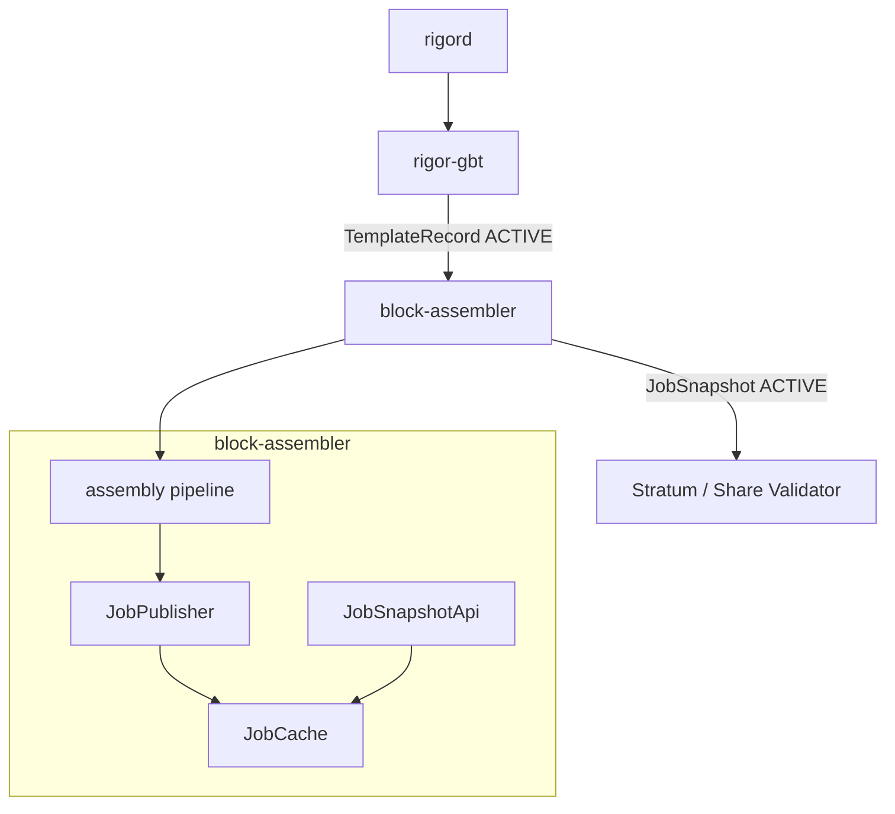
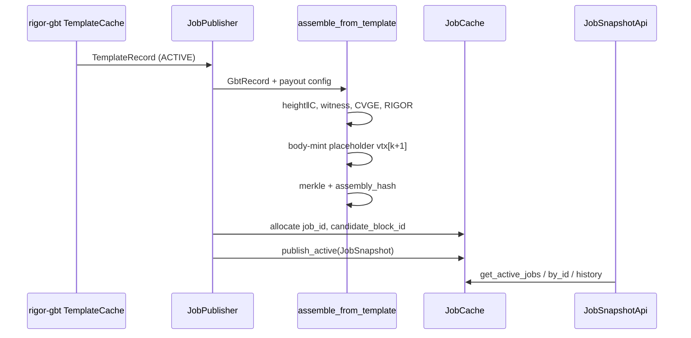

# block-assembler Architecture

**Component:** `pool/block-assembler`  
**Task:**
**Dependency:** `pool/rigor-gbt` 

## Stack position

## Data flow

## Identifier model

| ID | Owner | Rule |
|----|-------|------|
| `record_id` | rigor-gbt | FK on `JobSnapshot` |
| `job_id` | block-assembler | Monotonic hex serial, **never recycled** |
| `candidate_block_id` | block-assembler | `u64` 1:1 with `job_id` (UK-05) |

## Coinbase authority (§5 )

| Step | Implementation |
|------|----------------|
| ConvergenceRoot C | `convergence.rs` — Hash256(sorted txids), zero if \|F\| < 2 |
| BIP34 height | `script.rs` — push #1 in `scriptSig` |
| Witness commitment | GBT `default_witness_commitment` script |
| CVGE | GBT `default_convergence_commitment` script |
| RIGOR | `RIGR` tag + `prev_nbits` LE32 (not template `bits`) |
| Body mint | `placeholder.rs` — reserved slot only |

## Immutability

- `PublishedJobSnapshot` is stored as `Arc<_>`; state changes replace the entire struct.
- Body-mint placeholder `placeholder_txid` is deterministic per `record_id` until Mint Engine supplies real tx bytes.
- Block Assembler **does not** mutate `TemplateRecord` or assign `template_state`.

## Reorg handling

On `JobPublisher::on_tip_changed`:

1. All `ACTIVE` / `STALE` / `CREATED` jobs → `INVALIDATED`
2. `active` list cleared
3. Fresh publish after rigor-gbt ingests new tip template

## Impact

| Category | Impact |
|----------|--------|
| Consensus | NONE |
| Protocol | NONE |
| RPC | NONE |
| Freeze | NONE |
