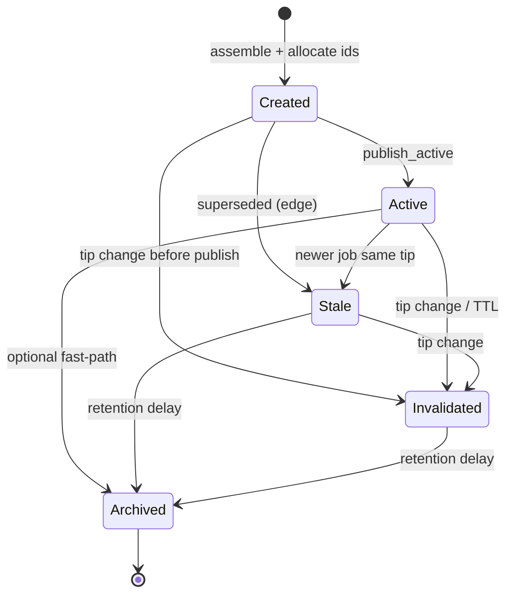

# JobSnapshot State Machine

**Implementation:** `src/cache.rs`  
**Policy:** Replacement-only (no in-place mutation)

## States

| State | Meaning | Servable |
|-------|---------|----------|
| **CREATED** | Assembled, not yet promoted | no |
| **ACTIVE** | Published work for miners | yes |
| **STALE** | Superseded on same tip | no |
| **INVALIDATED** | Tip change / TTL / manual kill | no |
| **ARCHIVED** | Terminal audit retention | no |

## Diagram

## Allowed transitions

| From | To |
|------|-----|
| CREATED | ACTIVE, STALE, INVALIDATED |
| ACTIVE | STALE, INVALIDATED, ARCHIVED |
| STALE | INVALIDATED, ARCHIVED |
| INVALIDATED | ARCHIVED |

## Triggers

| Event | Behavior |
|-------|----------|
| `publish_active()` same tip | prior ACTIVE → STALE; new → ACTIVE |
| `handle_tip_changed()` | ACTIVE/STALE/CREATED → INVALIDATED |
| `apply_ttl_expiry()` | ACTIVE → INVALIDATED after `ttl_secs` |
| `apply_archival()` | STALE/INVALIDATED → ARCHIVED after delay |

## Configuration

| Parameter | Default |
|-----------|---------|
| `ttl_secs` | 300 |
| `archive_delay_secs` | 3600 |

## Relationship to TemplateRecord states

| TemplateRecord | JobSnapshot |
|----------------|-------------|
| ACTIVE | May have ACTIVE job |
| STALE | Linked job should be STALE |
| INVALIDATED | Linked job INVALIDATED on tip sync |

Orchestrator should call `JobPublisher::on_tip_changed` when rigor-gbt emits tip events.
