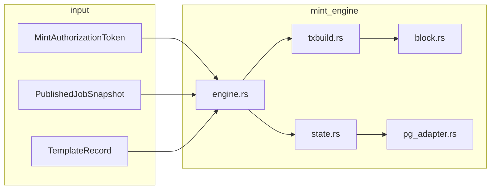

# mint-engine Architecture

**Task:** TASK-MINT-ENGINE-001, TASK-MINING-018  
**Spec:** `docs/mining/RES_BODY_MINT_OPERATIONAL_SPEC.md`

## Module map

## Authorization gate (TASK-MINING-018)

| Entry point | Authorization |
|-------------|---------------|
| `mint_for_authorized_winner` | **Production** — requires `MintAuthorizationToken`, `validate_token_consumption`, non-empty `draw_winner_txid` |
| `mint_for_winner` | Internal builder — caller must supply pre-validated `MintWinnerContext` |

Stratum orchestrator calls `mint_for_authorized_winner` only after
`WinnerRuntime::authorize_mint_for_block` returns `Some(token)`.

## State machine

| Status | Meaning |
|--------|---------|
| `Built` | RES tx assembled, block package ready |
| `Submitted` | `submitblock` RPC succeeded |
| `Revoked` | Winner invalidated / reorg |
| `Orphaned` | Submitted block orphaned |

`revoke_for_jobs` is invoked from Stratum `handle_tip_change` after winner invalidation.

## Integration

| Crate | Role |
|-------|------|
| `winner-engine` | Issues and validates `MintAuthorizationToken` |
| `block-assembler` | Candidate block assembly, convergence root in job snapshot |
| `stratum-server` | Block-found path triggers mint |
| `rigor-pool-pg` | `mint_jobs` persistence when `DATABASE_URL` set |

## Governance

| Field | Value |
|-------|-------|
| Consensus impact | **NONE** |
| Protocol impact | **NONE** |
| Freeze impact | **NONE** |
| `equivalence_claimed` | **false** |
