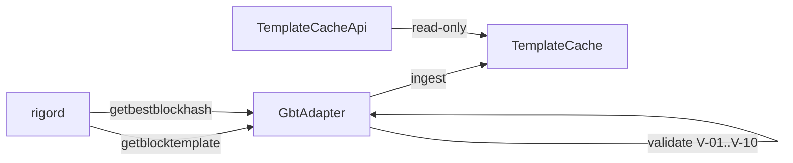

# rigor-gbt

First production component of the RIGOR Pool Stack (TASK-MINING-006).

`rigor-gbt` connects to `rigord`, polls `getblocktemplate`, validates and normalizes templates, and maintains an **immutable in-memory Template Cache** with a read-only API.

## Specifications

| Task | Document |
|------|----------|
| TASK-MINING-004 | [`docs/mining/RIGOR_GBT_ADAPTER_SPEC.md`](../../docs/mining/RIGOR_GBT_ADAPTER_SPEC.md) |
| TASK-MINING-005 | [`docs/mining/TEMPLATE_CACHE_AND_ASSEMBLER_SPEC.md`](../../docs/mining/TEMPLATE_CACHE_AND_ASSEMBLER_SPEC.md) |

## Scope (this crate)

| In scope | Out of scope |
|----------|--------------|
| `rigord` JSON-RPC client | Stratum |
| GBT poll + long-poll token carry | Winner Engine |
| Validation V-01–V-10 | RES Mint Engine |
| `TemplateRecord` / `GbtRecord` | Block Assembler pipeline |
| In-memory template cache | Database / Redis |
| State machine (ACTIVE … ARCHIVED) | Payout / share validation |
| Read API | Monitoring |

## Architecture

See [`docs/ARCHITECTURE.md`](./docs/ARCHITECTURE.md) and [`docs/STATE_MACHINE.md`](./docs/STATE_MACHINE.md).



## Build & test

```bash
cd pool/rigor-gbt
cargo test
```

## Library usage

```rust
use rigor_gbt::{GbtAdapter, RigordRpc, TemplateCache, TemplateCacheApi};
use std::sync::Arc;
use std::time::Duration;

let cache = Arc::new(TemplateCache::new());
let rpc = RigordRpc::new("http://127.0.0.1:8332")
    .with_auth("rpcuser", "rpcpass");
let mut adapter = GbtAdapter::new(rpc, cache.clone());

// Single poll cycle
match adapter.poll_once() {
    Ok(event) => println!("{event:?}"),
    Err(e) => eprintln!("{e}"),
}

// Read API
let api = TemplateCacheApi::new(cache);
if let Some(active) = api.get_active_template().unwrap() {
    println!("active record: {}", active.record_id);
}
```

## Validation rules (V-01–V-10)

| ID | Rule |
|----|------|
| V-01 | `height >= 1` |
| V-02 | `previousblockhash` is 32-byte hex |
| V-03 | `bits`, `prev_nbits` are 8 hex chars |
| V-04 | `coinbasevalue >= 0` |
| V-05 | Each `transactions[i].data` decodes from hex |
| V-06 | `convergence_txids` ⊆ mempool txid set |
| V-07 | `longpollid` non-empty |
| V-08 | `weightlimit` present (segwit rules) |
| V-09 | `bits` and `prev_nbits` stored as separate fields |
| V-10 | SHA256(raw JSON) stored as `gbt_payload_hash` |

Invalid templates are **rejected**; the cache is not updated.

## Read API

| Method | Description |
|--------|-------------|
| `get_active_template()` | Current `ACTIVE` record, if any |
| `get_template_by_id(id)` | Lookup by `record_id` |
| `get_template_history()` | Chronological ingest order (all states) |

## Governance

| Field | Value |
|-------|-------|
| Consensus impact | **NONE** |
| Protocol impact | **NONE** |
| Freeze impact | **NONE** |
| `equivalence_claimed` | **false** |

Complies with PROOF-031–034 and `MAINNET_PROTOCOL_FREEZE_DECLARATION`. No consensus, RPC, or mining-rule modifications.

## Module map

| Module | Role |
|--------|------|
| `rpc` | `rigord` JSON-RPC (`getblocktemplate`, `getbestblockhash`, `getblockchaininfo`) |
| `gbt` | GBT JSON deserialization |
| `validate` | V-01–V-10 gate |
| `record` | `GbtRecord`, `TemplateRecord`, `JobSnapshot` |
| `cache` | Immutable cache + state machine |
| `adapter` | Poll orchestration |
| `api` | Read-only facade |
