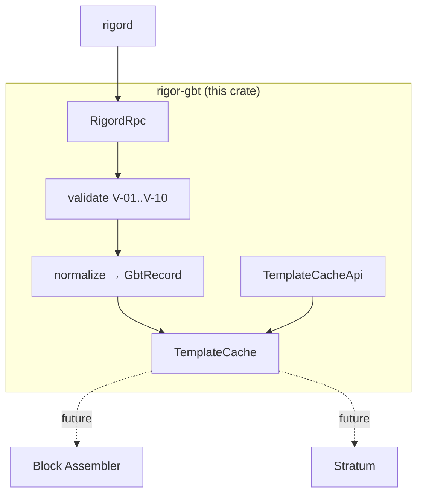
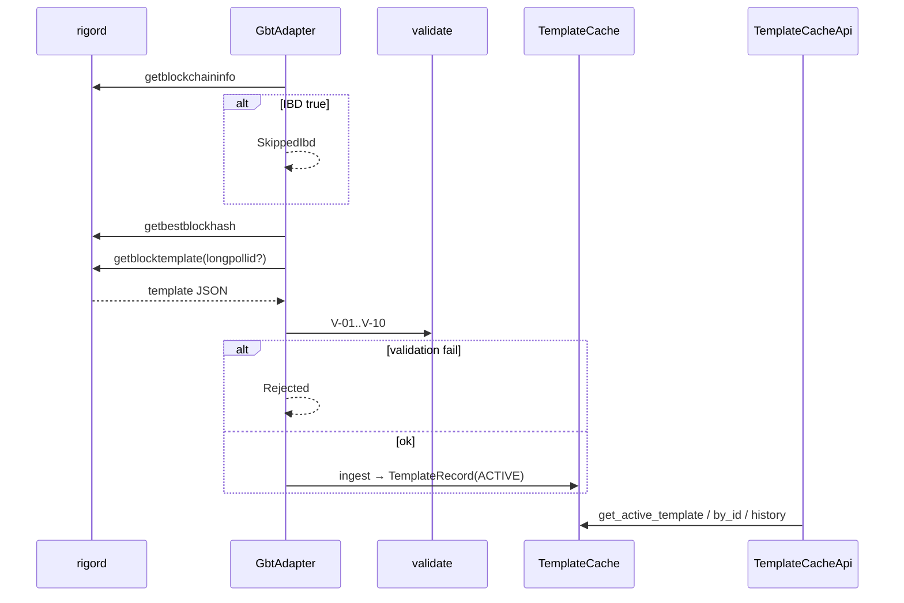

# rigor-gbt Architecture

**Component:** `pool/rigor-gbt`  
**Task:**
**Mode:** INFRASTRUCTURE 

## Position in pool stack

Solid lines are implemented in . Dashed lines are downstream components (out of scope).

## Data flow

## Immutability model

| Principle | Implementation |
|-----------|----------------|
| No in-place mutation | `TemplateRecord` fields are never updated on an existing `Arc` |
| State change = replacement | `transition_record` clones the record, sets new state/timestamp, inserts new `Arc` |
| GBT payload frozen | `GbtRecord.raw_json` and `gbt_payload_hash` set at ingest |
| Dedup | Same `longpollid` + same payload hash → no new record |

## Identifier ownership

| ID | Owner in this crate |
|----|---------------------|
| `record_id` | Assigned at `GbtRecord` normalization (UUID v4) |
| `template_version` | Cache: monotonic per `tip_hash` |
| `job_id` | Reserved on `TemplateRecord`; assigned when assembler publishes (future) |

## Reorg handling

On `tip_hash` change (`handle_tip_changed` or ingest with new tip):

1. All `ACTIVE` and `STALE` records → `INVALIDATED`
2. `active_id` cleared
3. Next successful ingest creates `template_version = 1` on new tip

## Auxiliary RPC usage

Per RIGOR_GBT_ADAPTER_SPEC audit item P-02:

| RPC | Purpose |
|-----|---------|
| `getblockchaininfo` | IBD gate — stop fetch when `initialblockdownload` is true |
| `getbestblockhash` | `tip_hash` at ingest |
| `getblocktemplate` | Primary template source |

## Impact declaration

| Category | Impact |
|----------|--------|
| Consensus | NONE |
| Protocol | NONE |
| RPC wire | NONE (client only) |
| Mining rules | NONE |
| Freeze | NONE |
| Equivalence claimed | false |
