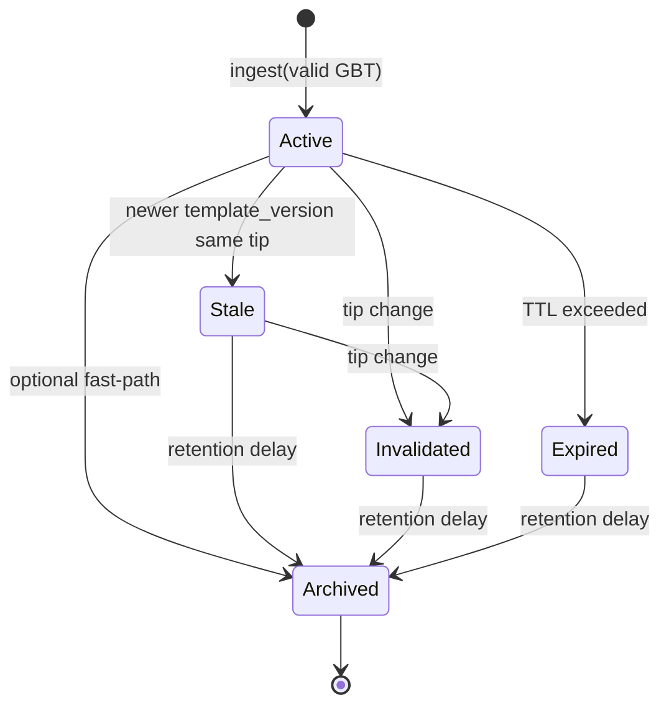

# Template Cache State Machine

**Spec:** §2.2–§2.3
**Implementation:** `src/cache.rs`

## States

| State | Meaning | Servable (`is_servable`) |
|-------|---------|--------------------------|
| **ACTIVE** | Current validated template on tip | yes |
| **STALE** | Superseded by newer `template_version` on same tip | no |
| **INVALIDATED** | Tip change, manual kill, validation drift | no |
| **EXPIRED** | TTL exceeded | no |
| **ARCHIVED** | Terminal; audit retention only | no |

> **Note:** `Ingested` / `Assembling` from the full pool orchestrator are **not** used in . Validated GBT ingest transitions directly to **ACTIVE** (assembler publish is a later phase).

## Diagram



## Allowed transitions (enforced)

| From | To |
|------|-----|
| ACTIVE | STALE, INVALIDATED, EXPIRED, ARCHIVED |
| STALE | INVALIDATED, ARCHIVED |
| INVALIDATED | ARCHIVED |
| EXPIRED | ARCHIVED |

Illegal transitions return `GbtError::Cache`.

## Triggers

| Event | Transition |
|-------|--------------|
| `ingest()` new `longpollid` same tip | prior ACTIVE → STALE; new record → ACTIVE |
| `ingest()` new tip | prior ACTIVE/STALE → INVALIDATED; new → ACTIVE |
| `handle_tip_changed()` | all ACTIVE/STALE → INVALIDATED |
| `apply_ttl_expiry()` | ACTIVE → EXPIRED when `now - state_changed_at >= ttl_secs` |
| `apply_archival()` | STALE/INVALIDATED/EXPIRED → ARCHIVED when retention delay elapsed |

## `template_version` rules

| Event | Version |
|-------|---------|
| New `tip_hash` | Reset to **1** |
| Same tip, new `longpollid` | `parent.version + 1` |
| Duplicate `longpollid` + same payload hash | Dedup — no new record |

## Immutability

State transitions **never** mutate an existing `Arc<TemplateRecord>`:

```text
Arc(record_v1, state=ACTIVE)
        │
        │ transition_record(STALE)
        ▼
Arc(record_v2, state=STALE)   // new Arc, same record_id, new state_changed_at
```

Readers holding an old `Arc` continue to see the prior state (useful for audit).

## Configuration

| Parameter | Default | Method |
|-----------|---------|--------|
| `ttl_secs` | 300 | `TemplateCache::with_policy` |
| `archive_delay_secs` | 3600 | `TemplateCache::with_policy` |

Set `ttl_secs = 0` to disable automatic expiry.

## Test coverage

| Test | File |
|------|------|
| ACTIVE on ingest | `cache::tests::ingest_creates_active_record` |
| STALE on supersede | `cache::tests::newer_template_version_stales_previous` |
| INVALIDATED on reorg | `cache::tests::tip_change_invalidates_active_and_stale` |
| Version reset on new tip | `cache::tests::reorg_then_new_template_resets_version` |
| EXPIRED on TTL | `cache::tests::ttl_expires_active` |
| ARCHIVED retention | `cache::tests::archival_moves_stale_to_archived` |
| Arc replacement | `cache::tests::records_are_replaced_not_mutated` |
| Reorg integration | `tests/integration.rs::reorg_sequence_*` |
