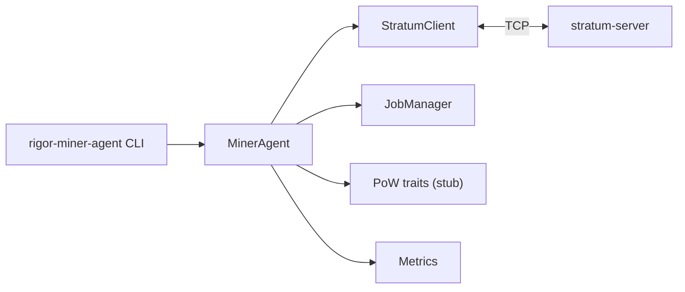

# rigor-miner-agent Architecture

## Boundary

The miner agent is a **Stratum client** only. It consumes pool-published work and submits shares. All draw authority, mint authorization, and block submission remain on the pool stack.



## Modules

| Module | Responsibility |
|--------|----------------|
| `stratum/` | JSON-RPC wire, `mining.subscribe/authorize/submit`, push parsing |
| `job/` | `JobSnapshot` cache, stale jobs, convergence metadata attachment |
| `pow/` | Trait interfaces for OpuHash worker and share production (no implementation) |
| `metrics/` | Counters and uptime snapshot |
| `agent.rs` | High-level orchestration (handshake, poll, stub submit) |

## Stratum client

- Persistent `BufReader` over TCP for line-delimited JSON
- `subscribe()` enforces `opushash` agent gate locally before wire send
- `read_event()` maps pushes: `mining.notify`, `mining.notify.rigor`, `mining.set_difficulty`
- `submit_share()` records metrics on accept/reject

## Job manager

- Ingests `MiningNotify` into `JobSnapshot`
- Optional `MiningNotifyRigor` attaches display-only `ConvergenceMetadata`
- `clean_jobs` flushes active jobs to stale set
- Time-based expiry via `expire_old_jobs`

## Convergence metadata (display only)

Stored fields:

- `convergence_root_hex`
- `preview_winner_txid`
- `mint_required`

**Forbidden locally:** draw selection, winner validation, mint, convergence replay.

## PoW traits

| Trait | Purpose |
|-------|---------|
| `OpuHashWorker` | Hash 80-byte header |
| `ShareProducer` | Yield `ShareCandidate` for a job |
| `NonceScanner` | Scan nonces via worker |

022A provides stubs (`StubOpuHashWorker`, `StubShareProducer`) for tests only. No SIMD, GPU, or optimized mining loop.

## Metrics

| Counter | Trigger |
|---------|---------|
| `shares_submitted` | Before `mining.submit` send |
| `shares_accepted` | Pool `result: true` |
| `shares_rejected` | Pool error or `result: false` |
| `stale_jobs` | Job marked stale or flushed |
| `uptime_secs` | Client connection age |

## CLI

```
rigor-miner-agent --pool HOST:PORT --worker NAME [--password x] [--threads N] [--stats]
```

- `--stats`: print JSON metrics after handshake and exit
- Default run: handshake + 30s event poll loop (scaffold)

## Governance

| Field | Value |
|-------|-------|
| Architecture impact | **NONE** |
| Consensus impact | **NONE** |
| Protocol impact | **NONE** |
| Freeze impact | **NONE** |
| `equivalence_claimed` | **false** |
