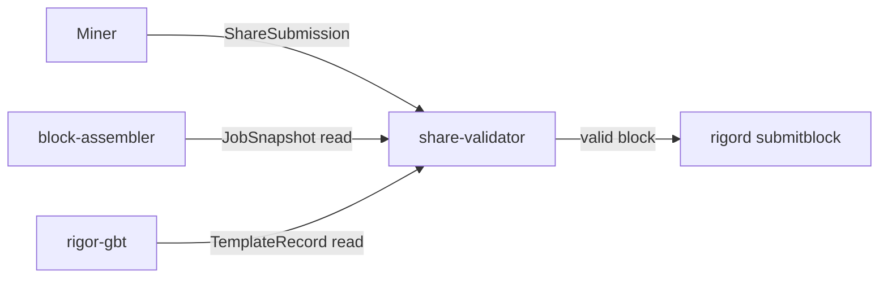
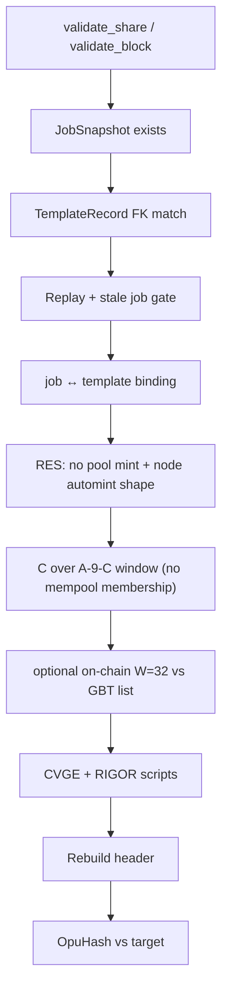

# share-validator Architecture

**Task:** TASK-MINING-008  
**Mode:** INFRASTRUCTURE (no consensus / RPC changes)

## Position

## Validation pipeline

## OpuHash

Port of `pow_opus.cpp` / `opus_pow.py`:

| Parameter | Value |
|-----------|-------|
| Buffer | 64 KiB ChaCha20 keystream |
| Rounds | 256 |
| Seed | 32-byte `SHA256d(header)` LE |
| Final | `Hash256(base ‖ mix)` |

Golden vectors: `pow_tests.cpp::OpuHash_v3plus_reference_vectors`.

## Replay guard

In-memory `seen_share_id` set with `import_seen_shares` / `export_seen_shares` hooks for future DB persistence.

## Job binding

`validate_job_template_binding` restates the share↔job contract:

- Job and template must both be ACTIVE
- `record_id`, `height`, `previousblockhash` / `prevhash`, `template_version`, and `tip_hash` must match

`resolve_job_and_template` already maps `job_id` → snapshot → template `record_id` and rejects non-servable jobs. Replay rejects non-ACTIVE jobs. A height/prevhash mix-up of an otherwise ACTIVE job is still `ERR_STALE_JOB`.

## Node automint (positive)

`validate_node_supplied_automint` parses GBT `transactions` and, when `convergence_draw.winner` is set, requires exactly one witness-v1 RES mint paying 100.00 RES to the winner's `res_program`, spending the AutoResMintBootstrap P2WSH. The pool never builds this tx.

## Impact

| Category | Impact |
|----------|--------|
| Consensus | NONE |
| Protocol | NONE |
| Freeze | NONE |
