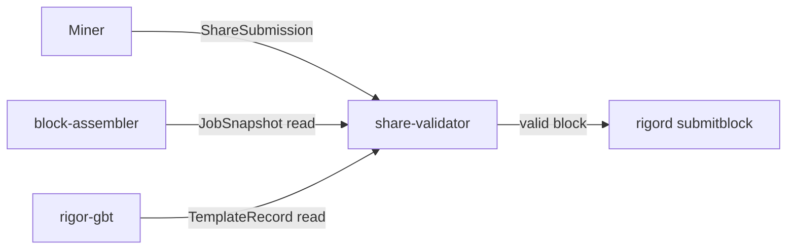
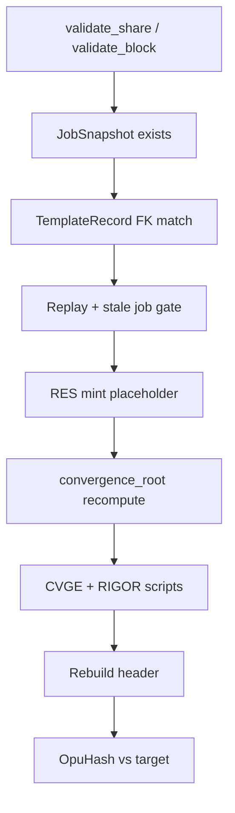

# share-validator Architecture

**Task:** TASK-MINING-008  
**Mode:** INFRASTRUCTURE (no consensus / RPC changes)

## Position

## Validation pipeline

## OpuHash

Port of `pow_opus.cpp` / `opus_pow.py`:

| Parameter | Value |
|-----------|-------|
| Buffer | 64 KiB ChaCha20 keystream |
| Rounds | 256 |
| Seed | 32-byte `SHA256d(header)` LE |
| Final | `Hash256(base ‖ mix)` |

Golden vectors: `pow_tests.cpp::OpuHash_v3plus_reference_vectors`.

## Replay guard

In-memory `seen_share_id` set with `import_seen_shares` / `export_seen_shares` hooks for future DB persistence.

## Impact

| Category | Impact |
|----------|--------|
| Consensus | NONE |
| Protocol | NONE |
| Freeze | NONE |
