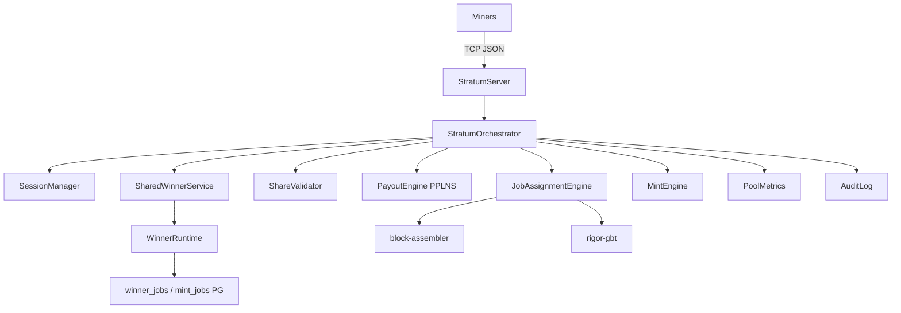

# stratum-server Architecture

**Task:** TASK-MINING-009, TASK-MINING-018

## FVR-M compliance

Draw replay uses `prev_nbits` for Sigma binding; template `bits` is never used as draw RHS.

## Winner preview (TASK-MINING-018)

`publish_jobs_from_active_template` calls:

1. `WinnerRuntime::register_published_job` — persist candidate + provisional winner
2. `WinnerRuntime::preview_winner` — full convergence draw replay
3. `StratumJobEnvelope.preview_winner_txid` — surfaced on `mining.notify`

Legacy min-txid / `len(F) ≥ 2` heuristic removed from `winner.rs`.

## RES mint

Fired on `is_block_candidate` after share-validator acceptance:

1. `authorize_block_found` → `WinnerRuntime::authorize_mint_for_block`
2. `mint_for_authorized_winner` with `MintAuthorizationToken`
3. Body mint disabled when authorization denied or `mint_required == false`

Amount: **100 RES** (`10_000` atoms).

## Reorg

`handle_tip_change` → `winner.invalidate_jobs` → `mint_engine.revoke_for_jobs` → orphan PPLNS shares.
