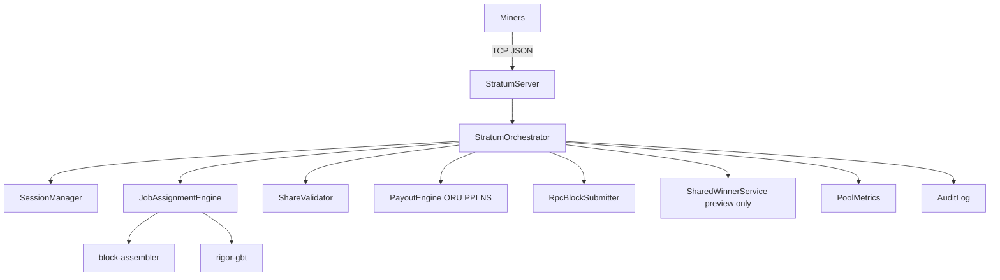

# stratum-server Architecture

**Task:** TASK-MINING-009, TASK-MINING-018, TASK-POOL-RES-BOUNDARY-IMPLEMENT-003  
**Product:** ORU-only Stratum pool (Option A). No mint-engine on the runtime path.

## FVR-M compliance

Draw replay uses `prev_nbits` for Sigma binding; template `bits` is never used as draw RHS.

## Winner preview (telemetry only)

`publish_jobs_from_active_template` may surface a draw **preview** for operators.
Preview never constructs, funds, or submits a RES body mint.

## RES mint (pool path)

**NONE.** Pool does not call mint-engine. RES body mint (when required) is assembled by
`rigord` automint / wallet Convergence. `res_mint_events` remains 0 by design.

## Reorg

`handle_tip_change` → invalidate jobs → orphan / reverse PPLNS ORU shares (REORG-01).
No mint revoke on the pool path.
