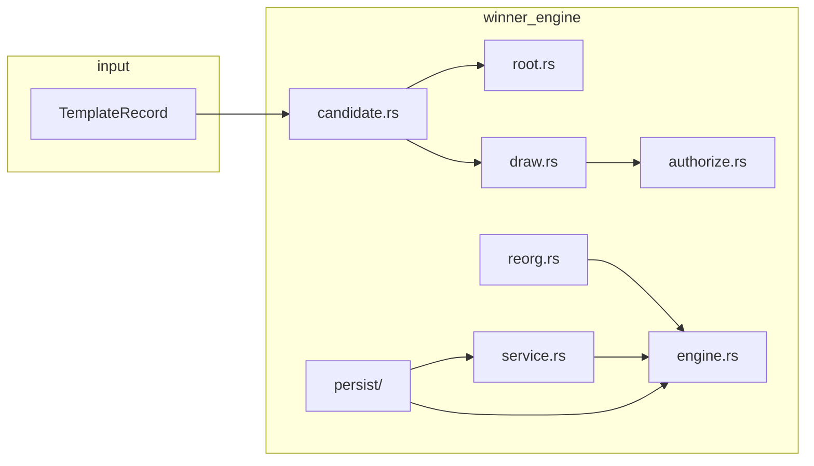
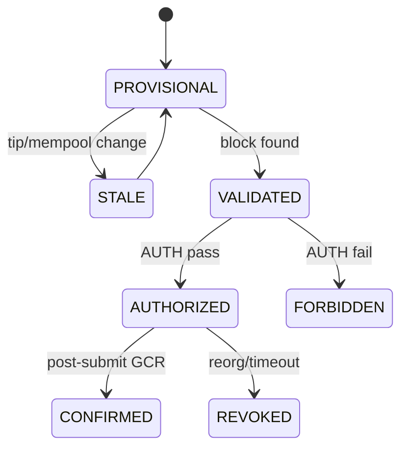

# Winner Engine Architecture

**Task:** TASK-MINING-016 (core), TASK-MINING-018 (pool wiring)  
**Spec:** `docs/mining/WINNER_ENGINE_PRODUCTION_SPEC.md`

## Module map

| Module | Responsibility |
|--------|----------------|
| `service` | `WinnerRuntime` — `preview_winner`, `register_published_job`, `authorize_mint_for_block`, `invalidate_job` |
| `candidate` | `extract_convergence_candidates()` — GBT F, no filtering |
| `root` | `compute_convergence_root()` — uint256 native memcmp sort |
| `sigma` | Sigma-CR-01 100-byte preimage |
| `math` | uint512 inequality + argmin |
| `draw` | `replay_convergence_draw()` — full kernel port |
| `authorize` | `MintAuthorizationToken`, AUTH-01..15 |
| `reorg` | `invalidate_winner()`, `revoke_authorization()` |
| `persist` | `WinnerRepository`, `MintAuthorizationRepository`, `CandidateRepository` |
| `engine` | Orchestration: preview → store → authorize → invalidate |

## State machine

## Mint authorization boundary (TASK-MINING-018)

`mint-engine::mint_for_authorized_winner` MUST consume `MintAuthorizationToken` with
`status == Authorized` and non-zero `bind_hash`.

Stratum `preview_winner_txid` on `mining.notify` comes from `WinnerRuntime::preview_winner`
(full draw replay). The legacy min-txid / `len(convergence_txids)` heuristic is removed.

AUTH-03 binds to the **block-assembler** convergence root in the published job snapshot
(`job.coinbase.convergence_root_hex`). Both paths use `rigor-convergence-root` (TASK-MINING-020).

## Persistence (TASK-MINING-017)

| Backend | Implementation |
|---------|----------------|
| In-memory (tests) | `persist/memory.rs` — `InMemoryWinnerStore` |
| PostgreSQL | `persist/pg.rs` — `PgWinnerStore` via `rigor-pool-pg` |
| Adapter | `pg_adapter.rs` — `WinnerPgBackend::open()` |

Recovery on tip mismatch: `RecoveryEngine` (rigor-pool-pg) + `handle_invalidation()`.

## Integration points

| Crate | Integration |
|-------|-------------|
| `block-assembler` | `mint_required` + canonical root; `AssemblerPgAdapter` |
| `stratum-server` | `SharedWinnerService` → `preview_winner` / `register_published_job` / `authorize_mint_for_block` / `invalidate_jobs` |
| `mint-engine` | `mint_for_authorized_winner`; `MintPgAdapter` atomic treasury reserve |
